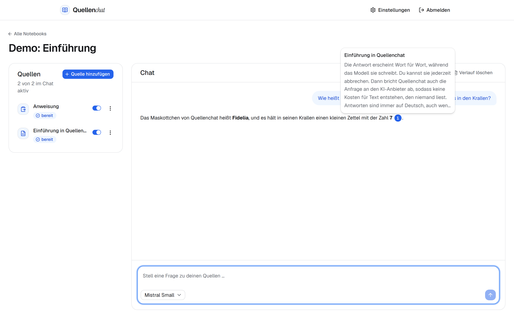
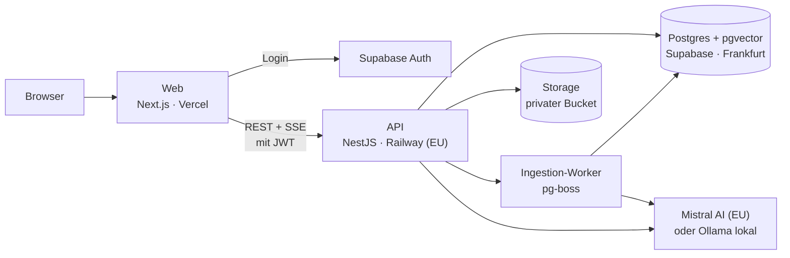

# Quellenchat – ein NotebookLM-Nachbau

**Mit eigenen Dokumenten sprechen – mit belegten Antworten, DSGVO-konform in der EU.**

Ein Nachbau von [Google NotebookLM](https://notebooklm.google.com): Nutzer sammeln PDFs und Texte in Notebooks und stellen Fragen dazu. Die Antworten stützen sich ausschließlich auf diese Quellen. Jede Aussage ist mit einem Zitat belegt, das sich bis zur Textstelle zurückverfolgen lässt.

> Unabhängiges Lernprojekt im Rahmen einer Bewerbung, nicht mit Google verbunden. NotebookLM ist eine Marke von Google LLC. Die App tritt deshalb öffentlich unter dem Namen **Quellenchat** auf.


---

## Links

| | |
|---|---|
| **Live-Demo** | [quellenchat.vercel.app](https://quellenchat.vercel.app) |
| **Loom-Video** | [Vorgehen und Live-Test (Loom)](https://www.loom.com/share/93e0d342ef544caab70792f511e4f13b) |
| **Zugang** | Die Zugangsdaten zum Demo-Account stehen in der Bewerbungs-Mail. Eine Registrierung ist bewusst nicht vorgesehen ([warum](#bewusste-abwägungen)). |



---

## Funktionen

- **Notebooks** anlegen, umbenennen und löschen
- **Quellen** hinzufügen: PDF, TXT/Markdown oder eingefügter Text, mit sichtbarem Verarbeitungsstatus
- **Quellen gezielt auswählen:** Einzelne Quellen für den Chat aktivieren oder deaktivieren
- **Chat mit den Quellen:** gestreamte Antworten auf Deutsch, abbrechbar per Stopp-Button, Verlauf pro Notebook gespeichert
- **Prüfbare Zitate:** Marker wie `[1]` zeigen beim Überfahren die Textstelle. Ein Klick öffnet den vollständigen Abschnitt mit Quelle und Seitenzahl
- **Ehrliche Antworten:** Geben die Quellen nichts her, sagt der Assistent das, statt etwas zu erfinden
- **Modellwahl:** Mistral-Modelle live, lokale Modelle über Ollama in der Entwicklung
- **Datenhoheit:** Quellen, Notebooks und Chatverläufe vollständig löschen, alle eigenen Daten als JSON exportieren

---

## Architektur



**Grundsätze**

- Das Frontend nutzt Supabase nur für den Login. **Alle Daten laufen über die NestJS-API.** Sie ist die einzige Stelle, die Datenbank, Speicher und KI-Anbieter anspricht.
- Die API ist zustandslos: Sitzungen stecken im JWT, Daten in Postgres und Storage.
- KI-Anbieter sind über eine **OpenAI-kompatible Provider-Schicht** austauschbar. Ein neuer Anbieter ist eine Konfigurationsfrage, keine Codeänderung.

**So entsteht eine belegte Antwort (RAG)**

1. **Aufbereiten:** Eine hochgeladene Quelle wird asynchron verarbeitet. Der Text wird extrahiert (PDF seitenweise), in Abschnitte zerlegt und mit `mistral-embed` in Vektoren übersetzt.
2. **Finden:** Eine Frage wird ebenfalls in einen Vektor übersetzt. Die Vektorsuche findet die passendsten Abschnitte der aktiven Quellen.
3. **Antworten:** Das Modell erhält nur diese Abschnitte, nummeriert und klar als Daten markiert. Es antwortet gestreamt und zitiert mit `[n]`. Das Backend prüft jedes Zitat und ordnet es der Textstelle zu.

---

## Tech-Stack

| Bereich | Technologie | Warum |
|---|---|---|
| Sprache | TypeScript (strict) | Typsicherheit von der UI bis zur Datenbank |
| Monorepo | pnpm Workspaces | Gemeinsame Typen und Schemas ohne zusätzliches Tooling |
| Frontend | Next.js, React, Tailwind CSS, shadcn/ui, TanStack Query | Moderner Standard, zugängliche Komponenten, sauberes Caching |
| Backend | NestJS | Modulare Architektur mit Dependency Injection, klare Schichten |
| Datenbank | Supabase Postgres + pgvector | Relationale Daten und Vektorsuche in einer Datenbank |
| ORM | Drizzle ORM | Native pgvector-Unterstützung, SQL-nah, typsicher |
| Job-Queue | pg-boss | Queue direkt in Postgres, kein zusätzlicher Dienst |
| Auth und Dateien | Supabase Auth, Supabase Storage | Bewährte Bausteine statt eigener Passwort- und Dateiverwaltung |
| Validierung | Zod, geteilt zwischen Web und API | Ein API-Vertrag, zur Laufzeit geprüft |
| KI | Mistral AI (`mistral-small-latest`, `mistral-embed`), Ollama lokal | EU-Anbieter, günstig, OpenAI-kompatibel |
| Tests | Vitest, Playwright | Ein Test-Runner für das ganze Repository |
| Hosting | Vercel, Railway (EU), Supabase (Frankfurt) | Einfacher Betrieb mit EU-Standorten |

---

## Sicherheit und Datenschutz

**Zugriff**
- Jeder API-Endpunkt außer dem Health-Check erfordert ein gültiges JWT, das gegen die Schlüssel des Supabase-Projekts geprüft wird.
- Jede Datenbankabfrage ist auf den angemeldeten Nutzer beschränkt. Fremde Ressourcen liefern `404`, damit ihre Existenz nicht erkennbar ist.
- Row Level Security ist auf allen Tabellen aktiv. Selbst mit dem öffentlichen Supabase-Schlüssel sind keine Daten erreichbar (Defense in Depth).

**Eingaben und KI**
- Alle Eingaben werden mit Zod validiert. Dateitypen werden am Inhalt erkannt, nicht an der Endung.
- **Schutz vor Prompt-Injection:** Quelltexte gehen als klar markierte Daten in den Prompt. Anweisungen darin werden ignoriert. Das Modell hat keine Werkzeuge und keinen Zugriff auf andere Daten.
- KI-Antworten werden ohne rohes HTML gerendert (Schutz vor XSS).

**Missbrauch und Kosten**
- Limits pro Nutzer und global, gezählt in der Datenbank. Löschen setzt Nutzungslimits nicht zurück.
- Bricht der Nutzer eine Antwort ab, wird auch die Anfrage an das Modell abgebrochen.
- Security-Header, CORS nur für die eigene Domain, Rate-Limiting pro IP, Ausgabelimit beim KI-Anbieter.

**DSGVO**
- Daten und Verarbeitung in der EU: Supabase in Frankfurt, Railway in der EU-Region, Vercel-Funktionen in Frankfurt, Mistral als europäischer Anbieter.
- Impressum und Datenschutzerklärung als eigene Seiten. Die Anbieterangaben kommen aus Umgebungsvariablen und stehen nicht im Repository.
- **Löschen (Art. 17):** Quellen, Notebooks und Chatverläufe werden samt Dateien und Vektoren vollständig entfernt.
- **Export (Art. 20):** Alle eigenen Daten als JSON.
- Dokumentinhalte, Prompts und Antworten werden nie geloggt.

Die Maßnahmen sind mit Tests abgesichert und in einer Live-Checkliste geprüft: [`docs/security-checklist.md`](docs/security-checklist.md).

---

## Lokale Einrichtung

**Voraussetzungen**
- Node.js 24 (Version laut [`.nvmrc`](.nvmrc)) und pnpm
- ein Supabase-Projekt für die Entwicklung (Region Frankfurt, Extension `vector`, Registrierung deaktiviert)
- ein Mistral-API-Key
- optional: [Ollama](https://ollama.com) für lokale Modelle

**Starten**

```bash
pnpm install
cp apps/api/.env.example apps/api/.env          # Werte des Supabase-Projekts und Mistral-Key eintragen
cp apps/web/.env.example apps/web/.env.local    # Supabase-URL, Anon-Key und API-URL eintragen
pnpm --filter api db:migrate                    # Datenbankschema anlegen
pnpm --filter api db:seed                       # Demo-Account und Demo-Notebook anlegen
pnpm dev                                        # Web (localhost:3000) und API (localhost:4000) starten
```

**Prüfen**

```bash
pnpm lint
pnpm typecheck
pnpm test
pnpm --filter web exec playwright install chromium   # einmalig: Browser für den E2E-Test
pnpm test:e2e                                        # braucht ein laufendes `pnpm dev` und E2E_USER_* in apps/web/.env.local
```

Einrichtung der Supabase-Projekte, Build-Einstellungen und Deployment: [`docs/deployment.md`](docs/deployment.md).

---

## Bewusste Abwägungen

Das Projekt ist in etwa einer Woche neben einer Vollzeitstelle entstanden. Statt vieler halbfertiger Funktionen gibt es einen vollständigen, sauberen Kern. Jede Vereinfachung ist bewusst getroffen und hat einen klaren Weg in die Produktion:

| Vereinfachung | Begründung | Weg in die Produktion |
|---|---|---|
| Nur Login, keine Registrierung | Kein E-Mail-Versand nötig, kein Risiko durch Massenregistrierung | Registrierung mit E-Mail-Bestätigung über eigenen SMTP |
| Antworten nur auf Deutsch | Einfacherer Prompt, eindeutige Tests | Antwortsprache aus der Frage ableiten |
| Abschnitte nach Zeichen statt Tokens | Kein modellabhängiger Tokenizer nötig | Token-basiertes Chunking pro Embedding-Modell |
| Ein Prozess für API und Worker | Minimaler Betrieb für Demo-Last | Getrennte Services per `RUN_MODE`, ohne Codeänderung |
| Exakte statt approximativer Vektorsuche | Bei Notebook-Größen der Demo schnell und exakt | HNSW-Index mit iterativem Scan |
| Zwei Spalten ohne Studio-Funktionen, nur Desktop | Fokus auf den Kern: Quellen und belegte Antworten | Zusammenfassungen, FAQ, Audio-Overview, responsives Layout |
| Keine Staging-Umgebung | Ein drittes Supabase-Projekt wäre kostenpflichtig, eine mit dev geteilte Datenbank würde pg-boss-Jobs vermischen | Eigenes Staging-Projekt mit eigener Datenbank und Queue |

Die Begründungen im Detail stehen in den [Architecture Decision Records](docs/adr/): Die Vereinfachungen selbst sind in [ADR 4](docs/adr/0004-bewusste-vereinfachungen.md) festgehalten.

---

## Ausblick

- Registrierung mit E-Mail-Bestätigung und Account-Löschung als Self-Service
- Studio-Funktionen: Zusammenfassung, FAQ, Study Guide, Audio-Overview
- Weitere Quelltypen: Webseiten, DOCX
- Spracheingabe für Fragen
- Getrennte Worker-Instanzen und HNSW-Index für große Datenmengen
- Teams und geteilte Notebooks

---

## Vorgehen und KI-Einsatz

Die Nutzung von KI-Werkzeugen war ausdrücklich erwünscht. Entwickelt wurde mit **Claude Code**, gesteuert über eine ausführliche Projektbeschreibung und in klar abgegrenzten Meilensteinen. Jeder Meilenstein endete mit einem Deployment.

| Dokument | Inhalt |
|---|---|
| [`CLAUDE.md`](CLAUDE.md) | Projektkontext, Architektur, Regeln und Meilensteine für den KI-Agenten |
| [ADR 1](docs/adr/0001-monorepo-nestjs-api.md) bis [ADR 4](docs/adr/0004-bewusste-vereinfachungen.md) | Architekturentscheidungen mit Alternativen und Konsequenzen |
| [`docs/security-checklist.md`](docs/security-checklist.md) | Sicherheits-Audit mit Live-Prüfung |
| [`docs/devlog.md`](docs/devlog.md) | Entwicklungs-Log pro Arbeitstag |
| [`docs/ai-workflow.md`](docs/ai-workflow.md) | Wie die KI eingesetzt wurde – inklusive ihrer Grenzen |
| [`docs/deployment.md`](docs/deployment.md) | Umgebungen, Einrichtung und Deployment |
