# Build-Plan NotebookLM-Klon

**Stand:** 2026-10-19 · **Grundlage:** alle Dateien des Repositorys zu diesem Datum · **Gepflegt von:** dem Entwickler (Status-Spalte in Abschnitt 3)

Dieser Plan zerlegt die Anwendung aus [`CLAUDE.md`](../CLAUDE.md) in 47 Arbeitspakete für die Meilensteine M0 bis M6, dazu 7 Deployment-Pakete und das optionale M7. Die Pakete sind so geschnitten, dass mehrere Coding-Agents gleichzeitig in **eigenen Git-Worktrees** arbeiten können, ohne dieselben Dateien zu ändern.

**So benutzt du den Plan:**

- Arbeite die Meilensteine der Reihe nach ab, innerhalb eines Meilensteins Welle für Welle (Abschnitt 6).
- Alle Pakete einer Welle startest du gleichzeitig, jedes in einem eigenen Worktree. Danach mergst du sie und prüfst die Integration. Die Schritt-für-Schritt-Anleitung steht in Abschnitt 6 „Ablauf einer Welle“.
- Deine eigenen Schritte sind mit **[Mensch]** markiert (Abschnitt 8). Den Fortschritt pflegst du in Abschnitt 3.

Ein Agent startet ein Paket mit:

> Lies `docs/build-plan.md` Abschnitt 2 und setze das Arbeitspaket `<ID>` vollständig um.

---

## 2. So arbeiten Agents mit diesem Plan

Diese Regeln sind für jeden Coding-Agent verbindlich.

1. **Vor dem Start lesen:** [`CLAUDE.md`](../CLAUDE.md), die passende App-Datei ([`apps/api/CLAUDE.md`](../apps/api/CLAUDE.md) oder [`apps/web/CLAUDE.md`](../apps/web/CLAUDE.md)), die Pflichtlektüre des Pakets, die dort referenzierten Planungsentscheidungen (`PE-xx`, Abschnitt 11) und alle Dateien, die das Paket ändern wird.
2. **Arbeitsort:** Du arbeitest im Worktree, den der Entwickler für das Paket angelegt hat (Branch `wp/<ID>`, Ordner `nlm-wt/<ID>` neben dem Repository, siehe Abschnitt 6 „Ablauf einer Welle“). Fehlen dort `apps/api/.env` oder `apps/web/.env.local`, kopiere sie aus dem Hauptcheckout. Gib ihren Inhalt nie aus.
3. **Nur eigene Dateien:** Du änderst nur die Dateien unter „Dateien (Eigentum)“. Brauchst du eine Änderung an einer anderen Datei, änderst du sie nicht, sondern meldest sie im Abschlussbericht.
4. **Keine schreibenden Git-Befehle** (`add`, `commit`, `branch`, `merge`, `worktree` usw.). Lesende Befehle sind erlaubt (`CLAUDE.md §11 „Git und Commits“`).
5. **Abhängigkeiten:** Installiere nur die Pakete, die im Arbeitspaket unter „Umsetzung“ genannt sind (PE-03), und nur dann, wenn dir die betroffene `package.json` gehört. Mit diesem Plan sind sie freigegeben. Jede weitere Abhängigkeit meldest du, statt sie zu installieren.
6. **Migrationen:** Nur Gerüst-Pakete (`Mx-API-01`) ändern `schema.ts`, erzeugen Migrationen und wenden sie gegen `notebooklm-dev` an (PE-02).
7. **Vor dem Abschluss prüfen:** `pnpm install`, `pnpm lint`, `pnpm typecheck`, `pnpm test` im Repository-Root. Die Root-Skripte bauen `packages/shared` vorher selbst (PE-05). Ausnahme Welle M0-W1, weil das Root-Tooling dort erst entsteht: Doku- und Konfigurationspakete prüfen nur ihre Dateien, M0-SH-01 führt `build`, `typecheck` und `test` im eigenen Paket aus (`pnpm --filter @notebooklm/shared …`). Lint folgt am Integrationspunkt.
8. **Ehrlich berichten.** Schließe jedes Paket mit diesem Bericht ab:
   - **Ergebnis:** was umgesetzt ist, mit Bezug auf die Akzeptanzkriterien,
   - **Geänderte Dateien:** Liste,
   - **Checks:** Ergebnis von lint, typecheck und test, Fehlschläge mit Ausgabe,
   - **Abweichungen und offene Punkte:** auch gemeldete Änderungen an fremden Dateien,
   - **Commit-Vorschlag:** Conventional Commit aus dem Paket, bei Bedarf angepasst.
9. **Diese Datei ändern nur der Entwickler** und Pakete, die sie ausdrücklich als Eigentum führen. Das ist keines.

---

## 3. Statusübersicht

Aufwand: S ≈ 0,75 h · M ≈ 1,5 h · L ≈ 2,5 h Agent-Sitzung. Für **[Mensch]**-Pakete steht „H“ und der Zeitbedarf in Abschnitt 9.

| ID | Titel | M | Lane | Welle | Abhängigkeiten | Aufwand | Status |
|---|---|---|---|---|---|---|---|
| M0-OPS-01 | Workspace-Tooling | M0 | OPS | W1 | H-01, H-02 | M | fertig |
| M0-OPS-02 | ADRs 0001–0003 und README-Stand | M0 | OPS | W1 | – | M | fertig |
| M0-OPS-03 | Deployment-Konfiguration als Code | M0 | OPS | W1 | – | S | fertig |
| M0-SH-01 | Shared-Basis: Fehlerformat, Limits, Health | M0 | SH | W1 | H-01 | S | fertig |
| M0-API-01 | NestJS-Grundgerüst | M0 | API | W2 | M0-OPS-01, M0-SH-01 | L | fertig |
| M0-WEB-01 | Next.js-Grundgerüst und Design-System | M0 | WEB | W2 | M0-OPS-01 | L | fertig |
| M0-API-02 | Datenbank, Health und Fehlerformat | M0 | API | W3 | M0-API-01, M0-SH-01, H-03 | M | fertig |
| M0-WEB-02 | App-Name, Impressum und Datenschutz | M0 | WEB | W4 | M0-WEB-01 | S | fertig |
| M0-DEP-01 | Deployment M0 | M0 | HUM | W4 | alle M0, H-04 bis H-07 | H | fertig |
| M1-SH-01 | Notebook-Verträge | M1 | SH | W1 | M0-DEP-01 | S | fertig |
| M1-API-01 | Gerüst M1: Schema `notebooks`, Modul-Stubs, Decorators | M1 | API | W1 | M0-DEP-01 | M | fertig |
| M1-WEB-01 | Supabase-Login, `proxy.ts` und API-Client | M1 | WEB | W1 | M0-DEP-01 | L | fertig |
| M1-API-02 | JWT-Auth-Guard | M1 | API | W2 | M1-API-01 | M | fertig |
| M1-API-03 | Notebooks-Modul, Bestandslimit und Ownership | M1 | API | W2 | M1-API-01, M1-SH-01 | L | fertig |
| M1-API-04 | Seed-Skript Demo-Account | M1 | API | W2 | M1-API-01 | M | fertig |
| M1-WEB-02 | Notebook-Übersicht | M1 | WEB | W2 | M1-WEB-01, M1-SH-01 | L | fertig |
| M1-DEP-01 | Deployment M1 | M1 | HUM | W3 | alle M1, H-09 | H | fertig |
| M2-SH-01 | Quellen-Verträge | M2 | SH | W1 | M1-DEP-01 | M | fertig |
| M2-API-01 | Gerüst M2: Schema `sources`/`usage_events`, Modul-Stubs | M2 | API | W1 | M1-DEP-01 | M | fertig |
| M2-API-02 | Storage-Service und Dateityp-Prüfung | M2 | API | W2 | M2-API-01 | M | fertig |
| M2-API-03 | Nutzungslimits mit `usage_events` | M2 | API | W2 | M2-API-01 | M | fertig |
| M2-WEB-01 | Notebook-Ansicht und Quellenliste | M2 | WEB | W2 | M2-SH-01 | L | fertig |
| M2-API-04 | Sources-Modul | M2 | API | W3 | M2-API-02, M2-API-03, M2-SH-01 | L | fertig |
| M2-WEB-02 | Quellen hinzufügen | M2 | WEB | W3 | M2-WEB-01 | M | fertig |
| M2-DEP-01 | Deployment M2 | M2 | HUM | W4 | alle M2 | H | fertig |
| M3-API-01 | Gerüst M3: Schema `chunks`, Queue/LLM/Ingestion-Stubs | M3 | API | W1 | M2-DEP-01 | M | fertig |
| M3-WEB-01 | Status-Polling und Fehleranzeige | M3 | WEB | W1 | M2-DEP-01 | S | fertig |
| M3-API-02 | Textextraktion und Chunking | M3 | API | W2 | M3-API-01 | M | fertig |
| M3-API-03 | Embedding-Provider | M3 | API | W2 | M3-API-01 | M | fertig |
| M3-API-04 | pg-boss-Queue, Einreihen, Aufräum-Job | M3 | API | W2 | M3-API-01 | M | fertig |
| M3-API-05 | Ingestion-Worker | M3 | API | W3 | M3-API-02, M3-API-03, M3-API-04 | L | fertig |
| M3-API-06 | Seed mit Beispielquelle | M3 | API | W3 | M3-API-04 | S | fertig |
| M3-DEP-01 | Deployment M3 | M3 | HUM | W4 | alle M3 | H | fertig |
| M4-SH-01 | Chat-Verträge | M4 | SH | W1 | M3-DEP-01 | M | fertig |
| M4-API-01 | Gerüst M4: Schema `messages`, Modul-Stubs | M4 | API | W1 | M3-DEP-01 | S | fertig |
| M4-API-02 | Chat-Provider, Modell-Registry, `GET /models` | M4 | API | W2 | M4-API-01, M4-SH-01 | M | fertig |
| M4-API-03 | Retrieval | M4 | API | W2 | M4-API-01 | M | fertig |
| M4-API-04 | Prompt-Aufbau und Zitat-Zuordnung | M4 | API | W2 | M4-API-01, M4-SH-01 | M | fertig |
| M4-API-05 | Chat-Limits | M4 | API | W2 | M4-API-01 | S | fertig |
| M4-WEB-01 | SSE-Client und Stream-Hook | M4 | WEB | W2 | M4-SH-01 | M | fertig |
| M4-WEB-02 | Antwort-Rendering und Zitate | M4 | WEB | W2 | M4-SH-01 | L | fertig |
| M4-API-06 | Chat-Service, SSE-Endpunkt und Verlauf | M4 | API | W3 | M4-API-02 bis M4-API-05 | L | fertig |
| M4-WEB-03 | Chat-Panel | M4 | WEB | W3 | M4-WEB-01, M4-WEB-02 | L | fertig |
| M4-DEP-01 | Deployment M4 | M4 | HUM | W4 | alle M4, H-10 (optional) | H | fertig |
| M5-SH-01 | Export-Vertrag | M5 | SH | W1 | M4-DEP-01 | S | fertig |
| M5-API-01 | Sicherheits- und Limit-Audit | M5 | API | W1 | M4-DEP-01 | M | fertig |
| M5-WEB-01 | Zustände und Design-Politur | M5 | WEB | W1 | M4-DEP-01 | L | fertig |
| M5-OPS-01 | Playwright-E2E-Test | M5 | OPS | W1 | M4-DEP-01, H-11 | M | fertig |
| M5-API-02 | Datenexport `GET /me/export` | M5 | API | W2 | M5-SH-01, M5-API-01 | M | fertig |
| M5-WEB-02 | Einstellungen und Export | M5 | WEB | W2 | M5-SH-01, M5-WEB-01 | S | fertig |
| M5-DEP-01 | Deployment M5 | M5 | HUM | W3 | alle M5 | H | fertig |
| M6-OPS-01 | README finalisieren | M6 | OPS | W1 | M5-DEP-01 | M | in Arbeit |
| M6-OPS-02 | ADR 0004 und ADR-Review | M6 | OPS | W1 | M5-DEP-01 | M | in Arbeit |
| M6-OPS-03 | KI-Workflow und Devlog vervollständigen | M6 | OPS | W1 | M5-DEP-01 | S | in Arbeit |
| M6-DEP-01 | Abgabe | M6 | HUM | W2 | alle M6, H-12 | H | offen |
| M7-OPS-01 | ADR 0005 Spracheingabe (optional) | M7 | OPS | W1 | M6-DEP-01 | S | offen |
| M7-WEB-01 | Spracheingabe (optional) | M7 | WEB | W2 | M7-OPS-01 | M | offen |
| M7-DEP-01 | Deployment M7 (optional) | M7 | HUM | W3 | alle M7 | H | offen |

### Ausstehende Deployments (bewusste Abweichung von `CLAUDE.md §10`)

Seit 2026-10-21 sperrt Railway nach einem Sicherheitsvorfall die Builds für Hobby (Devlog 2026-10-21 und 2026-10-22). M1 bis M3 sind deshalb nicht live. Die Entwicklung läuft trotzdem auf `dev` weiter, ab M4 ausdrücklich vom Entwickler freigegeben, obwohl M4-SH-01 und M4-API-01 auf M3-DEP-01 verweisen.

Die Deployments werden **einzeln und in dieser Reihenfolge** nachgeholt. Jedes bekommt den **vollständigen Smoke-Test** aus seinem `DEP`-Paket in Abschnitt 6, keiner wird übersprungen oder mit dem nächsten zusammengelegt:

| Paket | Stand, der nach `master` geht | Status |
|---|---|---|
| M1-DEP-01 | `09d6934` (liegt schon auf `master`) | fertig (gemeinsam mit M4, `cb5f778`) |
| M2-DEP-01 | `2062c5b` (M2 ohne M3), gezielt statt ganz `dev` | fertig (gemeinsam mit M4, `cb5f778`) |
| M3-DEP-01 | `55d35a0` (M3 ohne M4), gezielt statt ganz `dev` | fertig (gemeinsam mit M4, `cb5f778`) |

Am 2026-10-23 abweichend gemeinsam deployt: `dev` ging in einem Schritt nach `master` (`cb5f778`). Den vollständigen Smoke-Test aller vier Pakete gab es in einem Durchgang. Begründung im Devlog vom 2026-10-23.

- **M4-DEP-01 beginnt erst, wenn M1-DEP-01 bis M3-DEP-01 auf `fertig` stehen.**
- Braucht ein Meilenstein nach seinem Smoke-Test einen Fix, entsteht er auf einem Branch von `master`, geht nach `master` und danach `master` nach `dev`.
- Der Prod-Seed läuft immer aus dem Code, der gerade auf `master` deployt ist, in einem temporären Worktree von `master` (`git worktree add --detach`), nie aus dem Hauptcheckout auf `dev`. Der Seed auf `dev` setzt `sources` und `chunks` voraus und legt ein pg-boss-Schema an.

---

## 4. Abhängigkeitsgraph

Kanten zeigen „muss vorher fertig sein“. Pakete ohne Kante zueinander innerhalb eines Meilensteins laufen parallel. Jedes `DEP`-Paket hängt implizit von allen Paketen seines Meilensteins ab. Der Übersicht halber zeigt der Graph nur die letzten Pakete vor dem Deployment.

```mermaid
flowchart LR
  H01["H-01 Node/pnpm"] --> M0_OPS_01 & M0_SH_01
  H02["H-02 Repo/Branch"] --> M0_OPS_01
  H03["H-03 Supabase dev"] --> M0_API_02
  H0407["H-04–H-07 prod, Mistral,<br/>Railway, Vercel"] --> M0_DEP_01

  subgraph M0["M0 Fundament"]
    M0_OPS_01["M0-OPS-01"]
    M0_OPS_02["M0-OPS-02"]
    M0_OPS_03["M0-OPS-03"]
    M0_SH_01["M0-SH-01"]
    M0_API_01["M0-API-01"]
    M0_WEB_01["M0-WEB-01"]
    M0_API_02["M0-API-02"]
    M0_DEP_01{{"M0-DEP-01"}}
    M0_OPS_01 --> M0_API_01 & M0_WEB_01
    M0_SH_01 --> M0_API_01
    M0_API_01 --> M0_API_02
    M0_SH_01 --> M0_API_02
    M0_API_02 & M0_WEB_01 & M0_OPS_02 & M0_OPS_03 --> M0_DEP_01
  end

  subgraph M1["M1 Login und Notebooks"]
    M1_SH_01["M1-SH-01"]
    M1_API_01["M1-API-01"]
    M1_WEB_01["M1-WEB-01"]
    M1_API_02["M1-API-02"]
    M1_API_03["M1-API-03"]
    M1_API_04["M1-API-04"]
    M1_WEB_02["M1-WEB-02"]
    M1_DEP_01{{"M1-DEP-01"}}
    M1_API_01 --> M1_API_02 & M1_API_03 & M1_API_04
    M1_SH_01 --> M1_API_03 & M1_WEB_02
    M1_WEB_01 --> M1_WEB_02
    M1_API_02 & M1_API_03 & M1_API_04 & M1_WEB_02 --> M1_DEP_01
  end

  subgraph M2["M2 Quellen"]
    M2_SH_01["M2-SH-01"]
    M2_API_01["M2-API-01"]
    M2_API_02["M2-API-02"]
    M2_API_03["M2-API-03"]
    M2_WEB_01["M2-WEB-01"]
    M2_API_04["M2-API-04"]
    M2_WEB_02["M2-WEB-02"]
    M2_DEP_01{{"M2-DEP-01"}}
    M2_API_01 --> M2_API_02 & M2_API_03
    M2_SH_01 --> M2_WEB_01 & M2_API_04
    M2_API_02 & M2_API_03 --> M2_API_04
    M2_WEB_01 --> M2_WEB_02
    M2_API_04 & M2_WEB_02 --> M2_DEP_01
  end

  subgraph M3["M3 Ingestion"]
    M3_API_01["M3-API-01"]
    M3_WEB_01["M3-WEB-01"]
    M3_API_02["M3-API-02"]
    M3_API_03["M3-API-03"]
    M3_API_04["M3-API-04"]
    M3_API_05["M3-API-05"]
    M3_API_06["M3-API-06"]
    M3_DEP_01{{"M3-DEP-01"}}
    M3_API_01 --> M3_API_02 & M3_API_03 & M3_API_04
    M3_API_02 & M3_API_03 & M3_API_04 --> M3_API_05
    M3_API_04 --> M3_API_06
    M3_API_05 & M3_API_06 & M3_WEB_01 --> M3_DEP_01
  end

  subgraph M4["M4 Chat mit Zitaten"]
    M4_SH_01["M4-SH-01"]
    M4_API_01["M4-API-01"]
    M4_API_02["M4-API-02"]
    M4_API_03["M4-API-03"]
    M4_API_04["M4-API-04"]
    M4_API_05["M4-API-05"]
    M4_WEB_01["M4-WEB-01"]
    M4_WEB_02["M4-WEB-02"]
    M4_API_06["M4-API-06"]
    M4_WEB_03["M4-WEB-03"]
    M4_DEP_01{{"M4-DEP-01"}}
    M4_API_01 --> M4_API_02 & M4_API_03 & M4_API_04 & M4_API_05
    M4_SH_01 --> M4_API_02 & M4_API_04 & M4_WEB_01 & M4_WEB_02
    M4_API_02 & M4_API_03 & M4_API_04 & M4_API_05 --> M4_API_06
    M4_WEB_01 & M4_WEB_02 --> M4_WEB_03
    M4_API_06 & M4_WEB_03 --> M4_DEP_01
  end

  subgraph M5["M5 Feinschliff"]
    M5_SH_01["M5-SH-01"]
    M5_API_01["M5-API-01"]
    M5_WEB_01["M5-WEB-01"]
    M5_OPS_01["M5-OPS-01"]
    M5_API_02["M5-API-02"]
    M5_WEB_02["M5-WEB-02"]
    M5_DEP_01{{"M5-DEP-01"}}
    M5_SH_01 --> M5_API_02 & M5_WEB_02
    M5_API_01 --> M5_API_02
    M5_WEB_01 --> M5_WEB_02
    M5_API_02 & M5_WEB_02 & M5_OPS_01 --> M5_DEP_01
  end

  subgraph M6["M6 Abgabe"]
    M6_OPS_01["M6-OPS-01"]
    M6_OPS_02["M6-OPS-02"]
    M6_OPS_03["M6-OPS-03"]
    M6_DEP_01{{"M6-DEP-01"}}
    M6_OPS_01 & M6_OPS_02 & M6_OPS_03 --> M6_DEP_01
  end

  subgraph M7["M7 optional: Spracheingabe"]
    M7_OPS_01["M7-OPS-01"] --> M7_WEB_01["M7-WEB-01"] --> M7_DEP_01{{"M7-DEP-01"}}
  end

  M0_DEP_01 --> M1_SH_01 & M1_API_01 & M1_WEB_01
  M1_DEP_01 --> M2_SH_01 & M2_API_01
  M2_DEP_01 --> M3_API_01 & M3_WEB_01
  M3_DEP_01 --> M4_SH_01 & M4_API_01
  M4_DEP_01 --> M5_SH_01 & M5_API_01 & M5_WEB_01 & M5_OPS_01
  M5_DEP_01 --> M6_OPS_01 & M6_OPS_02 & M6_OPS_03
  M6_DEP_01 --> M7_OPS_01
```

---

## 5. Lanes

| Lane | Zuständigkeit | Ordner und Dateien |
|---|---|---|
| **SH** – Shared/Verträge | Zod-Schemas, API-Typen, SSE-Events, Konstanten. Läuft in jeder Welle **vor** den Paketen, die den Vertrag nutzen. | `packages/shared/**` |
| **API** – Backend | NestJS-Module, Datenbank, Worker, Provider-Schicht | `apps/api/**` |
| **WEB** – Frontend | Next.js-Seiten, Features, UI | `apps/web/**` (ohne `e2e/`, `vercel.json`) |
| **OPS** – Infrastruktur und Doku | Tooling im Root, Deployment-Konfiguration, ADRs, README, E2E-Test, Doku | Root-Konfiguration, `apps/web/vercel.json`, `apps/web/e2e/**`, `docs/**` |
| **HUM** – Mensch | Konten, Secrets, Worktrees, Merges, Commits, Deployments, Smoke-Tests, Loom | keine Dateien, außer `docs/devlog.md` und README-Stand in den `DEP`-Paketen |

### Regeln für gemeinsam genutzte Dateien

| Datei | Wer ändert sie | Wann |
|---|---|---|
| Root-`package.json`, `eslint.config.mjs`, `.prettierrc`, `.prettierignore`, `vitest.workspace`-Dateien im Root | M0-OPS-01, danach M5-OPS-01 (nur Skript `test:e2e`, falls nötig) | nie parallel zu einem anderen Paket mit Root-Änderungen |
| `pnpm-lock.yaml` | jedes Paket, das eine `package.json` ändert | **Konflikte löst der Entwickler beim Merge mit `pnpm install`.** pnpm führt widersprüchliche Lockfile-Stände dabei selbst zusammen. |
| `apps/api/package.json` | M0-API-01, dann nur das Gerüst-Paket `Mx-API-01` jedes Meilensteins | Welle 1 des Meilensteins |
| `apps/web/package.json` | M0-WEB-01, M1-WEB-01, M4-WEB-02, M5-OPS-01 | höchstens ein Web-Paket pro Welle (so geplant) |
| `apps/api/src/app.module.ts` | M0-API-01, M0-API-02, dann das Gerüst-Paket `Mx-API-01`, in M4 M4-API-02 (`ModelsModule`), in M5 M5-API-02 | Gerüst registriert alle neuen Module als leere Stubs. Parallele Pakete füllen sie nur aus. |
| `apps/api/src/db/schema.ts`, `src/db/migrations/**` | nur Gerüst-Pakete (M0-API-02, Mx-API-01) | Welle 1 |
| `apps/api/src/config/**`, `apps/api/.env.example` | M0-API-01 legt **alle** Variablen an | danach nur nach Rückfrage |
| `packages/shared/src/index.ts` | das SH-Paket der jeweiligen Welle | pro Welle gibt es höchstens ein SH-Paket |
| `apps/web/src/components/ui/**` | M0-WEB-01 installiert alle benötigten shadcn-Komponenten (PE-06) | später nur nach Rückfrage |
| `apps/web/src/app/(app)/layout.tsx` | M1-WEB-01, später M5-WEB-01, dann M5-WEB-02 | getrennte Wellen |
| `apps/web/src/app/(app)/notebooks/[id]/page.tsx` | M2-WEB-01, dann M4-WEB-03, dann M5-WEB-01 | getrennte Meilensteine |
| `README.md` | M0-OPS-02 (Stand-Hinweis), danach die `DEP`-Pakete (Stand-Zeile), M6-OPS-01 (Endfassung) | nie parallel |
| `docs/devlog.md` | `DEP`-Pakete, in M6 M6-OPS-03 | nie parallel |
| `docs/build-plan.md` | nur der Entwickler | – |

---

## 6. Meilensteine im Detail

### Ablauf einer Welle (Schritt für Schritt, H-08)

Diese Anleitung gilt für jede Welle jedes Meilensteins. Die Befehle laufen in **Git Bash** (unter Windows mit Git installiert) im Hauptcheckout `D:\Private Projekte\NotebookLM_Clone`. Platzhalter: `<ID>` ist die Paket-ID, z. B. `M0-OPS-01`.

**Ordnerkonvention:** Alle Worktrees liegen **neben** dem Repository unter `D:\Private Projekte\nlm-wt\<ID>`. So landen sie nie versehentlich im Repository.

#### Schritt 0 – Vorbereitung (einmal pro Welle, ca. 2 min)

1. Im Hauptcheckout prüfen, dass `dev` aktuell und sauber ist:
   - `git switch dev`
   - `git status`. Es dürfen keine offenen Änderungen da sein.
2. In der Wellen-Tabelle des Meilensteins (unten in diesem Abschnitt) nachsehen, welche Pakete zur Welle gehören.
3. Für jedes Paket die Abhängigkeiten in Abschnitt 3 prüfen. Alle müssen auf `fertig` stehen.
4. In Abschnitt 3 die Pakete der Welle auf `in Arbeit` setzen.

#### Schritt 1 – Worktrees anlegen (pro Paket, ca. 1 min)

Für **jedes** Paket der Welle:

1. Worktree mit eigenem Branch von `dev` anlegen:
   `git worktree add "../nlm-wt/<ID>" -b "wp/<ID>" dev`
2. Ab M0-W2 die Env-Dateien hineinkopieren. Sie sind gitignored und deshalb im Worktree nicht vorhanden:
   - `cp apps/api/.env "../nlm-wt/<ID>/apps/api/.env"`
   - `cp apps/web/.env.local "../nlm-wt/<ID>/apps/web/.env.local"`
3. Kontrolle: `git worktree list` zeigt den neuen Worktree mit Branch `[wp/<ID>]`.

Den Befehl `pnpm install` im Worktree führt der Agent selbst aus (Regel 7 in Abschnitt 2).

#### Schritt 2 – Agents starten (pro Paket, ca. 1 min)

Für **jedes** Paket der Welle:

1. In der Claude-Desktop-App (Tab „Code“) eine **neue Sitzung** öffnen und als Arbeitsordner `D:\Private Projekte\nlm-wt\<ID>` wählen. Keine zusätzliche Worktree-Option der App aktivieren, der Worktree existiert schon.
2. Modell und Aufwand wählen: Für L-Pakete und Pakete mit Sicherheits- oder Zitatlogik ein starkes Modell mit hohem Aufwand, für S-Pakete reicht ein günstigeres.
3. Diese Nachricht senden (nur die ID ändern):
   > Lies `docs/build-plan.md` Abschnitt 2 und setze das Arbeitspaket `<ID>` vollständig um.
4. Die Sitzung laufen lassen. Fragt der Agent nach Freigaben (z. B. `pnpm install`), freigeben, solange es zum Paket passt.

Alle Sitzungen einer Welle laufen gleichzeitig. Du kannst sie morgens starten und abends weitermachen.

#### Schritt 3 – Berichte prüfen (pro Paket, ca. 10 min)

Wenn eine Sitzung fertig ist, liefert der Agent den Abschlussbericht aus Regel 8 in Abschnitt 2. Prüfe ihn so:

1. **Checks:** lint, typecheck und test sind grün. Wenn nicht, schreib dem Agent in derselben Sitzung: „Behebe die fehlschlagenden Checks.“
2. **Dateien:** Im Worktree `git status` und `git diff --stat` aufrufen. Alle geänderten Dateien müssen unter „Dateien (Eigentum)“ des Pakets stehen. Weitere fremde Dateien muss der Agent zurücknehmen.
3. **Keine Secrets:** Keine `.env`-Datei taucht in `git status` auf, und im Diff stehen keine Schlüssel oder Zugangsdaten.
4. **Inhalt:** Die Akzeptanzkriterien des Pakets gegen den Diff abgleichen. Zuerst die Tests lesen, dann den Code.
5. **Offene Punkte:** Meldet der Agent nötige Änderungen an fremden Dateien, notierst du sie für den Integrationspunkt (Schritt 6).

#### Schritt 4 – Im Worktree committen (pro Paket, ca. 1 min)

Mit dem Commit-Vorschlag aus dem Bericht:

- `git -C "../nlm-wt/<ID>" add -A`
- `git -C "../nlm-wt/<ID>" commit -m "<Commit-Vorschlag>"`

Vor dem `add` noch einmal `git -C "../nlm-wt/<ID>" status` prüfen.

#### Schritt 5 – In `dev` mergen (pro Welle, ca. 5 min)

Erst wenn **alle** Pakete der Welle committet sind. Im Hauptcheckout auf `dev`, in dieser Reihenfolge: zuerst SH, dann API, dann WEB, dann OPS.

1. `git merge --no-ff --no-edit "wp/<ID>"` für jedes Paket der Welle. `--no-edit` übernimmt die Standard-Nachricht, ohne einen Editor zu öffnen.
2. **Konflikt nur in `pnpm-lock.yaml`:** das ist erwartet.
   - `pnpm install`
   - `git add pnpm-lock.yaml`
   - `git commit --no-edit`
3. **Konflikt in einer anderen Datei:** Das darf laut Abschnitt 5 nicht passieren. Mit `git merge --abort` abbrechen und eine Fix-Sitzung starten (Schritt 6, Punkt 5).

#### Schritt 6 – Integrationspunkt (pro Welle, ca. 10 min)

Im Hauptcheckout auf `dev`:

1. `pnpm install`
2. `pnpm lint`, `pnpm typecheck`, `pnpm test`. Alles muss grün sein.
3. Hat die Welle ein Gerüst-Paket (`Mx-API-01`) mit Migration enthalten: `pnpm --filter @notebooklm/api db:migrate`. Die Migration läuft gegen `notebooklm-dev` und ist dort meist schon angewendet, dann ändert sie nichts.
4. `pnpm dev` starten und die neue Funktion kurz von Hand anklicken. Was zu prüfen ist, steht im Absatz „Integration“ des Meilensteins.
5. **Ist etwas rot** oder gibt es gemeldete offene Punkte: eine Fix-Sitzung direkt im Hauptcheckout auf `dev` starten, z. B. mit
   > Lies `docs/build-plan.md` Abschnitt 2. Nach dem Merge der Welle `<Mx-Wy>` schlägt `<Check>` fehl. Ursache ist vermutlich Paket `<ID>`. Behebe nur das, ohne neue Funktionen.

   Danach committen und die Checks wiederholen. Erst danach beginnt die nächste Welle.

#### Schritt 7 – Aufräumen und Status (pro Welle, ca. 2 min)

1. Für jedes Paket:
   - `git worktree remove "../nlm-wt/<ID>"`
   - `git branch -d "wp/<ID>"`
2. In Abschnitt 3 die Pakete auf `fertig` setzen.
3. Nicht pushen: siehe den nächsten Absatz.
4. Weiter mit der nächsten Welle bei Schritt 0. Die neuen Worktrees zweigen vom aktualisierten `dev` ab und sehen damit alle Verträge der vorherigen Welle.

#### Wann gepusht wird

Es gibt zwei langlebige Branches (PE-01):

- **`dev`** ist der Integrationsbranch. Ihn darfst du jederzeit pushen (`git push -u origin dev`), z. B. als Sicherung nach jeder Welle. Railway deployt ihn nicht. Vercel baut daraus höchstens eine Vorschau, die die API wegen CORS nicht erreicht.
- **`master`** ist die Produktion. Ein Push auf `master` löst auf Railway und Vercel **sofort ein Deployment** aus. Deshalb kommt `dev` nur im `DEP`-Paket am Ende eines Meilensteins nach `master`:
  - `git switch master`
  - `git merge --no-ff --no-edit dev`
  - `git push`
  - `git switch dev`

#### Sonderfälle

| Fall | Vorgehen |
|---|---|
| **M0-W1** (Root-Tooling entsteht erst) | Keine `.env`-Dateien kopieren. Die Agents von M0-OPS-02 und M0-OPS-03 prüfen nur ihre Dateien, M0-SH-01 prüft nur das eigene Paket (Regel 7). Lint läuft zum ersten Mal am Integrationspunkt. |
| **Welle mit nur einem Paket** (z. B. M0-W3) | Ein Worktree ist trotzdem sinnvoll, weil `dev` sauber bleibt. Alternativ arbeitet der Agent direkt im Hauptcheckout auf einem Branch, den du vorher mit `git switch -c "wp/<ID>"` anlegst. |
| **Agent bricht ab oder liefert Unbrauchbares** | Worktree verwerfen (`git worktree remove --force "../nlm-wt/<ID>"`, `git branch -D "wp/<ID>"`) und das Paket neu starten, bei Bedarf mit einem Hinweis zur Ursache im Startprompt. |
| **Ein Paket der Welle ist fertig, ein anderes hängt** | Das fertige Paket committen (Schritt 4), aber erst mergen, wenn die ganze Welle fertig ist. Ausnahme: Keine Abhängigkeit der nächsten Welle zeigt auf das hängende Paket. |
| **Zu wenig Zeit für alle Pakete gleichzeitig** | Eine Welle darf auch nacheinander abgearbeitet werden. Die Reihenfolge innerhalb einer Welle ist egal. |

#### Beispiel: M0-W1 komplett

Vorbereitet sind H-01 (Node.js und pnpm) und H-02 (dieser Plan liegt auf `dev`).

1. Worktrees anlegen:
   - `git worktree add "../nlm-wt/M0-OPS-01" -b "wp/M0-OPS-01" dev`
   - `git worktree add "../nlm-wt/M0-OPS-02" -b "wp/M0-OPS-02" dev`
   - `git worktree add "../nlm-wt/M0-OPS-03" -b "wp/M0-OPS-03" dev`
   - `git worktree add "../nlm-wt/M0-SH-01" -b "wp/M0-SH-01" dev`
2. Vier Sitzungen in der Desktop-App öffnen, je eine pro Ordner, jeweils mit dem Startprompt und der passenden ID.
3. Berichte prüfen (Schritt 3), in jedem Worktree committen (Schritt 4).
4. Mergen in dieser Reihenfolge:
   - `git merge --no-ff wp/M0-SH-01`
   - `git merge --no-ff wp/M0-OPS-01`. Konflikt in `pnpm-lock.yaml` → `pnpm install`, `git add pnpm-lock.yaml`, `git commit --no-edit`.
   - `git merge --no-ff wp/M0-OPS-02`
   - `git merge --no-ff wp/M0-OPS-03`
5. Integrationspunkt: `pnpm install`, `pnpm lint`, `pnpm typecheck`, `pnpm test`.
6. Aufräumen, Status in Abschnitt 3 auf `fertig`, weiter mit M0-W2.

**Deployment-Pakete** folgen [`docs/deployment.md`](deployment.md) „Ablauf pro Meilenstein“. Sie enthalten jeweils:

- `dev` nach `master` mergen und `master` pushen (siehe „Wann gepusht wird“), Railway und Vercel deployen automatisch,
- den Smoke-Test des Live-Zustands,
- die Stand-Zeile im README,
- den Devlog-Eintrag. Ein Agent darf den Entwurf schreiben, der Entwickler gibt ihn frei.

### M0 – Fundament

**Ziel und Live-Zustand:** `CLAUDE.md §10`, Zeile M0. Web zeigt eine Startseite, `GET /health` meldet eine funktionierende DB-Verbindung.

| Welle | Pakete (parallel) |
|---|---|
| W1 | M0-OPS-01, M0-OPS-02, M0-OPS-03, M0-SH-01 |
| W2 | M0-API-01, M0-WEB-01 |
| W3 | M0-API-02 |
| W4 | M0-WEB-02, danach M0-DEP-01 [Mensch] |

**Integration:** Nach W1 ist `pnpm lint`, `typecheck` und `test` erstmals über das Root-Tooling grün. Nach W2 gilt das auch für beide Apps. Nach W3 meldet `curl localhost:4000/health` `200`.

#### M0-DEP-01 – Deployment M0 [Mensch]

- Vorbedingungen: H-04 bis H-07.
- Railway: Service-Einstellungen im Dashboard laut `docs/deployment.md` „API auf Railway“ (die `railway.json` aus M0-OPS-03 ist entfallen, siehe dort), Variablen laut `apps/api/.env.example` (`docs/deployment.md` „API auf Railway“).
- Vercel: Root `apps/web`, Variablen laut `apps/web/.env.example` (`docs/deployment.md` „Web auf Vercel“).
- **Smoke-Test:**
  - [ ] Vercel-URL zeigt die Startseite ohne Konsolenfehler.
  - [ ] `GET <railway>/health` → `200` mit gemeldeter DB-Verbindung.
  - [ ] Antwort-Header der API enthalten Helmet-Header. Eine CORS-Preflight-Anfrage von einer fremden Origin wird nicht freigegeben.
  - [ ] Railway-Logs zeigen keine Secrets.
- README-Stand „M0 live“, Devlog-Eintrag.
- Commit-Vorschlag für den Devlog: `docs(devlog): record milestone m0 deployment`

### M1 – Login und Notebooks

**Ziel und Live-Zustand:** `CLAUDE.md §10`, Zeile M1.

| Welle | Pakete |
|---|---|
| W1 | M1-SH-01, M1-API-01, M1-WEB-01 |
| W2 | M1-API-02, M1-API-03, M1-API-04, M1-WEB-02 |
| W3 | M1-DEP-01 [Mensch] |

**Integration:** Nach W2 führst du `db:seed` gegen dev aus (H-09). Login mit dem Demo-Account muss klappen, ebenso Notebooks anlegen, umbenennen und löschen. Ohne Token liefert `curl /notebooks` `401`.

#### M1-DEP-01 – Deployment M1 [Mensch]

- Deploy-Log zeigt die Migrationen `0001` und `0002`, danach `GET /health` → `200` mit `database: up`.
- `db:seed:prod` mit `apps/api/.env.production` ausführen (PE-26), aus einem Worktree von `master` (Abschnitt 3 „Ausstehende Deployments“). Das Log nennt Host und Projekt-URL von prod.
- **Smoke-Test:**
  - [ ] `/notebooks` ohne Login leitet auf `/login` um.
  - [ ] Login mit dem Demo-Account klappt. Die Login-Seite hat keine Registrierung und kein „Passwort vergessen“.
  - [ ] Notebook anlegen, umbenennen und löschen klappt.
  - [ ] `GET /notebooks` ohne bzw. mit ungültigem Token → `401`.
  - [ ] Supabase-REST mit Anon-Key auf `notebooks` liefert keine Zeilen (RLS), geprüft bei mindestens einer vorhandenen Zeile.
  - [ ] Registrierung über die Supabase-API mit Anon-Key wird abgelehnt.
  - [ ] Die Browser-Konsole zeigt keinen `404` beim Prefetch von `/login` mehr.
- README-Stand, Devlog.

### M2 – Quellen

**Ziel und Live-Zustand:** `CLAUDE.md §10`, Zeile M2. Status bleibt „wartet“.

| Welle | Pakete |
|---|---|
| W1 | M2-SH-01, M2-API-01 |
| W2 | M2-API-02, M2-API-03, M2-WEB-01 |
| W3 | M2-API-04, M2-WEB-02 |
| W4 | M2-DEP-01 [Mensch] |

**Integration:** Nach W3 eine PDF, eine `.md` und einen eingefügten Text hochladen. Die Datei liegt im Bucket unter `{userId}/{sourceId}`, Löschen entfernt sie.

#### M2-DEP-01 – Deployment M2 [Mensch]

- Nach `master` geht gezielt der Stand `2062c5b`, nicht ganz `dev` (Abschnitt 3 „Ausstehende Deployments“).
- Deploy-Log zeigt die Migrationen `0003` und `0004`. Der private Bucket `sources` existiert in prod.
- **Smoke-Test:**
  - [ ] PDF, TXT, MD und eingefügten Text hinzufügen. Alle erscheinen mit Status „wartet“.
  - [ ] Eine umbenannte Binärdatei `.txt` wird mit verständlicher Meldung abgelehnt.
  - [ ] Eine Datei über 10 MB wird im Browser abgewiesen und per `curl` mit `413` abgelehnt.
  - [ ] Aktivieren und Deaktivieren bleibt nach einem Reload erhalten.
  - [ ] Nach dem Löschen einer Quelle ist auch die Datei im Storage weg.
  - [ ] Nach dem Löschen eines Notebooks sind alle seine Dateien weg.
  - [ ] Die Zahl der Zeilen in `usage_events` (`upload`) sinkt nach dem Löschen nicht.
- README-Stand, Devlog.

### M3 – Ingestion

**Ziel und Live-Zustand:** `CLAUDE.md §10`, Zeile M3.

| Welle | Pakete |
|---|---|
| W1 | M3-API-01, M3-WEB-01 |
| W2 | M3-API-02, M3-API-03, M3-API-04 |
| W3 | M3-API-05, M3-API-06 |
| W4 | M3-DEP-01 [Mensch] |

**Integration:** Lokal wechseln hochgeladene Quellen auf „bereit“, eine Bild-PDF ohne Textebene wechselt auf „fehlgeschlagen“. Der erneute Seed legt die Beispielquelle an, sie wird „bereit“.

#### M3-DEP-01 – Deployment M3 [Mensch]

- Nach `master` geht gezielt der Stand `55d35a0`, nicht ganz `dev` (Abschnitt 3 „Ausstehende Deployments“).
- Build-Log zeigt Node 24 (pg-boss 12 verlangt mindestens 22.12). Deploy-Log zeigt die Migrationen `0005` und `0006`, beim Start entsteht das Schema `pgboss`.
- Seed gegen Produktion erneut ausführen, aus einem Worktree von `master`, damit die Beispielquelle entsteht. Sie wird live „bereit“.
- **Smoke-Test:**
  - [ ] Eine PDF mit mehreren Seiten wechselt live von „wartet“ über „wird verarbeitet“ auf „bereit“, ohne Reload.
  - [ ] Eine PDF ohne Text wird „fehlgeschlagen“, mit verständlicher Meldung.
  - [ ] Eine Markdown-Datei wird „bereit“.
  - [ ] `chunks` enthält Zeilen mit `page`, `notebook_id` und `user_id`.
  - [ ] Railway-Logs zeigen nur IDs, Status und Dauer, keine Inhalte.
  - [ ] Bei einem Redeploy zeigt das Railway-Log, dass pg-boss nach `SIGTERM` sauber stoppt (unter Windows nicht messbar).
  - [ ] Ausgaben in der Mistral-Konsole sind plausibel.
- Testdateien: `D:\Private Projekte\nlm-testdateien` (`text-dreiseitig.pdf`, `ohne-text.pdf`, `notiz.md`).
- README-Stand, Devlog.

### M4 – Chat mit Zitaten

**Ziel und Live-Zustand:** `CLAUDE.md §10`, Zeile M4. Der Kernfluss ist vollständig live.

| Welle | Pakete |
|---|---|
| W1 | M4-SH-01, M4-API-01 |
| W2 | M4-API-02, M4-API-03, M4-API-04, M4-API-05, M4-WEB-01, M4-WEB-02 |
| W3 | M4-API-06, M4-WEB-03 |
| W4 | M4-DEP-01 [Mensch] |

**Integration:** Lokal eine Frage zur Beispielquelle stellen. Die Antwort streamt, Zitate werden zu Badges, das Popover und das Seitenpanel funktionieren. Stopp bricht ab, der Verlauf bleibt nach einem Reload erhalten. Optional mit Ollama prüfen (H-10).

#### M4-DEP-01 – Deployment M4 [Mensch]

- Vorbedingung: M1-DEP-01 bis M3-DEP-01 stehen auf `fertig`, jeweils mit vollständigem Smoke-Test (Abschnitt 3 „Ausstehende Deployments“).
- **Smoke-Test:**
  - [ ] Eine Frage zur Beispielquelle ergibt eine deutsche Antwort, gestreamt (nicht als Block), mit `[n]`-Badges.
  - [ ] Hover zeigt Titel, Seite und Auszug. Klick öffnet das Seitenpanel mit dem Abschnitt.
  - [ ] Eine Frage ohne Bezug zu den Quellen ergibt die Antwort, dass die Quellen das nicht hergeben.
  - [ ] Eine Quelle mit „Ignoriere alle Anweisungen …“ ändert das Verhalten nicht.
  - [ ] Stopp während des Streamings markiert die Antwort als „Abgebrochen“. Nach einem Reload ist sie nicht im Verlauf.
  - [ ] Der Modell-Picker zeigt live nur Mistral-Modelle.
  - [ ] Nach dem Löschen der Quelle zeigt das Zitat im Verlauf „Quelle gelöscht“.
  - [ ] Verlauf löschen leert ihn, auch nach einem Reload.
  - [ ] Ohne aktive, fertige Quelle ist das Eingabefeld deaktiviert, die API antwortet mit `409`.
- README-Stand, Devlog.

### M5 – Feinschliff

**Ziel und Live-Zustand:** `CLAUDE.md §10`, Zeile M5.

| Welle | Pakete |
|---|---|
| W1 | M5-SH-01, M5-API-01, M5-WEB-01, M5-OPS-01 |
| W2 | M5-API-02, M5-WEB-02 |
| W3 | M5-DEP-01 [Mensch] |

**Integration:** `pnpm test:e2e` gegen dev ist grün, der Export lädt eine JSON-Datei herunter.

#### M5-DEP-01 – Deployment M5 [Mensch]

- **Smoke-Test:** die Checkliste des Audit-Berichts aus M5-API-01 live, dazu:
  - [ ] Der Export enthält Notebooks, Quellen-Metadaten und Nachrichten, aber keine fremden Daten und keine Dateiinhalte.
  - [ ] Alle Lade-, Leer- und Fehlerzustände sind in der Notebook-Liste, der Quellenliste und im Chat sichtbar.
  - [ ] Das Stundenlimit für Chat-Anfragen ergibt eine verständliche Meldung. Zum Test die Env-Variable lokal kurz auf 2 setzen.
- Danach `db:seed:prod`, damit die Demo-Daten frisch sind. README-Stand, Devlog.

### M6 – Abgabe

**Ziel und Live-Zustand:** `CLAUDE.md §10`, Zeile M6. Danach eingefroren.

| Welle | Pakete |
|---|---|
| W1 | M6-OPS-01, M6-OPS-02, M6-OPS-03 |
| W2 | M6-DEP-01 [Mensch] |

#### M6-DEP-01 – Abgabe [Mensch]

- Screenshot erstellen: Notebook-Ansicht mit geöffnetem Zitat, Datei `docs/assets/screenshot.png`, von M6-OPS-01 eingebunden.
- Checkliste aus `docs/deployment.md` „Checkliste vor der Abgabe“ vollständig abhaken.
- `db:seed:prod` als Seed-Reset, Loom-Video aufnehmen (max. 10 Minuten, Gliederung aus dem Devlog), README-Links setzen, Bewerbungs-Mail mit Zugangsdaten senden.

### M7 – Optional: Spracheingabe

Nur wenn M6 abgeschlossen ist (`CLAUDE.md §10`). Für M7 gibt es kein Budget.

| Welle | Pakete |
|---|---|
| W1 | M7-OPS-01 |
| W2 | M7-WEB-01 |
| W3 | M7-DEP-01 [Mensch] |

#### M7-DEP-01 – Deployment M7 [Mensch]

- **Smoke-Test:**
  - [ ] Diktat funktioniert in Chrome.
  - [ ] Ohne Browser-Unterstützung ist kein Mikrofon-Button sichtbar.
- README-Funktionsliste ergänzen, Devlog.

---

## 7. Arbeitspakete

Die `DEP`-Pakete stehen in Abschnitt 6.

### M0 – Fundament

#### M0-OPS-01 – Workspace-Tooling

- **Meilenstein, Lane, Welle:** M0 · OPS · W1
- **Ziel:** Root-Tooling für Lint, Format, Typecheck und Test, damit jedes spätere Paket dieselben Checks hat.
- **Pflichtlektüre:** `CLAUDE.md §3`, `§5`, `§11 „Code“`, `§12`; `package.json`, `tsconfig.base.json`, `.editorconfig`, `.nvmrc`; PE-04, PE-05
- **Abhängigkeiten:** H-01, H-02
- **Parallel möglich mit:** M0-OPS-02, M0-OPS-03, M0-SH-01
- **Dateien (Eigentum):** `package.json` (Root), `eslint.config.mjs`, `.prettierrc`, `.prettierignore` (`pnpm-lock.yaml` nach der Regel in Abschnitt 5)
- **Nicht anfassen:** `packages/shared/**` (M0-SH-01), `apps/**`, `docs/**`, `railway.json`
- **Umsetzung:**
  1. Root-devDependencies: `typescript`, `eslint`, `@eslint/js`, `typescript-eslint`, `eslint-config-prettier`, `prettier`, `vitest`.
  2. `packageManager`-Feld mit der installierten pnpm-Version setzen.
  3. Flat-Config `eslint.config.mjs`: TypeScript-Regeln strict, `no-explicit-any` als Fehler, `no-console` als Fehler, Ignore für `dist`, `.next`, `coverage`, `**/migrations/**`. Die Apps dürfen sie in eigenen Configs erweitern.
  4. Prettier-Config passend zu `.editorconfig` anlegen.
  5. Root-Skripte nach PE-05 anpassen: `lint`, `typecheck` und `test` bauen vorher `@notebooklm/shared`. Zusätzlich `format` und `format:check`.
- **Schnittstellen:** keine
- **Akzeptanzkriterien:**
  - `pnpm install` läuft fehlerfrei.
  - `pnpm lint`, `pnpm typecheck` und `pnpm test` laufen fehlerfrei. Sie dürfen leer sein, solange Pakete keine Skripte haben.
  - `pnpm format:check` ist grün.
- **Tests:** keine (reines Tooling)
- **Doku-Pflichten:** `CLAUDE.md §12` um `pnpm format` ergänzen. Das ist die einzige erlaubte Änderung an `CLAUDE.md`.
- **Aufwand:** M
- **Kürzbar bei Zeitnot:** nein, Fundament
- **Commit-Vorschlag:** `chore(repo): set up eslint, prettier and vitest workspace tooling`

#### M0-OPS-02 – ADRs 0001–0003 und README-Stand

- **Meilenstein, Lane, Welle:** M0 · OPS · W1
- **Ziel:** Die drei bereits getroffenen Architekturentscheidungen als ADR festhalten und im README den tatsächlichen Stand kennzeichnen.
- **Pflichtlektüre:** `CLAUDE.md §1`, `§3`, `§4`, `§6`, `§13 „README“` und „Architecture Decision Records“; `docs/adr/0000-vorlage.md`; `README.md`; PE-24, PE-34
- **Abhängigkeiten:** keine
- **Parallel möglich mit:** M0-OPS-01, M0-OPS-03, M0-SH-01
- **Dateien (Eigentum):** `docs/adr/0001-monorepo-nestjs-api.md`, `docs/adr/0002-drizzle-pgboss-supabase.md`, `docs/adr/0003-mistral-openai-kompatible-provider.md`, `README.md`
- **Nicht anfassen:** `docs/deployment.md` (M0-OPS-03), `CLAUDE.md`
- **Umsetzung:**
  1. ADR 1–3 nach Vorlage schreiben, jeweils etwa eine halbe Seite, mit Status „Angenommen“ und Datum.
  2. ADR 2 nennt den Session-Pooler als Konsequenz. ADR 3 nennt `mistral-embed` als festes Embedding-Modell.
  3. README: direkt unter dem Einzeiler einen Abschnitt „Projektstand“ einfügen, z. B. „In Entwicklung – live ist aktuell: …“. Die Funktionsliste als Zielumfang kennzeichnen, bis M4 live ist.
- **Schnittstellen:** keine
- **Akzeptanzkriterien:**
  - Drei ADRs folgen exakt der Vorlage.
  - Das README behauptet keine Funktion als live, die es nicht ist (`CLAUDE.md §13`).
- **Tests:** keine
- **Doku-Pflichten:** ist selbst Doku
- **Aufwand:** M
- **Kürzbar bei Zeitnot:** ja. Die ADRs lassen sich in M6 nachziehen, der README-Stand nicht.
- **Commit-Vorschlag:** `docs(adr): record monorepo, data layer and llm provider decisions`

#### M0-OPS-03 – Deployment-Konfiguration als Code

- **Meilenstein, Lane, Welle:** M0 · OPS · W1
- **Ziel:** Build-, Start- und Health-Einstellungen für Railway und Vercel versioniert ablegen.
- **Pflichtlektüre:** `docs/deployment.md` (ganz); `CLAUDE.md §8`, `§9`; PE-04, PE-25
- **Abhängigkeiten:** keine
- **Parallel möglich mit:** M0-OPS-01, M0-OPS-02, M0-SH-01
- **Dateien (Eigentum):** `railway.json`, `apps/web/vercel.json`, `docs/deployment.md`
- **Nicht anfassen:** alle anderen Dateien unter `apps/web/` (M0-WEB-01)
- **Umsetzung:**
  1. `railway.json` mit Build- und Startbefehl aus `docs/deployment.md` „API auf Railway“, aber mit den Paketnamen aus PE-04. Dazu `healthcheckPath: /health` und eine Restart-Policy.
  2. `apps/web/vercel.json`: Region `fra1`, Build-Command `pnpm --filter @notebooklm/shared build && pnpm --filter @notebooklm/web build`.
  3. `docs/deployment.md` anpassen: Verweis auf beide Dateien, Vercel-Build-Command, Paketnamen nach PE-04, Prod-Seed nach PE-26.
- **Schnittstellen:** Paketnamen `@notebooklm/api`, `@notebooklm/web`, `@notebooklm/shared`
- **Akzeptanzkriterien:**
  - Beide JSON-Dateien sind gültig.
  - `docs/deployment.md` widerspricht ihnen nicht.
- **Tests:** keine
- **Doku-Pflichten:** `docs/deployment.md`
- **Aufwand:** S
- **Kürzbar bei Zeitnot:** nein. Ohne diese Dateien muss alles im Dashboard gesetzt werden, und das ist nicht reviewbar.
- **Commit-Vorschlag:** `chore(deploy): add railway and vercel configuration`
- **Nachtrag (M0-DEP-01):** `railway.json` wurde wieder entfernt. Railway liest Config as Code für neue Services nicht mehr. Die Werte stehen jetzt als Dashboard-Referenz in `docs/deployment.md` „API auf Railway“.

#### M0-SH-01 – Shared-Basis: Fehlerformat, Limits, Health

- **Meilenstein, Lane, Welle:** M0 · SH · W1
- **Ziel:** Erste Verträge, auf die API und Web sofort bauen: einheitliches Fehlerformat, Standardwerte der Limits, Health-Antwort.
- **Pflichtlektüre:** `CLAUDE.md §5`, `§7 „Missbrauchsschutz und Kostenkontrolle“`; `apps/api/CLAUDE.md „Fehlerbehandlung“`; `packages/shared/*`; PE-31
- **Abhängigkeiten:** H-01
- **Parallel möglich mit:** M0-OPS-01, M0-OPS-02, M0-OPS-03
- **Dateien (Eigentum):** `packages/shared/**` (inklusive `packages/shared/package.json`)
- **Nicht anfassen:** `apps/**`
- **Umsetzung:**
  1. `zod` als dependency, `tsup`, `typescript` und `vitest` als devDependencies im Paket, weil das Root-Tooling parallel entsteht. Ein `lint`-Skript ergänzen, das ab dem Merge mit M0-OPS-01 greift.
  2. `src/errors.ts`: `ErrorResponseSchema` (`statusCode`, `error`, `message`, optional `code`), dazu `ErrorCode`-Enum mit `LIMIT_EXCEEDED`, `NO_READY_SOURCES`, `VALIDATION_FAILED`, `PAYLOAD_TOO_LARGE`, `UNSUPPORTED_FILE`, `NOT_FOUND`.
  3. `src/limits.ts`: `DEFAULT_LIMITS` mit allen Werten aus `CLAUDE.md §7`.
  4. `src/health.ts`: `HealthResponseSchema` (`status`, `database: 'up' | 'down'`).
  5. Alles über `src/index.ts` exportieren.
- **Schnittstellen:** stellt `ErrorResponseSchema`, `ErrorCode`, `DEFAULT_LIMITS`, `HealthResponseSchema` bereit
- **Akzeptanzkriterien:**
  - `pnpm --filter @notebooklm/shared build` erzeugt ESM, CJS und `.d.ts`.
  - Kein Import von Next.js oder NestJS im Paket.
- **Tests:** Vitest-Test, dass `DEFAULT_LIMITS` den Werten aus §7 entspricht und die Schemas gültige bzw. ungültige Beispiele erkennen.
- **Doku-Pflichten:** keine
- **Aufwand:** S
- **Kürzbar bei Zeitnot:** nein
- **Commit-Vorschlag:** `feat(shared): add error, limits and health contracts`

#### M0-API-01 – NestJS-Grundgerüst

- **Meilenstein, Lane, Welle:** M0 · API · W2
- **Ziel:** Lauffähige NestJS-App mit validierter Konfiguration, Security-Middleware, Zod-Pipe, RUN_MODE-Weiche und Testsetup.
- **Pflichtlektüre:** `apps/api/CLAUDE.md` „Struktur“, „Konventionen“ (alle Unterabschnitte), „Body-Limits“, „RUN_MODE“, „Tests“; `CLAUDE.md §7 „Härtung“`, `§9`; `apps/api/.env.example`; PE-03, PE-04, PE-18, PE-19, PE-28
- **Abhängigkeiten:** M0-OPS-01, M0-SH-01
- **Parallel möglich mit:** M0-WEB-01
- **Dateien (Eigentum):** `apps/api/package.json`, `apps/api/tsconfig*.json`, `apps/api/nest-cli.json`, `apps/api/eslint.config.mjs`, `apps/api/vitest.config.ts`, `apps/api/src/main.ts`, `apps/api/src/app.module.ts`, `apps/api/src/config/**`, `apps/api/src/common/pipes/**`, `apps/api/.env.example`
- **Nicht anfassen:** `apps/api/src/db/**`, `apps/api/src/health/**`, `apps/api/src/common/filters/**` (M0-API-02); `packages/shared/**`
- **Umsetzung:**
  1. Paket `@notebooklm/api` anlegen. Dependencies: `@nestjs/core`, `@nestjs/common`, `@nestjs/platform-express`, `@nestjs/config`, `@nestjs/throttler`, `helmet`, `reflect-metadata`, `rxjs`, `zod`, `@notebooklm/shared` (`workspace:*`). devDependencies: `@nestjs/cli`, `@nestjs/testing`, `@types/express`, `@types/node`, `unplugin-swc`, `@swc/core`, `supertest`, `@types/supertest`, `tsx`.
  2. Skripte: `dev` (watch), `build`, `start:prod`, `lint`, `typecheck`, `test`.
  3. `config/`: Zod-Env-Schema mit **allen** Variablen aus `.env.example` außer `DEMO_USER_*`, mit Standardwerten der Limits aus `DEFAULT_LIMITS`, `OLLAMA_*` optional. Dazu ein typisierter `AppConfigService`. Ohne Pflichtvariable bricht der Start mit klarer Meldung ab. Variablennamen nie mit Werten loggen.
  4. `main.ts`: Helmet, CORS nur für `WEB_ORIGIN`, JSON-Body-Limit 2 MB, `enableShutdownHooks`, Port aus der Config.
  5. Globale `ZodValidationPipe` für Body, Query und Params, bei Fehlern `400` mit Feldangaben.
  6. `app.module.ts`: `ConfigModule`, `ThrottlerModule` mit globalem Guard (PE-28) und RUN_MODE-Weiche als kleine Hilfsfunktion, die die Modullisten zurückgibt (`apps/api/CLAUDE.md „RUN_MODE“`).
  7. Vitest mit `unplugin-swc` (PE-18).
- **Schnittstellen:** nutzt `DEFAULT_LIMITS` (M0-SH-01)
- **Akzeptanzkriterien:**
  - `pnpm --filter @notebooklm/api dev` startet auf Port 4000.
  - Fehlende Pflichtvariablen brechen den Start mit klarer Meldung ab.
  - Ein JSON-Body über 2 MB wird abgewiesen.
- **Tests:**
  - Unit-Test des Env-Schemas: Pflichtvariable fehlt, Standardwerte greifen, `RUN_MODE` ungültig.
  - Unit-Test der Zod-Pipe.
  - Unit-Test der RUN_MODE-Weiche.
- **Doku-Pflichten:** `apps/api/.env.example` mit dem Schema abgleichen
- **Aufwand:** L
- **Kürzbar bei Zeitnot:** nein
- **Commit-Vorschlag:** `feat(api): bootstrap nestjs app with config, security middleware and validation`

#### M0-WEB-01 – Next.js-Grundgerüst und Design-System

- **Meilenstein, Lane, Welle:** M0 · WEB · W2
- **Ziel:** Next.js-App mit Tailwind, shadcn/ui, TanStack Query, Design-Tokens, Startseite und Testsetup.
- **Pflichtlektüre:** `apps/web/CLAUDE.md` „Struktur“, „Konventionen“, „Design“, „Tests“; `CLAUDE.md §3`, `§5`; PE-03, PE-04, PE-06
- **Abhängigkeiten:** M0-OPS-01
- **Parallel möglich mit:** M0-API-01
- **Dateien (Eigentum):** `apps/web/**` außer `apps/web/vercel.json`, `apps/web/CLAUDE.md`, `apps/web/.env.example`
- **Nicht anfassen:** `apps/web/vercel.json` (M0-OPS-03), `packages/shared/**`
- **Umsetzung:**
  1. Paket `@notebooklm/web` mit Next.js (App Router, `src/`), React, TypeScript anlegen. `create-next-app` verweigert den vorhandenen Ordner, daher in einem temporären Ordner erzeugen und übernehmen, ohne `CLAUDE.md`, `.env.example` und `vercel.json` zu überschreiben.
  2. Dependencies: `@tanstack/react-query`, `@notebooklm/shared` (`workspace:*`), `zod`. devDependencies: `vitest`, `@vitejs/plugin-react`, `jsdom`, `@testing-library/react`, `@testing-library/user-event`, `@testing-library/jest-dom`.
  3. Tailwind und shadcn/ui initialisieren. Alle Komponenten aus PE-06 auf einmal hinzufügen. Nur Light Mode, blauer Akzent als Token, Radien und Rahmen laut „Design“. Serif-Schrift für Hervorhebungen über `next/font`.
  4. `next.config.ts` mit `transpilePackages: ['@notebooklm/shared']`.
  5. `components/providers/query-provider.tsx`, im Root-`layout.tsx` eingebunden, `lang="de"`.
  6. Startseite `app/page.tsx`: Titel, Einzeiler, Hinweis „Zugänge werden vergeben“, Link „Anmelden“ auf `/login` (Seite folgt in M1).
  7. Skripte `dev`, `build`, `start`, `lint`, `typecheck`, `test`.
- **Schnittstellen:** keine
- **Akzeptanzkriterien:**
  - `pnpm --filter @notebooklm/web build` ist grün.
  - Die Startseite rendert auf `localhost:3000`.
  - Keine hart codierten Farbwerte in Komponenten.
- **Tests:** Smoke-Test der Startseite mit RTL (`getByRole('heading')`).
- **Doku-Pflichten:** keine
- **Aufwand:** L
- **Kürzbar bei Zeitnot:** nein
- **Commit-Vorschlag:** `feat(web): bootstrap next.js app with tailwind, shadcn/ui and tanstack query`

#### M0-API-02 – Datenbank, Health und Fehlerformat

- **Meilenstein, Lane, Welle:** M0 · API · W3
- **Ziel:** Drizzle-Anbindung an Supabase, erste Migration (pgvector), `GET /health` mit DB-Prüfung, globaler Exception-Filter im Format aus `packages/shared`.
- **Pflichtlektüre:** `apps/api/CLAUDE.md` „Datenbank“, „health“, „Fehlerbehandlung“, „Logging“; `docs/deployment.md „Datenbankverbindung“`; PE-12, PE-23, PE-29, PE-31
- **Abhängigkeiten:** M0-API-01, M0-SH-01, H-03
- **Parallel möglich mit:** keinem (einziges Paket der Welle)
- **Dateien (Eigentum):** `apps/api/package.json`, `apps/api/drizzle.config.ts`, `apps/api/src/db/**` (ohne `seed.ts`), `apps/api/src/health/**`, `apps/api/src/common/filters/**`, `apps/api/src/common/errors/**`, `apps/api/src/app.module.ts`
- **Nicht anfassen:** `apps/api/src/config/**`
- **Umsetzung:**
  1. Dependencies `drizzle-orm` und `postgres`, devDependency `drizzle-kit`. Skripte `db:generate` und `db:migrate`.
  2. `db/db.module.ts` stellt einen Drizzle-Client bereit (Pool max. 5, PE-12) und schließt ihn beim Shutdown.
  3. `db/schema.ts` ist noch leer, mit erklärendem Kommentar. Eine eigene kommentierte SQL-Migration `CREATE EXTENSION IF NOT EXISTS vector` (`drizzle-kit generate --custom`).
  4. `common/errors/`: Basisklasse `DomainError` mit `statusCode`, `code` und deutscher `message`, dazu `NotFoundError`, `LimitExceededError`, `PayloadTooLargeError`, `UnsupportedFileError`.
  5. `common/filters/`: globaler Filter, registriert über `APP_FILTER`. Er bildet `DomainError`, Nest-`HttpException` und Express-`PayloadTooLargeError` auf `ErrorResponseSchema` ab. Alles andere wird `500` mit generischer Meldung. Geloggt werden nur Fehlerklasse und Request-ID.
  6. `health/`: `GET /health` führt `select 1` aus. Ergebnis `200 {status:'ok', database:'up'}` oder `503`. Der Endpunkt wird in M1 mit `@Public()` markiert, bis dahin gibt es keinen Guard.
- **Schnittstellen:** nutzt `ErrorResponseSchema`, `ErrorCode`, `HealthResponseSchema`
- **Akzeptanzkriterien:**
  - `db:migrate` gegen dev läuft durch.
  - `/health` antwortet mit `200`, bei falscher `DATABASE_URL` mit `503`.
  - Ein unbekannter Fehler liefert keinen Stacktrace an den Client.
- **Tests:**
  - Unit-Tests des Filters: `DomainError`, `HttpException`, unbekannter Fehler, `413`.
  - Health-Controller-Test mit gefaktem DB-Client.
- **Doku-Pflichten:** keine
- **Aufwand:** M
- **Kürzbar bei Zeitnot:** nein
- **Commit-Vorschlag:** `feat(api): add drizzle database module, health check and global error filter`

#### M0-WEB-02 – App-Name, Impressum und Datenschutz

- **Meilenstein, Lane, Welle:** M0 · WEB · W4, vor dem ersten Vercel-Deployment nachträglich ergänzt
- **Ziel:** Die Seite geht mit Impressum und Datenschutzerklärung online, unter einem eigenen Namen statt der Marke „NotebookLM“.
- **Anlass:** Beim Einrichten von Vercel (H-07) fiel auf, dass Domain und Startseite die Marke von Google als eigenen Produktnamen verwendet hätten und eine öffentliche Seite ohne Impressum und Datenschutzerklärung online gegangen wäre.
- **Dateien:** `apps/web/src/app/page.tsx` (+ Test), `apps/web/src/app/layout.tsx`, `apps/web/src/app/impressum/**`, `apps/web/src/app/datenschutz/**`, `apps/web/src/components/site-footer.tsx`, `apps/web/src/features/legal/**`, `apps/web/.env.example`
- **Umsetzung:**
  1. Sichtbarer Name „Quellenchat“, Markenhinweis im Footer.
  2. `features/legal/legal-contact.ts` liest `IMPRESSUM_*` per Zod. Fehlt etwas, bricht der Vercel-Produktions-Build ab. Lokal und in Previews erscheint ein Hinweis.
  3. Seiten `/impressum` und `/datenschutz` als statische Server Components, verlinkt im `SiteFooter`.
- **Tests:** `legal-contact` (vollständig, fehlend, leer, Abbruch in Produktion ohne Werte im Fehlertext), Impressum mit und ohne Angaben, Footer-Links der Startseite.
- **Doku-Pflichten:** `CLAUDE.md` §1, §2, §7, `apps/web/CLAUDE.md`, `docs/deployment.md`
- **Commit-Vorschlag:** `feat(web): add legal notice and privacy policy, rename app to quellenchat`

### M1 – Login und Notebooks

#### M1-SH-01 – Notebook-Verträge

- **Meilenstein, Lane, Welle:** M1 · SH · W1
- **Ziel:** Request- und Response-Schemas für Notebooks.
- **Pflichtlektüre:** `CLAUDE.md §2` (Notebooks), `§4 „Datenmodell“`; PE-07
- **Abhängigkeiten:** M0-DEP-01
- **Parallel möglich mit:** M1-API-01, M1-WEB-01
- **Dateien (Eigentum):** `packages/shared/src/notebooks.ts`, `packages/shared/src/index.ts`, zugehörige Tests
- **Nicht anfassen:** `apps/**`
- **Umsetzung:**
  1. `NotebookSchema` (`id`, `title`, `createdAt`, `updatedAt`, `sourceCount`).
  2. `NotebookListResponseSchema`.
  3. `CreateNotebookRequestSchema` und `RenameNotebookRequestSchema`: `title` getrimmt, 1–200 Zeichen.
  4. `NotebookIdParamsSchema` (UUID).
- **Schnittstellen:** stellt die Notebook-Verträge bereit
- **Akzeptanzkriterien:** Leere oder zu lange Titel werden abgewiesen, Datumswerte sind ISO-Strings.
- **Tests:** Schema-Unit-Tests
- **Doku-Pflichten:** keine
- **Aufwand:** S
- **Kürzbar bei Zeitnot:** nein
- **Commit-Vorschlag:** `feat(shared): add notebook contracts`

#### M1-API-01 – Gerüst M1: Schema `notebooks`, Modul-Stubs, Decorators

- **Meilenstein, Lane, Welle:** M1 · API · W1
- **Ziel:** Alles anlegen, was die parallelen M1-API-Pakete gemeinsam brauchen, damit diese nur noch eigene Ordner füllen.
- **Pflichtlektüre:** `apps/api/CLAUDE.md` „Datenbank“, „auth“, „Struktur“; `CLAUDE.md §4 „Datenmodell“`, `§7 „Authentifizierung und Autorisierung“`; PE-02, PE-03
- **Abhängigkeiten:** M0-DEP-01
- **Parallel möglich mit:** M1-SH-01, M1-WEB-01
- **Dateien (Eigentum):** `apps/api/package.json`, `apps/api/src/db/schema.ts`, `apps/api/src/db/migrations/**`, `apps/api/src/app.module.ts`, `apps/api/src/common/decorators/**`, `apps/api/src/common/types/**`, `apps/api/src/auth/auth.module.ts`, `apps/api/src/notebooks/notebooks.module.ts`, `apps/api/src/limits/limits.module.ts`, `apps/api/src/health/health.controller.ts` (nur `@Public()`)
- **Nicht anfassen:** alle übrigen Dateien in `auth/`, `notebooks/` und `limits/` (W2-Pakete)
- **Umsetzung:**
  1. Dependencies `jose` und `@supabase/supabase-js`. Skripte `db:seed` und `db:seed:prod` (PE-26), beide zeigen auf `src/db/seed.ts`. Die Datei folgt in M1-API-04.
  2. Tabelle `notebooks` laut `CLAUDE.md §4`, mit Index auf `user_id`. Migration erzeugen, dazu eine kommentierte Custom-Migration `ENABLE ROW LEVEL SECURITY` ohne Policies. Gegen dev anwenden.
  3. `@Public()`, `@CurrentUser()` (liest `request.user.id`) und den Typ `AuthenticatedRequest`.
  4. Leere Module `AuthModule`, `NotebooksModule` und `LimitsModule` anlegen und in `app.module.ts` registrieren.
- **Schnittstellen:** Decorator-Signaturen, die M1-API-02 und M1-API-03 nutzen
- **Akzeptanzkriterien:**
  - Migration angewendet, RLS auf `notebooks` aktiv (`pg_class.relrowsecurity`).
  - App startet, `/health` ist mit `@Public()` markiert.
- **Tests:** Unit-Test für `@CurrentUser()` mit gefaktem ExecutionContext
- **Doku-Pflichten:** `CLAUDE.md §12` um `db:seed:prod` ergänzen
- **Aufwand:** M
- **Kürzbar bei Zeitnot:** nein
- **Commit-Vorschlag:** `feat(api): add notebooks schema with rls and auth decorators`

#### M1-WEB-01 – Supabase-Login, `proxy.ts` und API-Client

- **Meilenstein, Lane, Welle:** M1 · WEB · W1
- **Ziel:** Anmeldung, Routenschutz und ein typisierter API-Client mit Token.
- **Pflichtlektüre:** `apps/web/CLAUDE.md` „Authentifizierung“, „Umgebungsvariablen“, „Texte“, „Zugänglichkeit“; `CLAUDE.md §7 „Login ohne Registrierung“` und „Demo-Account“
- **Abhängigkeiten:** M0-DEP-01
- **Parallel möglich mit:** M1-SH-01, M1-API-01
- **Dateien (Eigentum):** `apps/web/package.json`, `apps/web/src/lib/supabase/**`, `apps/web/src/lib/api-client.ts` (+ Test), `apps/web/src/proxy.ts`, `apps/web/src/app/(auth)/login/**`, `apps/web/src/app/(app)/layout.tsx`, `apps/web/src/features/auth/**`, `apps/web/src/app/page.tsx`
- **Nicht anfassen:** `apps/web/src/features/notebooks/**`, `apps/web/src/app/(app)/notebooks/**` (M1-WEB-02)
- **Umsetzung:**
  1. Dependencies `@supabase/ssr` und `@supabase/supabase-js`. Browser- und Server-Client nach der Doku der installierten Version.
  2. `proxy.ts`: Session erneuern. Nicht angemeldete Nutzer auf `(app)`-Routen leitet er auf `/login` um, angemeldete auf `/login` nach `/notebooks`.
  3. Login-Seite: nur E-Mail und Passwort, deutsche Fehlermeldung, Hinweis „Zugänge werden vom Betreiber vergeben“. Keine Platzhalter mit echten Adressen. Unten der `SiteFooter` aus `components/site-footer.tsx` (M0-WEB-02).
  4. `(app)/layout.tsx`: schlanker Header mit App-Name und Abmelden-Button (`features/auth/logout-button.tsx`).
  5. `api-client.ts`: `apiFetch(path, { schema, method, body, signal })`. Er hängt den Bearer-Token an, parst die Antwort mit dem Zod-Schema und wirft bei Fehlern einen `ApiError` mit Status, `code` und `message` aus `ErrorResponseSchema`. Bei `401` erneuert er die Session einmal, sonst leitet er zum Login um.
  6. Startseite: angemeldet → Weiterleitung auf `/notebooks`.
- **Schnittstellen:** nutzt `ErrorResponseSchema`. Stellt `apiFetch` und `ApiError` bereit.
- **Akzeptanzkriterien:**
  - Login und Logout funktionieren gegen `notebooklm-dev`.
  - `/notebooks` ohne Session → `/login`.
  - Es gibt keine Registrierungs- oder Reset-UI.
- **Tests:** `api-client`: Token wird gesetzt, Zod-Parsing, `ApiError` bei `4xx`, `401`-Pfad (mit gemocktem `fetch` und Supabase-Client).
- **Doku-Pflichten:** keine (die Env-Variablen sind bereits dokumentiert)
- **Aufwand:** L
- **Kürzbar bei Zeitnot:** nein
- **Commit-Vorschlag:** `feat(web): add supabase login, route protection and api client`

#### M1-API-02 – JWT-Auth-Guard

- **Meilenstein, Lane, Welle:** M1 · API · W2
- **Ziel:** Globaler Guard, der Supabase-JWTs über JWKS prüft.
- **Pflichtlektüre:** `apps/api/CLAUDE.md „auth“`, „Tests“; `CLAUDE.md §7 „Authentifizierung und Autorisierung“`, `§11 „Tests“`; PE-19
- **Abhängigkeiten:** M1-API-01
- **Parallel möglich mit:** M1-API-03, M1-API-04, M1-WEB-02
- **Dateien (Eigentum):** `apps/api/src/auth/**` (außer dem Modul-Stub, den das Paket aber ausfüllen darf), `apps/api/test/auth-guard.test.ts`
- **Nicht anfassen:** `app.module.ts`. Die Registrierung erfolgt über `APP_GUARD` im `AuthModule`.
- **Umsetzung:**
  1. `jose.createRemoteJWKSet(${SUPABASE_URL}/auth/v1/.well-known/jwks.json)`. `jwtVerify` prüft Issuer `${SUPABASE_URL}/auth/v1`, Audience `authenticated` und Ablauf.
  2. Der Guard ignoriert `@Public()`-Routen. Er setzt `request.user = { id: sub }` und wirft sonst `401` ohne Details.
  3. Die Prüfung liegt hinter einem kleinen `TokenVerifier`-Interface, damit Tests ohne Netzwerk laufen.
- **Schnittstellen:** setzt `AuthenticatedRequest.user`
- **Akzeptanzkriterien:**
  - Ohne Token, mit falscher Signatur, abgelaufen oder mit falscher Audience → `401`.
  - Gültiges Token → Handler läuft, `@CurrentUser()` liefert `sub`.
  - `/health` bleibt öffentlich.
- **Tests:** zentraler Guard-Test (`CLAUDE.md §11`) mit lokal erzeugtem Schlüsselpaar (`jose.generateKeyPair`) und lokalem JWKS
- **Doku-Pflichten:** keine
- **Aufwand:** M
- **Kürzbar bei Zeitnot:** nein, Sicherheit
- **Commit-Vorschlag:** `feat(api): verify supabase jwts with a global auth guard`

#### M1-API-03 – Notebooks-Modul, Bestandslimit und Ownership

- **Meilenstein, Lane, Welle:** M1 · API · W2
- **Ziel:** CRUD für Notebooks im Schichtenmodell, Limit „Notebooks pro Nutzer“, zentraler Ownership-Test.
- **Pflichtlektüre:** `apps/api/CLAUDE.md` „Struktur“ (Schichtenmodell), „limits“, „Fehlerbehandlung“, „Tests“; `CLAUDE.md §7`; PE-07, PE-22
- **Abhängigkeiten:** M1-API-01, M1-SH-01
- **Parallel möglich mit:** M1-API-02, M1-API-04, M1-WEB-02
- **Dateien (Eigentum):** `apps/api/src/notebooks/**`, `apps/api/src/limits/**`, `apps/api/test/ownership.test.ts`
- **Nicht anfassen:** `apps/api/src/auth/**`
- **Umsetzung:**
  1. `NotebooksRepository`: jede Methode hat `userId` als Pflichtparameter. `sourceCount` liefert vorerst 0 (`sources` folgt in M2) oder lässt die Abfrage weg, mit TODO-freiem Kommentar.
  2. `NotebooksService`: `list`, `create` (vorher `LimitsService.assertCanCreateNotebook`), `rename`, `delete`. Nicht gefunden → `NotFoundError`.
  3. Controller nach PE-07, validiert mit den Schemas aus M1-SH-01.
  4. `LimitsService` mit `assertCanCreateNotebook(userId)`, zählt vorhandene Zeilen und wirft `LimitExceededError` mit deutscher Meldung.
- **Schnittstellen:** nutzt die Notebook-Verträge
- **Akzeptanzkriterien:**
  - Alle Endpunkte aus PE-07 für Notebooks funktionieren.
  - Ein fremdes Notebook liefert bei `PATCH` und `DELETE` `404`.
  - Das 26. Notebook liefert `429` mit `code: LIMIT_EXCEEDED`.
- **Tests:**
  - Service-Tests mit Fake-Repository.
  - Limit-Unit-Test.
  - Zentraler Ownership-Test (Supertest gegen das Modul mit gefaktem `CurrentUser`): fremde Ressource → `404`.
- **Doku-Pflichten:** keine
- **Aufwand:** L
- **Kürzbar bei Zeitnot:** nein
- **Commit-Vorschlag:** `feat(api): add notebooks crud with ownership checks and notebook limit`

#### M1-API-04 – Seed-Skript Demo-Account

- **Meilenstein, Lane, Welle:** M1 · API · W2
- **Ziel:** Idempotentes Seed-Skript, das den Demo-Account und ein leeres Demo-Notebook anlegt bzw. zurücksetzt.
- **Pflichtlektüre:** `apps/api/CLAUDE.md „seed“`; `CLAUDE.md §7 „Demo-Account“`; PE-17, PE-26
- **Abhängigkeiten:** M1-API-01
- **Parallel möglich mit:** M1-API-02, M1-API-03, M1-WEB-02
- **Dateien (Eigentum):** `apps/api/src/db/seed.ts`, `apps/api/src/db/seed/**`
- **Nicht anfassen:** `apps/api/src/notebooks/**`
- **Umsetzung:**
  1. Eigenes Zod-Schema für `DEMO_USER_EMAIL` und `DEMO_USER_PASSWORD`.
  2. Supabase-Admin-Client: Nutzer suchen, sonst anlegen (`email_confirm: true`), Passwort zurücksetzen.
  3. Alle Notebooks des Demo-Nutzers löschen. Das Löschen der Storage-Dateien folgt in M3-API-06, sobald Quellen existieren.
  4. Notebook „Demo: Einführung“ anlegen, direkt über Drizzle (Insert mit `user_id`).
  5. Nur IDs loggen, nie E-Mail oder Passwort.
- **Schnittstellen:** keine
- **Akzeptanzkriterien:**
  - Zweimal hintereinander ausführen ergibt denselben Zustand.
  - Ein geändertes Passwort wird zurückgesetzt.
- **Tests:** Unit-Test der Ablauflogik mit gefaktem Admin-Client und gefaktem Repository (Nutzer existiert / existiert nicht)
- **Doku-Pflichten:** `apps/api/CLAUDE.md „seed“` um „Beispielquelle ab M3“ ergänzen (PE-17)
- **Aufwand:** M
- **Kürzbar bei Zeitnot:** nein
- **Commit-Vorschlag:** `feat(api): add idempotent demo account seed script`

#### M1-WEB-02 – Notebook-Übersicht

- **Meilenstein, Lane, Welle:** M1 · WEB · W2
- **Ziel:** Notebooks auflisten, anlegen, umbenennen und löschen, mit allen Pflichtzuständen.
- **Pflichtlektüre:** `apps/web/CLAUDE.md` „Daten und State“, „Komponenten“, „Pflichtzustände“, „Texte“, „Zugänglichkeit“
- **Abhängigkeiten:** M1-WEB-01, M1-SH-01
- **Parallel möglich mit:** M1-API-02, M1-API-03, M1-API-04
- **Dateien (Eigentum):** `apps/web/src/app/(app)/notebooks/page.tsx` (+ `loading.tsx`), `apps/web/src/features/notebooks/**`
- **Nicht anfassen:** `apps/web/src/lib/**`, `apps/web/src/app/(app)/layout.tsx`
- **Umsetzung:**
  1. `features/notebooks/query-keys.ts` und Hooks `useNotebooks`, `useCreateNotebook`, `useRenameNotebook`, `useDeleteNotebook` mit gezielter Invalidierung.
  2. Kartenraster mit Titel, Quellenanzahl und Datum. Klick führt auf `/notebooks/[id]` (Seite folgt in M2).
  3. Dialoge: Anlegen, Umbenennen (Inline oder Dialog), Löschen mit `AlertDialog`.
  4. Zustände: Skeleton, leer („Noch keine Notebooks …“), Fehler mit „Erneut versuchen“, `429` mit API-Meldung.
- **Schnittstellen:** nutzt die Notebook-Verträge und `apiFetch`
- **Akzeptanzkriterien:** Alle vier Aktionen funktionieren gegen die lokale API, Löschen fragt nach, alles ist per Tastatur bedienbar.
- **Tests:** RTL-Tests für den Leerzustand, das Validieren des Titels und den Bestätigungsdialog (mit gemocktem `apiFetch`)
- **Doku-Pflichten:** keine
- **Aufwand:** L
- **Kürzbar bei Zeitnot:** nein
- **Commit-Vorschlag:** `feat(web): add notebook overview with create, rename and delete`

### M2 – Quellen

#### M2-SH-01 – Quellen-Verträge

- **Meilenstein, Lane, Welle:** M2 · SH · W1
- **Ziel:** Schemas und Konstanten für Quellen.
- **Pflichtlektüre:** `CLAUDE.md §2` (Quellen), `§4 „Datenmodell“`, `§7 „Missbrauchsschutz und Kostenkontrolle“`; `apps/api/CLAUDE.md „sources und ingestion“`; PE-07, PE-15
- **Abhängigkeiten:** M1-DEP-01
- **Parallel möglich mit:** M2-API-01
- **Dateien (Eigentum):** `packages/shared/src/sources.ts`, `packages/shared/src/index.ts`, Tests
- **Nicht anfassen:** `apps/**`
- **Umsetzung:**
  1. `SourceTypeSchema` (`pdf`, `text`, `markdown`, `pasted`), `SourceStatusSchema` (`pending`, `processing`, `ready`, `failed`).
  2. `SourceSchema` (`id`, `notebookId`, `type`, `title`, `status`, `error` nullable, `isActive`, `createdAt`), `SourceListResponseSchema`.
  3. `CreatePastedSourceRequestSchema`: `title` 1–200, `text` 1 bis `DEFAULT_LIMITS.maxPastedTextChars`.
  4. `UpdateSourceRequestSchema` (`isActive`), `SourceParamsSchema`.
  5. `ACCEPTED_UPLOAD_EXTENSIONS` (`.pdf`, `.txt`, `.md`, `.markdown`).
- **Schnittstellen:** stellt die Quellen-Verträge bereit
- **Akzeptanzkriterien:** 500.001 Zeichen werden abgewiesen, 500.000 nicht.
- **Tests:** Schema-Unit-Tests, inklusive Grenzwerte
- **Doku-Pflichten:** keine
- **Aufwand:** M
- **Kürzbar bei Zeitnot:** nein
- **Commit-Vorschlag:** `feat(shared): add source contracts and upload constants`

#### M2-API-01 – Gerüst M2: Schema `sources`/`usage_events`, Modul-Stubs

- **Meilenstein, Lane, Welle:** M2 · API · W1
- **Ziel:** Tabellen, Migrationen und leere Module für M2.
- **Pflichtlektüre:** `apps/api/CLAUDE.md „Datenbank“`; `CLAUDE.md §4 „Datenmodell“`; PE-02
- **Abhängigkeiten:** M1-DEP-01
- **Parallel möglich mit:** M2-SH-01
- **Dateien (Eigentum):** `apps/api/package.json`, `apps/api/src/db/schema.ts`, `apps/api/src/db/migrations/**`, `apps/api/src/app.module.ts`, `apps/api/src/sources/sources.module.ts`, `apps/api/src/storage/storage.module.ts`
- **Nicht anfassen:** `apps/api/src/limits/**`, `apps/api/src/notebooks/**`
- **Umsetzung:**
  1. Dependency `unpdf`, devDependency `@types/multer`.
  2. `sources` laut §4 (FK `notebook_id` mit Cascade, Indizes `user_id` und `notebook_id`).
  3. `usage_events` laut `apps/api/CLAUDE.md „Datenbank“` (kein FK zu `notebooks` oder `sources`, `user_id` nullable mit FK auf `auth.users` und `ON DELETE SET NULL`, beide Indizes).
  4. RLS-Migration für beide Tabellen. Gegen dev anwenden.
  5. Stubs `SourcesModule` und `StorageModule` registrieren.
  6. Prüfen, dass `unpdf` sich aus dem CJS-Build laden lässt. Wenn nicht, PE-19 anwenden.
- **Schnittstellen:** keine
- **Akzeptanzkriterien:** Migration angewendet, RLS aktiv, App startet, `import('unpdf')` funktioniert im Build.
- **Tests:** keine neuen. Ein bestehender Test darf nicht brechen.
- **Doku-Pflichten:** keine
- **Aufwand:** M
- **Kürzbar bei Zeitnot:** nein
- **Commit-Vorschlag:** `feat(api): add sources and usage_events schema with rls`

#### M2-API-02 – Storage-Service und Dateityp-Prüfung

- **Meilenstein, Lane, Welle:** M2 · API · W2
- **Ziel:** Zugriff auf den privaten Bucket und reine Funktionen zur Typprüfung nach Inhalt.
- **Pflichtlektüre:** `apps/api/CLAUDE.md „sources und ingestion“`; `CLAUDE.md §7 „Härtung“`, „Authentifizierung und Autorisierung“ (Bucket, Pfadschema); PE-15
- **Abhängigkeiten:** M2-API-01
- **Parallel möglich mit:** M2-API-03, M2-WEB-01
- **Dateien (Eigentum):** `apps/api/src/storage/**`, `apps/api/src/sources/file-validation/**`
- **Nicht anfassen:** übrige `apps/api/src/sources/**` (M2-API-04)
- **Umsetzung:**
  1. `StorageService` (Supabase-Client mit Service-Role-Key, Bucket `sources`): `upload(userId, sourceId, buffer, contentType)`, `download`, `remove(paths)`, `removeAllForUser`. Der Pfad wird intern gebaut, nie aus Eingaben übernommen.
  2. `detectFileType(buffer, filename)`: `%PDF-` → `pdf`. Sonst strikte UTF-8-Dekodierung (`TextDecoder` mit `fatal: true`), Endung `.md`/`.markdown` → `markdown`, `.txt` → `text`. Alles andere → `UnsupportedFileError`.
  3. `countPdfPages(buffer)` über `unpdf`.
- **Schnittstellen:** stellt `StorageService`, `detectFileType` und `countPdfPages` für M2-API-04 bereit
- **Akzeptanzkriterien:** Eine als `.txt` umbenannte PDF wird `pdf`, eine Binärdatei als `.txt` wird abgelehnt, ein UTF-8-Text mit Umlauten wird erkannt.
- **Tests:** Unit-Tests der Typprüfung mit kleinen Fixture-Buffern, Seitenzählung mit Mini-PDF-Fixture, `StorageService` mit gefaktem Supabase-Client (Pfadschema)
- **Doku-Pflichten:** keine
- **Aufwand:** M
- **Kürzbar bei Zeitnot:** nein, Sicherheit
- **Commit-Vorschlag:** `feat(api): add storage service and content-based file type detection`

#### M2-API-03 – Nutzungslimits mit `usage_events`

- **Meilenstein, Lane, Welle:** M2 · API · W2
- **Ziel:** Limits „Quellen pro Notebook“ und „Uploads global pro Tag“, transaktionssicher gezählt.
- **Pflichtlektüre:** `apps/api/CLAUDE.md „limits“`; `CLAUDE.md §4` (`usage_events`), `§7 „Missbrauchsschutz und Kostenkontrolle“`; PE-10, PE-11
- **Abhängigkeiten:** M2-API-01
- **Parallel möglich mit:** M2-API-02, M2-WEB-01
- **Dateien (Eigentum):** `apps/api/src/limits/**`
- **Nicht anfassen:** `apps/api/src/sources/**`
- **Umsetzung:**
  1. `UsageEventsRepository`: `countSince(kind, since, userId?)` und `insert(kind, userId)`.
  2. `LimitsService.acceptUpload(userId, notebookId)` führt in **einer** Transaktion aus: Advisory-Lock (PE-11), Bestandsprüfung Quellen, globale Tagesprüfung (PE-10), dann `usage_event` schreiben. Bei Überschreitung `LimitExceededError` mit deutscher Meldung.
  3. Die Transaktion wird als Callback-Parameter akzeptiert, damit M4 dieselbe Struktur nutzt.
- **Schnittstellen:** stellt `acceptUpload` für M2-API-04 bereit
- **Akzeptanzkriterien:** Das Limit greift. Gelöschte Quellen geben den Bestand frei, aber nicht das Tageskontingent.
- **Tests:** Limit-Unit-Tests mit Fake-Repository, inklusive „Löschen setzt Nutzungslimits nicht zurück“ (`apps/api/CLAUDE.md „Tests“`)
- **Doku-Pflichten:** keine
- **Aufwand:** M
- **Kürzbar bei Zeitnot:** nein
- **Commit-Vorschlag:** `feat(api): count upload limits via usage_events in a locked transaction`

#### M2-WEB-01 – Notebook-Ansicht und Quellenliste

- **Meilenstein, Lane, Welle:** M2 · WEB · W2
- **Ziel:** Zweispaltige Notebook-Seite mit Quellenliste, Status, Aktivieren/Deaktivieren und Löschen.
- **Pflichtlektüre:** `apps/web/CLAUDE.md` „Design“, „Pflichtzustände“, „Daten und State“, „Zugänglichkeit“
- **Abhängigkeiten:** M2-SH-01
- **Parallel möglich mit:** M2-API-02, M2-API-03
- **Dateien (Eigentum):** `apps/web/src/app/(app)/notebooks/[id]/**`, `apps/web/src/features/sources/**`
- **Nicht anfassen:** `apps/web/src/features/notebooks/**`. Hooks wie `useNotebook` daraus importieren, nicht ändern. Fehlt ein Hook, im Paket lokal ergänzen und melden.
- **Umsetzung:**
  1. Seite mit linker Spalte (ca. 320 px, Quellen) und rechter Spalte (Platzhalter „Chat folgt“). Kopf mit Notebook-Titel und Zurück-Link.
  2. `features/sources/query-keys.ts`, `useSources`, `useToggleSource`, `useDeleteSource`.
  3. `source-list.tsx`, `source-item.tsx` (Typ-Icon, Titel, Switch „aktiv“, Menü „Löschen“ mit Bestätigung), `source-status-badge.tsx` mit den deutschen Labels „wartet“, „wird verarbeitet“, „bereit“, „fehlgeschlagen“.
  4. Zustände: Skeleton, leer (Text aus `apps/web/CLAUDE.md „Pflichtzustände“`), Fehler. Ein unbekanntes Notebook zeigt `notFound()`.
- **Schnittstellen:** nutzt die Quellen-Verträge
- **Akzeptanzkriterien:** Liste, Umschalten und Löschen funktionieren gegen die API aus M2-API-04, sobald sie gemergt ist. Bis dahin mit gemockten Hooks in Tests prüfen.
- **Tests:** RTL: Status-Badges aller vier Status, Leerzustand, Bestätigungsdialog
- **Doku-Pflichten:** keine
- **Aufwand:** L
- **Kürzbar bei Zeitnot:** nein
- **Commit-Vorschlag:** `feat(web): add notebook view with source list and status`

#### M2-API-04 – Sources-Modul

- **Meilenstein, Lane, Welle:** M2 · API · W3
- **Ziel:** Upload (multipart), eingefügter Text, Liste, Aktivieren/Deaktivieren, Löschen inklusive Storage. Beim Löschen eines Notebooks werden dessen Dateien mitgelöscht.
- **Pflichtlektüre:** `apps/api/CLAUDE.md` „sources und ingestion“, „Body-Limits“, „Struktur“; `CLAUDE.md §7`; PE-07, PE-15, PE-16, PE-22
- **Abhängigkeiten:** M2-API-02, M2-API-03, M2-SH-01
- **Parallel möglich mit:** M2-WEB-02
- **Dateien (Eigentum):** `apps/api/src/sources/**` außer `file-validation/`, `apps/api/src/notebooks/notebooks.service.ts`, `apps/api/src/notebooks/notebooks.module.ts`, `apps/api/src/notebooks/notebooks.repository.ts` (nur `sourceCount`)
- **Nicht anfassen:** `apps/api/src/limits/**`, `apps/api/src/storage/**`
- **Umsetzung:**
  1. `POST /notebooks/:id/sources/upload` mit `FileInterceptor` und `limits.fileSize` aus der Config. Zu groß → `413`.
  2. Ablauf nach PE-16: Notebook-Ownership prüfen, Typ prüfen, PDF-Seiten prüfen, `acceptUpload`, `sourceId` erzeugen, in Storage hochladen, Zeile `pending` anlegen. Der Titel ist der Dateiname ohne Pfadanteile, gekürzt auf 200 Zeichen.
  3. `POST /notebooks/:id/sources/text` speichert den Text in Storage als UTF-8-Datei `{userId}/{sourceId}` (PE-16). Dann gilt für alle Quellen derselbe Extraktionsweg. `type = 'pasted'`, `storage_path` bleibt laut §4 leer, der Speicherort ergibt sich aus dem Pfadschema.
  4. `GET /notebooks/:id/sources`, `PATCH …/:sourceId` (`isActive`), `DELETE …/:sourceId` (erst Storage, dann DB).
  5. `NotebooksService.delete`: erst alle Storage-Dateien der Quellen entfernen, dann die DB-Zeile (PE-22). `sourceCount` im Repository ergänzen.
- **Schnittstellen:** nutzt die Quellen-Verträge, `StorageService`, `detectFileType`, `countPdfPages`, `LimitsService.acceptUpload`
- **Akzeptanzkriterien:**
  - Alle fünf Endpunkte funktionieren.
  - Eine fremde Quelle oder ein fremdes Notebook → `404`.
  - Die 21. Quelle → `429`.
  - Löschen entfernt Storage-Dateien nachweisbar.
- **Tests:** Service-Tests mit Fakes für Upload-Ablauf, Reihenfolge beim Löschen, abgelehnte Typen, Seitenlimit, Ownership der Quelle über das Notebook
- **Doku-Pflichten:** `apps/api/CLAUDE.md „sources und ingestion“` um den Speicherort von eingefügtem Text ergänzen (PE-16)
- **Aufwand:** L
- **Kürzbar bei Zeitnot:** nein
- **Commit-Vorschlag:** `feat(api): add source upload, pasted text, toggle and delete endpoints`

#### M2-WEB-02 – Quellen hinzufügen

- **Meilenstein, Lane, Welle:** M2 · WEB · W3
- **Ziel:** Dialog mit Datei-Upload (Auswahl und Drag and Drop) und Text-Einfügen mit Zeichenzähler.
- **Pflichtlektüre:** `apps/web/CLAUDE.md` „Quellen hinzufügen“, „Texte“, „Zugänglichkeit“, „Tests“
- **Abhängigkeiten:** M2-WEB-01
- **Parallel möglich mit:** M2-API-04
- **Dateien (Eigentum):** `apps/web/src/features/sources/add-source/**`, `apps/web/src/features/sources/source-list-header.tsx` (bzw. die Stelle in der Liste, an der der Button sitzt)
- **Nicht anfassen:** `apps/web/src/lib/**`
- **Umsetzung:**
  1. Button „Quelle hinzufügen“ öffnet einen Dialog mit Tabs „Datei“ und „Text einfügen“.
  2. Datei: Prüfung von Größe und Endung im Browser (`DEFAULT_LIMITS`, `ACCEPTED_UPLOAD_EXTENSIONS`), Upload als `FormData` über `apiFetch`. Fehlermeldungen wie in `apps/web/CLAUDE.md „Texte“`.
  3. Text: Titel und Textarea mit Zähler „x / 500.000“. Über dem Limit ist „Hinzufügen“ deaktiviert.
  4. Bei Erfolg Quellen invalidieren und den Dialog schließen. Bei `429` und `413` die API-Meldung anzeigen.
- **Schnittstellen:** nutzt die Quellen-Verträge. `apiFetch` muss `FormData` ohne JSON-Header senden. Fehlt das, die Änderung an `lib/api-client.ts` melden (Integration).
- **Akzeptanzkriterien:** Alle drei Quellarten lassen sich hinzufügen, Limits werden vor dem Senden angezeigt.
- **Tests:** RTL: Zeichenlimit deaktiviert den Button, falsche Endung bzw. Größe ergibt eine Meldung
- **Doku-Pflichten:** keine
- **Aufwand:** M
- **Kürzbar bei Zeitnot:** teilweise. Drag and Drop kann entfallen, die Dateiauswahl genügt.
- **Commit-Vorschlag:** `feat(web): add source upload and paste dialog with client-side limits`

### M3 – Ingestion

#### M3-API-01 – Gerüst M3: Schema `chunks`, Queue/LLM/Ingestion-Stubs

- **Meilenstein, Lane, Welle:** M3 · API · W1
- **Ziel:** Tabelle `chunks`, neue Abhängigkeiten und leere Module mit RUN_MODE-Zuordnung.
- **Pflichtlektüre:** `apps/api/CLAUDE.md` „Datenbank“, „RUN_MODE“, „sources und ingestion“; `CLAUDE.md §4`, `§9`; PE-02, PE-12, PE-19
- **Abhängigkeiten:** M2-DEP-01
- **Parallel möglich mit:** M3-WEB-01
- **Dateien (Eigentum):** `apps/api/package.json`, `apps/api/src/db/schema.ts`, `apps/api/src/db/migrations/**`, `apps/api/src/app.module.ts`, `apps/api/src/queue/queue.module.ts`, `apps/api/src/llm/llm.module.ts`, `apps/api/src/ingestion/ingestion.module.ts`
- **Nicht anfassen:** übrige Dateien dieser Ordner
- **Umsetzung:**
  1. Dependencies `pg-boss` und `openai`.
  2. `chunks` laut §4 mit `vector(1024)`, FKs mit Cascade auf `sources` und `notebooks`, Indizes `notebook_id`, `user_id`, `source_id`. Kein Vektorindex (exakte Suche, `CLAUDE.md §9`). RLS-Migration. Gegen dev anwenden.
  3. `QueueModule` und `LlmModule` immer laden, `IngestionModule` nur in `all` und `worker`. Im Modus `worker` werden nur `/health` und die Worker-Module registriert.
- **Schnittstellen:** keine
- **Akzeptanzkriterien:** Migration angewendet, RLS aktiv, App startet in allen drei Modi.
- **Tests:** RUN_MODE-Test um die neuen Module erweitern
- **Doku-Pflichten:** keine
- **Aufwand:** M
- **Kürzbar bei Zeitnot:** nein
- **Commit-Vorschlag:** `feat(api): add chunks schema and ingestion module scaffolding`

#### M3-WEB-01 – Status-Polling und Fehleranzeige

- **Meilenstein, Lane, Welle:** M3 · WEB · W1
- **Ziel:** Quellen in `pending` oder `processing` werden gepollt, `failed` zeigt die Meldung.
- **Pflichtlektüre:** `apps/web/CLAUDE.md` „Daten und State“, „Pflichtzustände“; PE-36
- **Abhängigkeiten:** M2-DEP-01
- **Parallel möglich mit:** M3-API-01
- **Dateien (Eigentum):** `apps/web/src/features/sources/use-sources.ts` (bzw. die Datei mit `useSources`), `apps/web/src/features/sources/source-status-badge.tsx`, `apps/web/src/features/sources/source-item.tsx`
- **Nicht anfassen:** `apps/web/src/features/sources/add-source/**`
- **Umsetzung:**
  1. `refetchInterval` von 2 s, solange eine Quelle `pending` oder `processing` ist, sonst aus.
  2. Bei `failed` einen Tooltip mit `error` zeigen und den Hinweis „Bitte lösche die Quelle und lade sie erneut hoch“.
- **Schnittstellen:** nutzt `SourceSchema`
- **Akzeptanzkriterien:** Das Polling stoppt, sobald alle Quellen fertig sind.
- **Tests:** Unit-Test der Intervall-Funktion, RTL-Test der Fehleranzeige
- **Doku-Pflichten:** keine
- **Aufwand:** S
- **Kürzbar bei Zeitnot:** nein
- **Commit-Vorschlag:** `feat(web): poll processing sources and show failure reasons`

#### M3-API-02 – Textextraktion und Chunking

- **Meilenstein, Lane, Welle:** M3 · API · W2
- **Ziel:** Reine Funktionen: Text seitenweise extrahieren und absatzbewusst in Abschnitte zerlegen.
- **Pflichtlektüre:** `apps/api/CLAUDE.md „sources und ingestion“` (Schritte 1–2); `CLAUDE.md §11 „Tests“`; PE-13
- **Abhängigkeiten:** M3-API-01
- **Parallel möglich mit:** M3-API-03, M3-API-04
- **Dateien (Eigentum):** `apps/api/src/ingestion/extraction/**`, `apps/api/src/ingestion/chunking/**`
- **Nicht anfassen:** übrige `apps/api/src/ingestion/**`
- **Umsetzung:**
  1. `extractPages(buffer, type)` liefert `{ page: number | null, text }[]`. Bei PDFs über `unpdf` pro Seite, bei Text und Markdown eine „Seite“ mit `page = null`.
  2. Kein extrahierbarer Text → `IngestionError` mit Meldung „Die Datei enthält keinen lesbaren Text (z. B. ein gescanntes PDF).“
  3. `chunkPages(pages)` liefert `{ content, page, position }[]`, Ziel 3.000 Zeichen, 400 Überlappung, trennt bevorzugt an Absätzen, dann an Sätzen. Leerzeichen und Steuerzeichen werden normalisiert.
- **Schnittstellen:** stellt `extractPages` und `chunkPages` für M3-API-05 bereit
- **Akzeptanzkriterien:** Keine Chunks über 3.000 + Toleranz, Seite bleibt erhalten, Position ist fortlaufend, leere Seiten erzeugen keine Chunks.
- **Tests:** ausführliche Unit-Tests zum Chunking (Grenzen, Überlappung, Umlaute, sehr lange Absätze) und zur Extraktion mit Fixture-PDF
- **Doku-Pflichten:** keine
- **Aufwand:** M
- **Kürzbar bei Zeitnot:** nein
- **Commit-Vorschlag:** `feat(api): add page-aware text extraction and character-based chunking`

#### M3-API-03 – Embedding-Provider

- **Meilenstein, Lane, Welle:** M3 · API · W2
- **Ziel:** `EmbeddingProvider`-Schnittstelle und Implementierung für OpenAI-kompatible APIs mit Batching und Backoff.
- **Pflichtlektüre:** `apps/api/CLAUDE.md „llm“`, „sources und ingestion“ (Schritt 3, 429); `CLAUDE.md §6`; PE-14
- **Abhängigkeiten:** M3-API-01
- **Parallel möglich mit:** M3-API-02, M3-API-04
- **Dateien (Eigentum):** `apps/api/src/llm/**`
- **Nicht anfassen:** `apps/api/src/ingestion/**`
- **Umsetzung:**
  1. `llm/openai-compatible.client.ts`: Factory für einen `openai`-Client mit Base-URL und Key (Mistral `https://api.mistral.ai/v1`).
  2. `EmbeddingProvider` mit `embed(texts: string[], signal?)`, Batches zu 16, prüft die Dimension 1024.
  3. `withBackoff`: exponentiell bei `429` und `5xx`, maximal 5 Versuche, Abbruch per `AbortSignal`.
  4. Injection-Token `EMBEDDING_PROVIDER` im `LlmModule` exportieren.
- **Schnittstellen:** stellt `EMBEDDING_PROVIDER` bereit. M4-API-02 ergänzt später den `ChatProvider` in diesem Ordner.
- **Akzeptanzkriterien:** Batching und Backoff funktionieren nachweisbar, falsche Dimension ergibt einen Fehler.
- **Tests:** Unit-Tests mit gefaktem Client (429 → Retry, Batches, Dimension), keine echten Aufrufe
- **Doku-Pflichten:** keine
- **Aufwand:** M
- **Kürzbar bei Zeitnot:** nein
- **Commit-Vorschlag:** `feat(api): add openai-compatible embedding provider with batching and backoff`

#### M3-API-04 – pg-boss-Queue, Einreihen, Aufräum-Job

- **Meilenstein, Lane, Welle:** M3 · API · W2
- **Ziel:** pg-boss-Lebenszyklus, Einreihen von `ingest-source` nach dem Anlegen einer Quelle, täglicher Aufräum-Job für `usage_events`.
- **Pflichtlektüre:** `apps/api/CLAUDE.md` „sources und ingestion“, „limits“ (Aufräum-Job), „RUN_MODE“, „Datenbank“ (pg-boss); `docs/deployment.md „Datenbankverbindung“`; PE-12, PE-14
- **Abhängigkeiten:** M3-API-01
- **Parallel möglich mit:** M3-API-02, M3-API-03
- **Dateien (Eigentum):** `apps/api/src/queue/**`, `apps/api/src/sources/sources.service.ts`, `apps/api/src/sources/sources.service.test.ts` (der Test baut den Service direkt und braucht die Queue als neuen Parameter), `apps/api/src/sources/sources.module.ts`, `apps/api/src/limits/usage-cleanup.job.ts`, `apps/api/src/limits/limits.module.ts`, `apps/api/test/support/**` (die gemeinsame Test-App muss die Queue ersetzen, sobald das Quellen-Modul sie einbindet)
- **Nicht anfassen:** `apps/api/src/ingestion/**`, übrige `apps/api/src/limits/**`
- **Umsetzung:**
  1. `QueueService` startet pg-boss (Pool max. 3) bei `onModuleInit` und stoppt beim Shutdown. Queues `ingest-source` und `cleanup-usage-events` anlegen.
  2. `enqueueIngestion(sourceId, userId)` mit `retryLimit: 3` und `singletonKey: sourceId`.
  3. `QueueService.work(name, handler, options)` als Hülle, die nur in `all` und `worker` Handler registriert.
  4. `SourcesService`: nach dem Anlegen einreihen.
  5. Aufräum-Job per pg-boss-Schedule täglich: `usage_events` älter als 7 Tage löschen.
- **Schnittstellen:** stellt `QueueService.work` und den Payload-Typ `IngestSourceJob` bereit
- **Akzeptanzkriterien:** Ein Upload erzeugt einen Job im `pgboss`-Schema. Im Modus `api` wird nur eingereiht.
- **Tests:** Unit-Tests mit Fake-Boss (Einreihen beim Anlegen, keine Worker im Modus `api`), Aufräum-Logik
- **Doku-Pflichten:** keine
- **Aufwand:** M
- **Kürzbar bei Zeitnot:** nein
- **Commit-Vorschlag:** `feat(api): add pg-boss queue, ingestion enqueueing and usage cleanup job`

#### M3-API-05 – Ingestion-Worker

- **Meilenstein, Lane, Welle:** M3 · API · W3
- **Ziel:** Job-Handler, der Extraktion, Chunking, Embedding und Speicherung orchestriert, idempotent mit Status-Übergängen.
- **Pflichtlektüre:** `apps/api/CLAUDE.md „sources und ingestion“` (ganzer Ablauf), „Logging“; `CLAUDE.md §7 „DSGVO“`; PE-14
- **Abhängigkeiten:** M3-API-02, M3-API-03, M3-API-04
- **Parallel möglich mit:** M3-API-06
- **Dateien (Eigentum):** `apps/api/src/ingestion/**` außer `extraction/` und `chunking/`, `apps/api/test/support/**` (die gemeinsame Test-App startet das AppModule im Modus `all` und lädt damit den Worker, `FakeQueue` braucht deshalb `work`)
- **Nicht anfassen:** `apps/api/src/queue/**`, `apps/api/src/llm/**`
- **Umsetzung:**
  1. Handler: Quelle laden (mit `userId` aus dem Payload) und auf `processing` setzen. Datei aus Storage laden, `extractPages`, `chunkPages`, `embed`.
  2. In **einer** Transaktion alte Chunks der Quelle löschen und neue mit `notebook_id` und `user_id` einfügen, dann `ready` setzen.
  3. Fehler: `IngestionError` → sofort `failed` mit Meldung, ohne Retry. Andere Fehler werfen, damit pg-boss erneut versucht. Ist der letzte Versuch gescheitert, `failed` mit generischer Meldung.
  4. Wurde die Quelle inzwischen gelöscht, endet der Job still.
  5. Parallelität 2 (PE-14). Logs nur mit `sourceId`, `jobId`, `durationMs`, `chunkCount`.
- **Schnittstellen:** nutzt `IngestSourceJob`, `EMBEDDING_PROVIDER`, `StorageService`, `extractPages`, `chunkPages`
- **Akzeptanzkriterien:** PDF und Text werden `ready`, eine PDF ohne Text wird `failed`, ein zweiter Lauf erzeugt keine doppelten Chunks.
- **Tests:** Service-Tests mit Fakes (Erfolg, `IngestionError`, transienter Fehler, gelöschte Quelle, Idempotenz)
- **Doku-Pflichten:** keine
- **Aufwand:** L
- **Kürzbar bei Zeitnot:** nein
- **Commit-Vorschlag:** `feat(api): process ingestion jobs into embedded chunks`

#### M3-API-06 – Seed mit Beispielquelle

- **Meilenstein, Lane, Welle:** M3 · API · W3
- **Ziel:** Der Seed löscht Storage-Dateien des Demo-Accounts und legt eine Beispielquelle an, die die normale Ingestion durchläuft.
- **Pflichtlektüre:** `apps/api/CLAUDE.md „seed“`; PE-17
- **Abhängigkeiten:** M3-API-04
- **Parallel möglich mit:** M3-API-05
- **Dateien (Eigentum):** `apps/api/src/db/seed.ts`, `apps/api/src/db/seed/**`
- **Nicht anfassen:** `apps/api/src/ingestion/**`
- **Umsetzung:**
  1. Der Seed läuft als Nest-Application-Context ohne HTTP und ohne Worker: eigenes Seed-Modul unter `seed/` mit `AppConfigModule` (`RUN_MODE` fest `api`), `DbModule`, `StorageModule` und `QueueModule`, kein `IngestionModule`. Er nutzt `StorageService` und `QueueService`. Weil `AppConfigModule` die vollständige Konfiguration braucht, prüft der Seed das ganze API-Env-Schema plus `DEMO_USER_*` (`apps/api/CLAUDE.md` „seed“). Der Seed läuft unter `tsx`, das keine Decorator-Metadaten erzeugt: Jeder Provider im Seed-Modul nennt seine Abhängigkeiten per `@Inject` oder `inject`.
  2. Vor dem Löschen der Notebooks werden alle Storage-Dateien des Demo-Nutzers entfernt.
  3. Beispielquelle: selbst verfasster deutscher Markdown-Text (`seed/demo-source.md`, ca. 3–5 Seiten). Er erklärt z. B. das Projekt, RAG und Zitate, enthält einen eindeutigen Fakt für die Demo-Frage und keine fremden urheberrechtlich geschützten Inhalte.
  4. Ablauf: in Storage hochladen, Quelle `pending` anlegen, einreihen.
- **Schnittstellen:** nutzt `QueueService`, `StorageService`
- **Akzeptanzkriterien:** Nach dem Seed und laufender API ist die Beispielquelle nach kurzer Zeit `ready`. Der Seed bleibt idempotent.
- **Tests:** Ablauftest erweitern (Storage wird geleert, Job wird eingereiht)
- **Doku-Pflichten:** keine
- **Aufwand:** S
- **Kürzbar bei Zeitnot:** nein. Die Prüfer brauchen ein vorbefülltes Notebook (`CLAUDE.md §2`).
- **Commit-Vorschlag:** `feat(api): seed demo notebook with an ingested sample source`

### M4 – Chat mit Zitaten

#### M4-SH-01 – Chat-Verträge

- **Meilenstein, Lane, Welle:** M4 · SH · W1
- **Ziel:** Schemas für Chat-Anfrage, SSE-Events, Zitate, Nachrichten und Modelle.
- **Pflichtlektüre:** `apps/api/CLAUDE.md „chat“`, „llm“; `apps/web/CLAUDE.md „Chat und Zitate“`; `CLAUDE.md §4` (`messages`); PE-08, PE-09, PE-21, PE-32
- **Abhängigkeiten:** M3-DEP-01
- **Parallel möglich mit:** M4-API-01
- **Dateien (Eigentum):** `packages/shared/src/chat.ts`, `packages/shared/src/models.ts`, `packages/shared/src/index.ts`, Tests
- **Nicht anfassen:** `apps/**`
- **Umsetzung:**
  1. `ChatRequestSchema`: `question` 1–4.000 Zeichen, `model` optional als String. Die Whitelist prüft die API.
  2. `StoredCitationSchema` (`n`, `sourceId`, `chunkId`, `page`) für die DB. `CitationSchema` als diskriminierte Union: `available: true` mit `sourceTitle`, `excerpt` (max. 300 Zeichen) und `content` (vollständiger Abschnitt), oder `available: false` (Quelle gelöscht).
  3. SSE-Events als diskriminierte Union über `type`: `token {text}`, `citations {citations}`, `done {messageId, model}`, `error {code, message}`. Dazu die Event-Namen als Konstanten.
  4. `MessageSchema` (`id`, `role`, `content`, `model`, `citations`, `createdAt`), `MessageListResponseSchema`.
  5. `ModelSchema` (`id`, `label`, `provider: 'mistral' | 'ollama'`, `isLocal`, `isDefault`), `ModelListResponseSchema`.
- **Schnittstellen:** stellt alle Chat-Verträge bereit
- **Akzeptanzkriterien:** Jeder Event-Typ ist einzeln parsebar. Ein unbekannter Typ wird abgewiesen.
- **Tests:** Schema-Unit-Tests
- **Doku-Pflichten:** keine
- **Aufwand:** M
- **Kürzbar bei Zeitnot:** nein
- **Commit-Vorschlag:** `feat(shared): add chat, sse event, citation and model contracts`

#### M4-API-01 – Gerüst M4: Schema `messages`, Modul-Stubs

- **Meilenstein, Lane, Welle:** M4 · API · W1
- **Ziel:** Tabelle `messages` und leere Module `RetrievalModule` und `ChatModule`.
- **Pflichtlektüre:** `apps/api/CLAUDE.md „Datenbank“`; `CLAUDE.md §4`; PE-02, PE-08
- **Abhängigkeiten:** M3-DEP-01
- **Parallel möglich mit:** M4-SH-01
- **Dateien (Eigentum):** `apps/api/src/db/schema.ts`, `apps/api/src/db/migrations/**`, `apps/api/src/app.module.ts`, `apps/api/src/app.module.test.ts`, `apps/api/src/retrieval/retrieval.module.ts`, `apps/api/src/chat/chat.module.ts`
- **Nicht anfassen:** übrige Dateien dieser Ordner
- **Umsetzung:**
  1. `messages` laut §4. `citations jsonb` nimmt Einträge im Format `StoredCitation` auf, Standard `[]`. Indizes `(notebook_id, created_at)` und `user_id`. RLS-Migration. Gegen dev anwenden.
  2. Stubs registrieren, beide in `RUN_MODE_MODULES.http`: Nur der Chat-Endpunkt braucht Retrieval, der Worker keins von beiden.
- **Schnittstellen:** keine
- **Akzeptanzkriterien:** Migration angewendet, RLS aktiv. `ChatModule` und `RetrievalModule` laden in `all` und `api`, nicht in `worker`.
- **Tests:** `app.module.test.ts` um die Zuordnung der beiden Module zu den `RUN_MODE`s ergänzen
- **Doku-Pflichten:** keine
- **Aufwand:** S
- **Kürzbar bei Zeitnot:** nein
- **Commit-Vorschlag:** `feat(api): add messages schema with rls`

#### M4-API-02 – Chat-Provider, Modell-Registry, `GET /models`

- **Meilenstein, Lane, Welle:** M4 · API · W2
- **Ziel:** Gestreamte Completion mit Abbruch, Whitelist der Modelle, Endpunkt für den Picker.
- **Pflichtlektüre:** `apps/api/CLAUDE.md „llm“`, „chat“ (Abbruch); `CLAUDE.md §6`; PE-21, PE-32
- **Abhängigkeiten:** M4-API-01, M4-SH-01
- **Parallel möglich mit:** M4-API-03, M4-API-04, M4-API-05, M4-WEB-01, M4-WEB-02
- **Dateien (Eigentum):** `apps/api/src/llm/**`, `apps/api/src/app.module.ts`, `apps/api/src/app.module.test.ts`
- **Nicht anfassen:** `apps/api/src/chat/**`
- **Umsetzung:**
  1. `ChatProvider.stream({ model, messages, signal })` liefert `AsyncIterable<string>`. Die Implementierung reicht `signal` an den `openai`-Client weiter.
  2. `ModelRegistry` aus `CHAT_MODELS` (Mistral), dazu `OLLAMA_CHAT_MODELS`, falls `OLLAMA_BASE_URL` gesetzt ist. Ollama-IDs tragen das Präfix `ollama:`. `resolve(id?)` liefert Provider und Modellname oder einen Fehler `400` bei unbekanntem Modell. Ohne Angabe gilt das erste Modell.
  3. `GET /models` liefert `ModelListResponse`. Labels: Mistral-Namen lesbar, Ollama mit Kennzeichen „Lokal“. Der Controller liegt in einem eigenen `llm/models.module.ts`, registriert in `RUN_MODE_MODULES.http`. Im `LlmModule` (lädt in jedem Modus) würde er auch im Worker erscheinen, der nur `/health` bedient.
- **Schnittstellen:** nutzt `ModelListResponseSchema`. Stellt `CHAT_PROVIDER_FACTORY` und `ModelRegistry` bereit.
- **Akzeptanzkriterien:** Ein unbekanntes Modell wird abgelehnt. Ohne `OLLAMA_BASE_URL` erscheint kein lokales Modell. Abbruch per Signal beendet die Iteration.
- **Tests:** Modell-Whitelist (`apps/api/CLAUDE.md „Tests“`), Abbruch mit gefaktem Stream
- **Doku-Pflichten:** `apps/api/CLAUDE.md „llm“` um `GET /models` und das Präfix `ollama:` ergänzen
- **Aufwand:** M
- **Kürzbar bei Zeitnot:** teilweise. Der Ollama-Zweig kann ungetestet bleiben (H-10 entfällt), die Whitelist nicht.
- **Commit-Vorschlag:** `feat(api): add streaming chat provider, model registry and models endpoint`

#### M4-API-03 – Retrieval

- **Meilenstein, Lane, Welle:** M4 · API · W2
- **Ziel:** Exakte Vektorsuche über die aktiven, fertigen Quellen eines Notebooks.
- **Pflichtlektüre:** `apps/api/CLAUDE.md „retrieval“`; `CLAUDE.md §4`, `§9`; PE-13
- **Abhängigkeiten:** M4-API-01
- **Parallel möglich mit:** M4-API-02, M4-API-04, M4-API-05, M4-WEB-01, M4-WEB-02
- **Dateien (Eigentum):** `apps/api/src/retrieval/**`
- **Nicht anfassen:** `apps/api/src/chat/**`, `apps/api/src/llm/**`
- **Umsetzung:**
  1. `buildSearchQuery(question, previousUserQuestion?)` als reine Funktion.
  2. `RetrievalRepository.search(userId, notebookId, embedding, k)`: Cosinus-Distanz (`<=>`), Join auf `sources` mit `is_active` und `status = 'ready'`, gefiltert nach `user_id` und `notebook_id`. Liefert Chunk, Seite, Quellentitel und `sourceId`.
  3. `RetrievalService.retrieve(...)` bettet über `EMBEDDING_PROVIDER` ein und sucht mit `k = 8`.
  4. `hasReadyActiveSources(userId, notebookId)`.
- **Schnittstellen:** stellt `RetrievalService` bereit
- **Akzeptanzkriterien:** Deaktivierte oder nicht fertige Quellen und fremde Notebooks tauchen nie auf.
- **Tests:** Unit-Test `buildSearchQuery`, Service-Test mit Fakes. Der SQL-Filter wird bei der Integration gegen dev geprüft.
- **Doku-Pflichten:** keine
- **Aufwand:** M
- **Kürzbar bei Zeitnot:** nein
- **Commit-Vorschlag:** `feat(api): add exact vector retrieval over active ready sources`

#### M4-API-04 – Prompt-Aufbau und Zitat-Zuordnung

- **Meilenstein, Lane, Welle:** M4 · API · W2
- **Ziel:** Reine Funktionen für den Prompt (inklusive Injection-Schutz) und für die Zuordnung der `[n]`-Marker zu Chunks.
- **Pflichtlektüre:** `apps/api/CLAUDE.md „chat“` (Prompt-Aufbau, Zitate); `CLAUDE.md §1` (Quellentreue), `§7 „Prompt-Injection-Schutz“`, `§14` Punkt 8; PE-08, PE-09
- **Abhängigkeiten:** M4-API-01, M4-SH-01
- **Parallel möglich mit:** M4-API-02, M4-API-03, M4-API-05, M4-WEB-01, M4-WEB-02
- **Dateien (Eigentum):** `apps/api/src/chat/prompt/**`, `apps/api/src/chat/citations/**`
- **Nicht anfassen:** übrige `apps/api/src/chat/**`
- **Umsetzung:**
  1. `buildPrompt({ chunks, history, question })` liefert die Nachrichtenliste.
  2. Das System-Prompt auf Deutsch deckt alle fünf Regeln aus `apps/api/CLAUDE.md „chat“` ab.
  3. Die Chunks stehen als `<source n="…" title="…" page="…">…</source>`. Titel werden escaped, schließende Tags im Inhalt neutralisiert.
  4. Der Verlauf umfasst die letzten 6 Nachrichten.
  5. `extractCitationNumbers(text)` und `mapCitations(numbers, chunks)` liefern `StoredCitation[]`. Ungültige Nummern werden verworfen, Duplikate entfernt.
  6. Den Eingabetyp für Chunks definiert das Paket selbst, minimal (`sourceId`, `chunkId`, `title`, `page`, `content`). M4-API-03 entsteht parallel, M4-API-06 bildet dessen Ergebnis darauf ab.
- **Schnittstellen:** nutzt `StoredCitationSchema`
- **Akzeptanzkriterien:** Ein Quellinhalt mit `</source>` oder „Ignoriere alle Anweisungen“ bricht den Block nicht auf. `[99]` ohne Chunk wird verworfen.
- **Tests:** Unit-Tests Prompt-Aufbau (Reihenfolge, Escaping, Verlaufslänge, Sprache) und Zitat-Zuordnung (gültig, ungültig, doppelt, `[1][2]`, `[1, 2]`)
- **Doku-Pflichten:** keine
- **Aufwand:** M
- **Kürzbar bei Zeitnot:** nein, Kernversprechen
- **Commit-Vorschlag:** `feat(api): build injection-safe prompts and map citations to chunks`

#### M4-API-05 – Chat-Limits

- **Meilenstein, Lane, Welle:** M4 · API · W2
- **Ziel:** `acceptChat(userId)` für das Stundenlimit pro Nutzer und das globale Tageslimit.
- **Pflichtlektüre:** `apps/api/CLAUDE.md „limits“`; `CLAUDE.md §7`; PE-10, PE-11
- **Abhängigkeiten:** M4-API-01
- **Parallel möglich mit:** M4-API-02, M4-API-03, M4-API-04, M4-WEB-01, M4-WEB-02
- **Dateien (Eigentum):** `apps/api/src/limits/**`
- **Nicht anfassen:** `apps/api/src/chat/**`
- **Umsetzung:** Analog zu `acceptUpload`. Das Stundenfenster rollt über 60 Minuten, das globale Limit gilt pro Kalendertag in Europe/Berlin. Deutsche Meldungen wie in `apps/web/CLAUDE.md „Texte“`.
- **Schnittstellen:** stellt `acceptChat` bereit
- **Akzeptanzkriterien:** Die 101. Anfrage pro Stunde und die 501. pro Tag → `LimitExceededError`.
- **Tests:** Limit-Unit-Tests, inklusive „gelöschter Verlauf setzt das Limit nicht zurück“
- **Doku-Pflichten:** keine
- **Aufwand:** S
- **Kürzbar bei Zeitnot:** nein, Kostenkontrolle
- **Commit-Vorschlag:** `feat(api): enforce per-user and global chat limits`

#### M4-WEB-01 – SSE-Client und Stream-Hook

- **Meilenstein, Lane, Welle:** M4 · WEB · W2
- **Ziel:** Den Chat-Stream per `fetch` lesen, Events validieren, abbrechbar.
- **Pflichtlektüre:** `apps/web/CLAUDE.md „Chat und Zitate“` (Stream, Stopp), „Tests“; PE-20
- **Abhängigkeiten:** M4-SH-01
- **Parallel möglich mit:** M4-API-02 bis M4-API-05, M4-WEB-02
- **Dateien (Eigentum):** `apps/web/src/lib/sse.ts` (+ Test), `apps/web/src/features/chat/use-chat-stream.ts` (+ Test), `apps/web/src/lib/api-client.ts` (+ Test), dort nur die Ergänzung aus Schritt 0
- **Nicht anfassen:** bestehendes Verhalten von `apiFetch`
- **Umsetzung:**
  0. `api-client.ts` gibt die Token-Logik bisher nicht heraus, `apiFetch` liest immer JSON. Ergänzung: eine Variante, die mit derselben Token- und `401`-Logik die rohe `Response` liefert und Fehler vor dem Stream als `ApiError` wirft. So gibt es Token-Erneuerung und Fehlerformat nur an einer Stelle.
  1. `readSseStream(response, onEvent)`: SSE-Frames aus dem `ReadableStream` parsen (Zeilenpuffer, `event:` und `data:`) und jedes Event mit dem Schema aus `packages/shared` prüfen.
  2. `useChatStream(notebookId)`: `send(question, model)` mit `AbortController`. Zustände `idle`, `streaming`, `done`, `aborted`, `error`, dazu der gesammelte Text und die Zitate. `stop()` bricht ab. Beim Unmount wird ebenfalls abgebrochen. Ein `409` oder `429` vor dem Stream wird als Fehler mit API-Meldung gezeigt.
- **Schnittstellen:** nutzt die SSE-Event-Schemas und `ChatRequestSchema`
- **Akzeptanzkriterien:** Über Chunk-Grenzen geteilte Frames werden korrekt gelesen. Abbruch setzt `aborted` ohne Fehler.
- **Tests:** SSE-Parsing (geteilte Frames, mehrere Events pro Chunk, ungültiges Event) und Abbruch (`apps/web/CLAUDE.md „Tests“`)
- **Doku-Pflichten:** keine
- **Aufwand:** M
- **Kürzbar bei Zeitnot:** nein
- **Commit-Vorschlag:** `feat(web): read chat sse stream via fetch with abort support`

#### M4-WEB-02 – Antwort-Rendering und Zitate

- **Meilenstein, Lane, Welle:** M4 · WEB · W2
- **Ziel:** Markdown ohne rohes HTML, Zitat-Marker als Badges, Popover und Seitenpanel.
- **Pflichtlektüre:** `apps/web/CLAUDE.md „Chat und Zitate“` (Zitat-Marker), „Zugänglichkeit“, „Tests“; `CLAUDE.md §7 „Härtung“` (XSS); PE-09
- **Abhängigkeiten:** M4-SH-01
- **Parallel möglich mit:** M4-API-02 bis M4-API-05, M4-WEB-01
- **Dateien (Eigentum):** `apps/web/package.json`, `apps/web/src/features/chat/answer/**`, `apps/web/src/features/chat/citations/**`
- **Nicht anfassen:** `apps/web/src/features/chat/use-chat-stream.ts`, `apps/web/src/lib/**`
- **Umsetzung:**
  1. Dependencies `react-markdown` und `remark-gfm`, **kein** `rehype-raw`.
  2. `processCitations(text, citations | null)` als reine Funktion. Ohne Zitate (während des Streamings) werden Marker als gedämpfte Segmente markiert. Mit Zitaten werden gültige Nummern zu Badges, alle anderen entfernt.
  3. `answer-markdown.tsx` rendert die Marker als eigene Komponente (über ein Remark-Plugin oder eine Textersetzung im Renderer, ohne HTML-Strings).
  4. `citation-badge.tsx`: `<button>` mit `aria-label` „Zitat n“. Hover bzw. Fokus öffnet einen `HoverCard`/`Popover` mit Titel, Seite und Auszug. Klick öffnet `citation-panel.tsx` (shadcn `Sheet`) mit dem vollständigen Abschnitt. Bei `available: false` erscheint „Quelle gelöscht“.
- **Schnittstellen:** nutzt `CitationSchema`. Stellt `AnswerMarkdown` und `CitationPanelProvider` bereit.
- **Akzeptanzkriterien:** Ein `<script>` in der Antwort wird als Text angezeigt. Ungültige Nummern verschwinden nach dem `citations`-Event.
- **Tests:** `processCitations` (gültig, ungültig, Streaming-Zustand), XSS-Test, Popover und Panel per Tastatur
- **Doku-Pflichten:** keine
- **Aufwand:** L
- **Kürzbar bei Zeitnot:** nein, Kernversprechen
- **Commit-Vorschlag:** `feat(web): render answers with safe markdown and interactive citations`

#### M4-API-06 – Chat-Service, SSE-Endpunkt und Verlauf

- **Meilenstein, Lane, Welle:** M4 · API · W3
- **Ziel:** `POST /notebooks/:id/chat` als SSE-Stream mit Abbruch, Speicherung nach `done`, Verlauf lesen und löschen.
- **Pflichtlektüre:** `apps/api/CLAUDE.md „chat“` (ganz), „Logging“, „Tests“ (Abbruch); `CLAUDE.md §7 „Missbrauchsschutz“` (Abbruch); PE-07, PE-08, PE-09, PE-20, PE-30, PE-35
- **Abhängigkeiten:** M4-API-02, M4-API-03, M4-API-04, M4-API-05
- **Parallel möglich mit:** M4-WEB-03
- **Dateien (Eigentum):** `apps/api/src/chat/**` außer `prompt/` und `citations/`, `apps/api/test/chat-abort.test.ts`
- **Nicht anfassen:** `apps/api/src/llm/**`, `apps/api/src/retrieval/**`, `apps/api/src/limits/**`
- **Umsetzung:**
  1. Reihenfolge nach PE-30: Notebook-Ownership, Modell auflösen, `hasReadyActiveSources` (sonst `409 NO_READY_SOURCES`), `acceptChat`, Retrieval, Prompt, Stream.
  2. SSE über die rohe Express-Response (PE-20). `req.on('close')` löst den `AbortController` aus.
  3. Tokens werden als `token`-Events gesendet. Danach `mapCitations`, Zitate auflösen und `citations` senden.
  4. Frage und Antwort in **einer** Transaktion speichern, dann `done {messageId, model}` senden. Bei Abbruch oder Fehler nichts speichern. Fehler während des Streams gehen als `error`-Event mit generischer Meldung raus.
  5. `GET /notebooks/:id/messages` löst die gespeicherten Referenzen live auf (Join auf `chunks` und `sources`, gefiltert nach `user_id`). Fehlende Chunks ergeben `available: false`.
  6. `DELETE /notebooks/:id/messages`.
  7. Logs nur mit IDs, Modell, Dauer und Zitatanzahl.
- **Schnittstellen:** nutzt alle Chat-Verträge und die Bausteine aus W2
- **Akzeptanzkriterien:**
  - Die Antwort streamt, die Zitate stimmen.
  - Bei Abbruch erreicht das Signal den Provider und es wird keine Nachricht gespeichert, das Nutzungsereignis bleibt.
  - Ohne fertige Quellen erfolgt kein Modellaufruf.
- **Tests:** Abbruch-Test (`apps/api/CLAUDE.md „Tests“`), Service-Tests mit Fakes (Speichern nur nach `done`, `409`-Pfad, Auflösung `available: false`)
- **Doku-Pflichten:** `apps/api/CLAUDE.md „chat“` gemäß PE-08 anpassen (Referenzen statt Auszug speichern)
- **Aufwand:** L
- **Kürzbar bei Zeitnot:** nein
- **Commit-Vorschlag:** `feat(api): stream cited chat answers via sse and persist history`

#### M4-WEB-03 – Chat-Panel

- **Meilenstein, Lane, Welle:** M4 · WEB · W3
- **Ziel:** Chat-Spalte mit Verlauf, Eingabe, Stopp, Modell-Picker und Löschen des Verlaufs.
- **Pflichtlektüre:** `apps/web/CLAUDE.md „Chat und Zitate“`, „Zugänglichkeit“, „Pflichtzustände“, „Texte“
- **Abhängigkeiten:** M4-WEB-01, M4-WEB-02
- **Parallel möglich mit:** M4-API-06
- **Dateien (Eigentum):** `apps/web/src/features/chat/**` außer `answer/`, `citations/`, `use-chat-stream.ts`; `apps/web/src/app/(app)/notebooks/[id]/page.tsx`
- **Nicht anfassen:** `apps/web/src/features/sources/**`
- **Umsetzung:**
  1. `queries.ts`: `useMessages`, `useClearMessages`, `useModels`.
  2. `chat-panel.tsx` in der rechten Spalte der Notebook-Seite einbinden.
  3. `message-list.tsx` mit `aria-live="polite"` und Tipp-Indikator. Abgebrochene Antworten werden als „Abgebrochen“ markiert und nicht in den Cache übernommen.
  4. `chat-input.tsx`: Enter sendet, Shift+Enter bricht um. Während des Streams ersetzt der Stopp-Button den Senden-Button. Ohne aktive, fertige Quelle (aus `useSources`) ist das Feld deaktiviert und nennt den Grund.
  5. `model-picker.tsx` mit Standardmodell vorausgewählt und Label „Lokal“.
  6. `clear-history-dialog.tsx`.
  7. Nach `done` werden die Nachrichten invalidiert.
- **Schnittstellen:** nutzt die Chat-Verträge, `useChatStream`, `AnswerMarkdown`, `CitationPanelProvider`
- **Akzeptanzkriterien:** Der Kernfluss aus `CLAUDE.md §10` M4 funktioniert lokal vollständig.
- **Tests:** RTL: deaktiviertes Eingabefeld ohne Quellen, Stopp-Button während des Streams, Enter/Shift+Enter, Bestätigungsdialog
- **Doku-Pflichten:** keine
- **Aufwand:** L
- **Kürzbar bei Zeitnot:** nein
- **Commit-Vorschlag:** `feat(web): add chat panel with model picker, stop and history`

### M5 – Feinschliff

#### M5-SH-01 – Export-Vertrag

- **Meilenstein, Lane, Welle:** M5 · SH · W1
- **Ziel:** Schema des JSON-Exports.
- **Pflichtlektüre:** `apps/api/CLAUDE.md „account“`; `CLAUDE.md §7 „DSGVO“`
- **Abhängigkeiten:** M4-DEP-01
- **Parallel möglich mit:** M5-API-01, M5-WEB-01, M5-OPS-01
- **Dateien (Eigentum):** `packages/shared/src/export.ts`, `packages/shared/src/index.ts`, Tests
- **Nicht anfassen:** `apps/**`
- **Umsetzung:** `ExportSchema` mit `exportedAt`, `userId`, `notebooks[]`. Jedes Notebook enthält `sources[]` (nur Metadaten) und `messages[]` (mit gespeicherten Zitat-Referenzen). Keine Chunks, keine Dateiinhalte, keine Embeddings.
- **Schnittstellen:** stellt `ExportSchema` bereit
- **Akzeptanzkriterien:** Das Schema enthält keine Inhaltsfelder von Quellen.
- **Tests:** Schema-Test
- **Doku-Pflichten:** keine
- **Aufwand:** S
- **Kürzbar bei Zeitnot:** nein (Art. 20)
- **Commit-Vorschlag:** `feat(shared): add data export contract`

#### M5-API-01 – Sicherheits- und Limit-Audit

- **Meilenstein, Lane, Welle:** M5 · API · W1
- **Ziel:** Jede Regel aus `CLAUDE.md §7` gegen den Code prüfen, Lücken schließen und eine Live-Checkliste für M5-DEP-01 liefern.
- **Pflichtlektüre:** `CLAUDE.md §7` (ganz), `§11 „Tests“`; `apps/api/CLAUDE.md` (ganz); Abschnitt 12 dieses Plans
- **Abhängigkeiten:** M4-DEP-01
- **Parallel möglich mit:** M5-SH-01, M5-WEB-01, M5-OPS-01
- **Dateien (Eigentum):** `apps/api/src/**` (nur gezielte Korrekturen, da einziges API-Paket der Welle), `apps/api/test/**`, `docs/security-checklist.md`
- **Nicht anfassen:** `apps/web/**`, `packages/shared/**`
- **Umsetzung:**
  1. Jede Zeile der Abdeckungsmatrix (Abschnitt 12, Teil §7) im Code nachweisen.
  2. Prüfen, dass jede Repository-Methode `userId` filtert, dass in Logs keine Inhalte stehen, dass `413` und `429` korrekt ankommen und dass der Throttler aktiv ist.
  3. Fehlende Tests ergänzen. Gefundene Lücken beheben, wenn sie klein sind, sonst melden.
  4. `docs/security-checklist.md` mit der Live-Checkliste für den Smoke-Test anlegen.
  5. Den Stopp von pg-boss beim Herunterfahren loggen und belegen, dass `SIGTERM` durch die pnpm-Startkette auf Railway den Node-Prozess erreicht (Devlog 2026-10-23). Falls nicht, den Start so ändern, dass das Signal ankommt.
- **Schnittstellen:** keine neuen
- **Akzeptanzkriterien:** Für jede §7-Regel steht in der Checkliste ein Nachweis (Datei oder Test) oder ein dokumentierter offener Punkt.
- **Tests:** ergänzte Tests je nach Befund
- **Doku-Pflichten:** `docs/security-checklist.md`
- **Aufwand:** M
- **Kürzbar bei Zeitnot:** nein, Sicherheit ist ein Bewertungskriterium
- **Commit-Vorschlag:** `test(api): audit security rules and close gaps`

#### M5-WEB-01 – Zustände und Design-Politur

- **Meilenstein, Lane, Welle:** M5 · WEB · W1
- **Ziel:** Alle Lade-, Leer- und Fehlerzustände vollständig, einheitliche Optik nach `apps/web/CLAUDE.md „Design“`.
- **Pflichtlektüre:** `apps/web/CLAUDE.md` „Design“, „Pflichtzustände“, „Texte“, „Zugänglichkeit“
- **Abhängigkeiten:** M4-DEP-01
- **Parallel möglich mit:** M5-SH-01, M5-API-01, M5-OPS-01
- **Dateien (Eigentum):** `apps/web/src/app/**` (ohne `(app)/settings/`), `apps/web/src/features/**` (ohne `account/`), `apps/web/src/app/globals.css`
- **Nicht anfassen:** `apps/web/package.json`, `apps/web/e2e/**`, `apps/web/playwright.config.ts` (M5-OPS-01)
- **Umsetzung:**
  1. Jede Ansicht gegen die Tabelle „Pflichtzustände“ prüfen und Lücken schließen. Dazu `error.tsx` und `not-found.tsx` für die Routen.
  2. Typografie, Abstände und Akzent vereinheitlichen. Fokus-Stile prüfen.
  3. Toasts (`sonner`) für Erfolgsmeldungen.
- **Schnittstellen:** keine neuen
- **Akzeptanzkriterien:** Für jede Ansicht ist jeder Zustand manuell auslösbar und gestaltet. Keine hart codierten Farben.
- **Tests:** bestehende Tests bleiben grün, fehlende Zustands-Tests werden ergänzt
- **Doku-Pflichten:** keine
- **Aufwand:** L
- **Kürzbar bei Zeitnot:** teilweise. Pflichtzustände bleiben, die Politur entfällt (K2).
- **Commit-Vorschlag:** `style(web): complete loading, empty and error states and polish design`

#### M5-OPS-01 – Playwright-E2E-Test

- **Meilenstein, Lane, Welle:** M5 · OPS · W1
- **Ziel:** Ein E2E-Test für den Hauptfluss gegen die Entwicklungsumgebung.
- **Pflichtlektüre:** `apps/web/CLAUDE.md „Tests“`; `CLAUDE.md §11 „Tests“`, `§12`; PE-33
- **Abhängigkeiten:** M4-DEP-01, H-11
- **Parallel möglich mit:** M5-SH-01, M5-API-01, M5-WEB-01
- **Dateien (Eigentum):** `apps/web/package.json`, `apps/web/playwright.config.ts`, `apps/web/e2e/**`
- **Nicht anfassen:** `apps/web/src/**`. Fehlende zugängliche Namen meldet das Paket als Befund für M5-WEB-01.
- **Umsetzung:**
  1. devDependency `@playwright/test`, Skript `test:e2e`, nur Chromium.
  2. Ablauf: anmelden (`E2E_USER_*`), Notebook mit eindeutigem Namen anlegen, Text-Quelle einfügen, auf „bereit“ warten (Timeout 60 s), Frage stellen, Zitat-Badge hovern, Popover prüfen, Notebook löschen.
  3. Nur zugängliche Selektoren.
- **Schnittstellen:** keine
- **Akzeptanzkriterien:** `pnpm test:e2e` ist gegen dev mit laufender App grün.
- **Tests:** ist selbst der Test
- **Doku-Pflichten:** README „Prüfen“ bleibt korrekt. Sonst meldet das Paket die Abweichung.
- **Aufwand:** M
- **Kürzbar bei Zeitnot:** ja, als letzte Kürzung (K7). Dann gilt der manuelle Smoke-Test, und die Lücke wird in ADR 4 benannt.
- **Commit-Vorschlag:** `test(web): add playwright e2e test for the main flow`

#### M5-API-02 – Datenexport `GET /me/export`

- **Meilenstein, Lane, Welle:** M5 · API · W2
- **Ziel:** Export aller eigenen Daten als JSON-Download.
- **Pflichtlektüre:** `apps/api/CLAUDE.md „account“`; `CLAUDE.md §7 „DSGVO“`
- **Abhängigkeiten:** M5-SH-01, M5-API-01
- **Parallel möglich mit:** M5-WEB-02
- **Dateien (Eigentum):** `apps/api/src/account/**`, `apps/api/src/app.module.ts`
- **Nicht anfassen:** andere Module
- **Umsetzung:**
  1. `AccountRepository` liest Notebooks, Quellen und Nachrichten des Nutzers.
  2. Das Ergebnis wird gegen `ExportSchema` geprüft und mit `Content-Disposition: attachment; filename="quellenchat-export-<datum>.json"` (öffentlicher Name, `CLAUDE.md §1`) ausgeliefert.
- **Schnittstellen:** nutzt `ExportSchema`
- **Akzeptanzkriterien:** Der Export enthält nur Daten des angemeldeten Nutzers und entspricht dem Schema.
- **Tests:** Service-Test mit Fake-Repository (fremde Daten fehlen, Schema gültig)
- **Doku-Pflichten:** keine
- **Aufwand:** M
- **Kürzbar bei Zeitnot:** nein (Art. 20)
- **Commit-Vorschlag:** `feat(api): add json data export endpoint`

#### M5-WEB-02 – Einstellungen und Export

- **Meilenstein, Lane, Welle:** M5 · WEB · W2
- **Ziel:** Einstellungsseite mit Export-Button und Hinweis zur Account-Löschung über den Betreiber.
- **Pflichtlektüre:** `apps/web/CLAUDE.md „Struktur“` (`settings`), „Texte“; `CLAUDE.md §2` (Datenschutz), `§7 „DSGVO“`; PE-27
- **Abhängigkeiten:** M5-SH-01, M5-WEB-01
- **Parallel möglich mit:** M5-API-02
- **Dateien (Eigentum):** `apps/web/src/app/(app)/settings/**`, `apps/web/src/features/account/**`, `apps/web/src/app/(app)/layout.tsx` (Navigationslink)
- **Nicht anfassen:** andere Features
- **Umsetzung:** Ein Button „Meine Daten exportieren“ lädt per `apiFetch` (Blob) die Datei herunter. Den Dateinamen `quellenchat-export-<datum>.json` erzeugt der Browser selbst, weil CORS den Header `Content-Disposition` nicht freigibt (nur `X-Request-Id`). Zustände für Laden und Fehler. Ein Hinweis „Zum Löschen deines Accounts wende dich an den Betreiber“.
- **Schnittstellen:** nutzt `ExportSchema`
- **Akzeptanzkriterien:** Der Download funktioniert, der Fehlerzustand wird angezeigt.
- **Tests:** RTL: Button löst den Download aus (gemockt), Fehlerzustand
- **Doku-Pflichten:** keine
- **Aufwand:** S
- **Kürzbar bei Zeitnot:** nein
- **Commit-Vorschlag:** `feat(web): add settings page with data export`

### M6 – Abgabe

#### M6-OPS-01 – README finalisieren

- **Meilenstein, Lane, Welle:** M6 · OPS · W1
- **Ziel:** Das README zeigt den tatsächlichen Endstand und folgt der Gliederung aus `CLAUDE.md §13`.
- **Pflichtlektüre:** `CLAUDE.md §13 „README“`; `README.md`; `docs/devlog.md`
- **Abhängigkeiten:** M5-DEP-01
- **Parallel möglich mit:** M6-OPS-02, M6-OPS-03
- **Dateien (Eigentum):** `README.md`
- **Nicht anfassen:** `docs/**`
- **Umsetzung:**
  1. Stand-Hinweis entfernen, Funktionsliste gegen den Live-Stand prüfen.
  2. Platzhalter für Live-Link, Loom-Link und `docs/assets/screenshot.png` einbinden. Die Werte trägt der Mensch in M6-DEP-01 ein.
  3. Abschnitt „Prüfen“ und Befehle verifizieren, Links auf ADRs 1–4 setzen.
- **Schnittstellen:** keine
- **Akzeptanzkriterien:** Alle elf Gliederungspunkte sind vorhanden, keine falsche Behauptung, keine Zugangsdaten.
- **Tests:** keine
- **Doku-Pflichten:** ist selbst Doku
- **Aufwand:** M
- **Kürzbar bei Zeitnot:** nein
- **Commit-Vorschlag:** `docs(readme): finalize readme for submission`

#### M6-OPS-02 – ADR 0004 und ADR-Review

- **Meilenstein, Lane, Welle:** M6 · OPS · W1
- **Ziel:** ADR 4 zu den bewussten Vereinfachungen schreiben und ADR 1–3 auf Abweichungen in der Umsetzung prüfen.
- **Pflichtlektüre:** `CLAUDE.md §2 „Bewusst nicht im Umfang“`, `§13 „Architecture Decision Records“`; `docs/adr/*`; Abschnitt 11 dieses Plans
- **Abhängigkeiten:** M5-DEP-01
- **Parallel möglich mit:** M6-OPS-01, M6-OPS-03
- **Dateien (Eigentum):** `docs/adr/0004-bewusste-vereinfachungen.md`, `docs/adr/0001-*.md` bis `0003-*.md`
- **Nicht anfassen:** `README.md`
- **Umsetzung:**
  1. ADR 4 deckt alle fünf Punkte aus `CLAUDE.md §13` ab, jeweils mit Weg in die Produktion.
  2. Falls zutreffend, zusätzlich: kein E2E-Test (K7) und Zitate als Referenzen (PE-08).
  3. ADR 1–3 nur bei echten Abweichungen anpassen.
- **Schnittstellen:** keine
- **Akzeptanzkriterien:** ADR 4 folgt der Vorlage, die README-Tabelle „Bewusste Abwägungen“ widerspricht ihr nicht.
- **Tests:** keine
- **Doku-Pflichten:** ist selbst Doku
- **Aufwand:** M
- **Kürzbar bei Zeitnot:** nein. ADR 4 wird im README referenziert.
- **Commit-Vorschlag:** `docs(adr): record deliberate simplifications for the demo`

#### M6-OPS-03 – KI-Workflow und Devlog vervollständigen

- **Meilenstein, Lane, Welle:** M6 · OPS · W1
- **Ziel:** `docs/ai-workflow.md` Phase 2 und „Grenzen und Korrekturen“ ausfüllen, Devlog abschließen, Gliederung für das Loom-Video.
- **Pflichtlektüre:** `CLAUDE.md §13 „Devlog und KI-Workflow“`; `docs/ai-workflow.md`; `docs/devlog.md`; Abschnitt 3 dieses Plans
- **Abhängigkeiten:** M5-DEP-01
- **Parallel möglich mit:** M6-OPS-01, M6-OPS-02
- **Dateien (Eigentum):** `docs/ai-workflow.md`, `docs/devlog.md`
- **Nicht anfassen:** `README.md`, `docs/adr/**`
- **Umsetzung:**
  1. Die Phase-2-Beschreibung stützt sich auf den Devlog und die Abschlussberichte der Pakete, die der Entwickler bereitstellt.
  2. Ehrlich festhalten, wo die KI korrigiert werden musste.
  3. Gliederung für das Loom-Video mit maximal 10 Minuten.
- **Schnittstellen:** keine
- **Akzeptanzkriterien:** Keine Platzhalter mehr, die Gliederung passt in 10 Minuten.
- **Tests:** keine
- **Doku-Pflichten:** ist selbst Doku
- **Aufwand:** S
- **Kürzbar bei Zeitnot:** ja, auf Stichpunkte kürzbar (K3)
- **Commit-Vorschlag:** `docs: complete ai workflow notes and devlog`

### M7 – Optional: Spracheingabe

#### M7-OPS-01 – ADR 0005 Spracheingabe

- **Meilenstein, Lane, Welle:** M7 · OPS · W1
- **Ziel:** Die Technik für die Spracheingabe per ADR entscheiden (`CLAUDE.md §2 „Optional“`).
- **Pflichtlektüre:** `CLAUDE.md §2`, `§7 „DSGVO“`; `docs/adr/0000-vorlage.md`
- **Abhängigkeiten:** M6-DEP-01
- **Parallel möglich mit:** –
- **Dateien (Eigentum):** `docs/adr/0005-spracheingabe.md`
- **Nicht anfassen:** alles andere
- **Umsetzung:** Alternativen abwägen: Web Speech API (kostenlos, aber Audio geht je nach Browser an einen US-Anbieter) und Transkription über einen EU-Anbieter (Kosten, neuer Endpunkt). Die Empfehlung berücksichtigt §7 „DSGVO“. Die Entscheidung trifft der Entwickler.
- **Schnittstellen:** keine
- **Akzeptanzkriterien:** Das ADR ist entschieden und folgt der Vorlage.
- **Tests:** keine
- **Doku-Pflichten:** ist selbst Doku
- **Aufwand:** S
- **Kürzbar bei Zeitnot:** ja, ganz M7 (K1)
- **Commit-Vorschlag:** `docs(adr): decide speech input approach`

#### M7-WEB-01 – Spracheingabe

- **Meilenstein, Lane, Welle:** M7 · WEB · W2
- **Ziel:** Mikrofon-Button am Chat-Eingabefeld nach ADR 0005.
- **Pflichtlektüre:** `docs/adr/0005-spracheingabe.md`; `apps/web/CLAUDE.md „Chat und Zitate“`, „Zugänglichkeit“
- **Abhängigkeiten:** M7-OPS-01
- **Parallel möglich mit:** –
- **Dateien (Eigentum):** `apps/web/src/features/chat/speech/**`, `apps/web/src/features/chat/chat-input.tsx`
- **Nicht anfassen:** `apps/api/**`. Verlangt das ADR einen API-Endpunkt, wird vorher ein eigenes API-Paket geplant.
- **Umsetzung:** Nach ADR. Fehlende Browser-Unterstützung blendet den Button aus. Das Diktat füllt nur das Feld und sendet nicht automatisch.
- **Schnittstellen:** keine
- **Akzeptanzkriterien:** Diktat in Chrome funktioniert, ohne Unterstützung ist kein Button sichtbar.
- **Tests:** RTL mit gemockter Speech-API
- **Doku-Pflichten:** README-Funktionsliste in M7-DEP-01
- **Aufwand:** M
- **Kürzbar bei Zeitnot:** ja (K1)
- **Commit-Vorschlag:** `feat(web): add optional speech input for questions`

---

## 8. Menschliche Schritte

| ID | Schritt | Ab wann nötig | Blockiert |
|---|---|---|---|
| H-01 | **Node.js 24 LTS** (laut `.nvmrc`) installieren, dann pnpm (`corepack enable` oder `npm i -g pnpm`). Prüfen mit `node -v` und `pnpm -v`. Aktuell ist **keins von beiden installiert**. | sofort | alles |
| H-02 | Branch `feat/masterBuildPlan` mit diesem Plan nach `master` mergen und pushen, dann den Integrationsbranch `dev` von `master` anlegen (`git switch -c dev master`). Ein GitHub-Remote muss existieren (PE-01). | vor M0-W1 | M0-OPS-01 |
| H-03 | Supabase-Projekt `notebooklm-dev` nach `docs/deployment.md` „Einrichtung Supabase“ einrichten: Frankfurt, Registrierung aus, asymmetrische JWT-Schlüssel, privater Bucket `sources`. `apps/api/.env` und `apps/web/.env.local` füllen. | vor M0-W3 | M0-API-02 |
| H-04 | Supabase-Projekt `notebooklm-prod`, gleiche Einrichtung | vor M0-DEP-01 | M0-DEP-01 |
| H-05 | Mistral-Konto, API-Key, **monatliches Ausgabelimit** setzen, Key in dev-`.env` eintragen. Die Config verlangt ihn ab M0 (PE-03). | vor M0-W2-Integration | M0-Integration, M0-DEP-01 |
| H-06 | Railway-Projekt in der EU-Region mit dem GitHub-Repo verbinden, als Deploy-Branch **`master`** wählen, Service-Einstellungen laut `docs/deployment.md` „API auf Railway“ im Dashboard setzen (Config as Code ist abgekündigt), Variablen setzen | vor M0-DEP-01 | M0-DEP-01 |
| H-07 | Vercel-Projekt mit Root `apps/web` und Production Branch **`master`**, Variablen setzen. Die Vercel-Domain anschließend als `WEB_ORIGIN` in Railway eintragen. | vor M0-DEP-01 | M0-DEP-01 |
| H-08 | **Pro Welle:** Schritte 0–7 aus Abschnitt 6 „Ablauf einer Welle“ abarbeiten: Worktrees anlegen, Agents starten, Berichte prüfen, committen, mergen, Integrationspunkt, aufräumen | ab M0-W1, laufend | jede folgende Welle |
| H-09 | Demo-Zugangsdaten festlegen, nur in der lokalen `apps/api/.env` und `apps/api/.env.production`. Seed gegen dev (nach M1-W2) und prod (M1-DEP-01) ausführen. | M1-W2 | M1-DEP-01 |
| H-10 | Optional: Ollama starten (die CLI ist installiert, der Dienst läuft nicht), Modell ziehen, `OLLAMA_CONTEXT_LENGTH` setzen, `OLLAMA_*` in der dev-`.env` eintragen | M4-Integration | nichts (optional) |
| H-11 | `E2E_USER_EMAIL` und `E2E_USER_PASSWORD` (Demo-Account dev) in `apps/web/.env.local` eintragen | vor M5-W1 | M5-OPS-01 |
| H-12 | Screenshot, Checkliste „Checkliste vor der Abgabe“, Seed-Reset prod, Loom-Video, README-Links, Bewerbungs-Mail | M6-W2 | Abgabe |
| H-13 | Deployment-Pakete `Mx-DEP-01` (Push, Smoke-Test, README-Stand, Devlog) | Ende jedes Meilensteins | nächster Meilenstein |

---

## 9. Zeitbudget

### Agent-Aufwand (Summe der Paketgrößen)

| Meilenstein | Pakete | Aufwand (Summe) | Kritischer Pfad (Summe der längsten Paketgröße je Welle) |
|---|---|---|---|
| M0 | 7 | 11,0 h | 5,5 h |
| M1 | 7 | 12,75 h | 5,0 h |
| M2 | 7 | 12,5 h | 6,5 h |
| M3 | 7 | 10,0 h | 5,5 h |
| M4 | 10 | 16,5 h | 6,5 h |
| M5 | 6 | 8,5 h | 4,0 h |
| M6 | 3 | 3,75 h | 1,5 h |
| **Gesamt M0–M6** | **47** | **75,0 h** | **34,5 h** |
| M7 (optional) | 2 | 2,25 h | 2,25 h |

Die Größen S/M/L sind die vorgegebenen Richtwerte je Agent-Sitzung. Erfahrungsgemäß laufen Agent-Sitzungen kürzer. Den Engpass bildet deshalb nicht die Agent-Zeit, sondern **deine Zeit** für Review, Merge und Prüfung.

### Deine Zeit (Budget: 20 h)

| Posten | Annahme | Zeit |
|---|---|---|
| Einrichtung H-01 bis H-07 | einmalig | 2,5 h |
| Pakete starten und Bericht/Diff prüfen | 47 Pakete × ca. 13 min | 10,2 h |
| Integrationspunkt je Welle | 17 Wellen × ca. 10 min | 2,8 h |
| Deployment und Smoke-Test | 7 × ca. 25 min | 2,9 h |
| M6: Screenshot, Checkliste, Loom, Mail | einmalig | 2,0 h |
| Puffer für Fix-Sitzungen | – | 2,0 h |
| **Summe** | | **ca. 22,4 h** |

**Ehrliche Einschätzung:** Ohne Kürzungen liegt der Plan **ca. 2,5 h über dem Budget**. Bei 17 Wellen in 7 Abenden musst du an den meisten Abenden zwei bis drei Wellen abschließen. Das geht nur, wenn eine Welle während deiner Arbeitszeit läuft (morgens starten, abends mergen) oder Agent-Sitzungen deutlich kürzer laufen als die Richtwerte.

### Kürzungsreihenfolge bei Zeitnot

Fundament und Sicherheit werden nie gekürzt: Auth-Guard, Ownership, RLS, Limits, Löschen, Export und Abbruch bleiben.

| Stufe | Kürzung | Ersparnis (deine Zeit) | Betroffene Pakete |
|---|---|---|---|
| K1 | M7 komplett streichen | 0 h (nicht budgetiert) | M7-* |
| K2 | Design-Politur streichen, nur Pflichtzustände | ca. 0,3 h (+1 h Agent) | M5-WEB-01 |
| K3 | KI-Workflow und Devlog auf Stichpunkte kürzen | ca. 0,3 h | M6-OPS-03 |
| K4 | Ollama nicht lokal testen (Code bleibt) | ca. 0,5 h | M4-API-02, H-10 |
| K5 | Drag and Drop beim Upload streichen | ca. 0,2 h (+0,5 h Agent) | M2-WEB-02 |
| K6 | Statt Einzelreview kleine S-Pakete einer Welle gemeinsam reviewen | ca. 1,0 h | alle S-Pakete |
| K7 | Playwright-E2E durch dokumentierten manuellen Smoke-Test ersetzen und in ADR 4 benennen (**letzte Stufe**) | ca. 0,6 h | M5-OPS-01 |

Mit K1 bis K6 sinkt deine Zeit auf ca. 20 h, dann allerdings ohne Puffer. Ein freier Wochenendtag als Reserve ist realistisch nötig.

---

## 10. Risiken

| # | Risiko | Gegenmaßnahme | Betroffene Pakete |
|---|---|---|---|
| R1 | Node.js und pnpm fehlen, der Start verzögert sich | H-01 als allererster Schritt | alle |
| R2 | Deine Zeit (ca. 22 h) übersteigt das Budget (20 h) | Kürzungsreihenfolge, Wellen tagsüber laufen lassen, gemeinsame Reviews | alle |
| R3 | Ein Worktree sieht keine Verträge, die in derselben Welle entstehen | Jeder Vertrag liegt mindestens eine Welle vor seinen Nutzern (SH-Pakete immer in W1). Die Abhängigkeitsspalte erzwingt das. | alle WEB- und API-Pakete |
| R4 | Merge-Konflikte in `pnpm-lock.yaml` und gemeinsamen Dateien | Eigentumsregeln (Abschnitt 5), Gerüst-Pakete, `pnpm install` beim Merge | alle mit `package.json` |
| R5 | ESM-only-Bibliotheken (`jose`, `unpdf`) im CommonJS-Build von NestJS | Node 24 unterstützt `require(esm)`. Fallback nach PE-19. Früh geprüft in M1-API-01 und M2-API-01. | M1-API-02, M2-API-02, M3-API-02 |
| R6 | Verbindungslimit des Supabase-Free-Session-Poolers, pg-boss und Drizzle teilen sich Verbindungen | kleine Pools (PE-12), ein Prozess | M0-API-02, M3-API-04 |
| R7 | SSE wird von Railway oder Proxys gepuffert, die Antwort kommt als Block | Header nach PE-20, sofortiges Flush, früher Live-Test in M4-DEP-01 | M4-API-06 |
| R8 | Mistral-Ratenlimits (`429`) bei Embeddings | Batches, Parallelität 2, Backoff, Retries | M3-API-03, M3-API-05 |
| R9 | Das Modell zitiert unzuverlässig (v. a. `ministral-8b`) | `mistral-small` als Standard, strenges Prompt, ungültige Zitate werden verworfen, Smoke-Test „keine Antwort in Quellen“ | M4-API-04 |
| R10 | Gescannte PDFs ohne Textebene | klare Meldung „fehlgeschlagen“ statt leerer Quelle | M3-API-02 |
| R11 | Supabase pausiert das Free-Projekt in der Bewerbungsphase | Checkliste `docs/deployment.md`, bei Bedarf Keep-alive | M6-DEP-01 |
| R12 | Agents kennen aktuelle Versionen von Next.js 16, Tailwind 4 und shadcn nicht genau | Pflicht, die installierte Version und deren Doku zu prüfen (`apps/web/CLAUDE.md „Struktur“`, Hinweis zu `proxy.ts`) | M0-WEB-01, M1-WEB-01 |
| R13 | Vitest mit NestJS-Decorators liefert keine Metadaten | `unplugin-swc` (PE-18) | alle API-Pakete |
| R14 | Kostenmissbrauch über weitergegebene Demo-Zugangsdaten | Limits aus §7, Ausgabelimit (H-05) | M2-API-03, M4-API-05 |
| R15 | Shared-Paket wird auf Vercel nicht gebaut | Build-Command in `apps/web/vercel.json` (PE-25) | M0-OPS-03 |

---

## 11. Planungsentscheidungen

| ID | Entscheidung | Begründung |
|---|---|---|
| PE-01 | Jedes Paket läuft auf Branch `wp/<ID>`, parallel in einem eigenen Worktree, einzeln auch direkt im Hauptcheckout. **`dev`** ist der Integrationsbranch: Der Entwickler mergt dort nach jeder Welle. **`master`** ist die Produktion und bekommt `dev` nur im `DEP`-Paket. Einen `stage`-Branch gibt es nicht, weil es nur zwei Umgebungen gibt (`CLAUDE.md §8`). | Abgestimmt mit dem Entwickler (Worktrees und Merge durch ihn, `dev`/`master`-Modell am 2026-10-20). Volle Checks pro Agent, keine Git-Befehle durch Agents, und ein Push von `dev` als Sicherung löst nie ein Deployment aus. |
| PE-02 | Pro Meilenstein besitzt ein **Gerüst-Paket** (`Mx-API-01`) `schema.ts`, Migrationen, `app.module.ts` und `apps/api/package.json`. Es registriert neue Module als leere Stubs. | Parallele API-Pakete berühren keine gemeinsamen Dateien. |
| PE-03 | **Freigegebene Abhängigkeiten** (mit dem Plan genehmigt, abgestimmt in der Planungssitzung). Root: typescript, eslint, @eslint/js, typescript-eslint, eslint-config-prettier, prettier, vitest. Shared: zod, tsup. API: @nestjs/core, common, platform-express, config, throttler, testing, cli; helmet, reflect-metadata, rxjs, zod, drizzle-orm, drizzle-kit, postgres, jose, @supabase/supabase-js, pg-boss, openai, unpdf, unplugin-swc, @swc/core, supertest, tsx, Typings. Web: next, react, react-dom, @tanstack/react-query, @supabase/ssr, @supabase/supabase-js, zod, react-markdown, remark-gfm, Tailwind und shadcn/ui samt CLI-Abhängigkeiten (radix-ui, class-variance-authority, clsx, tailwind-merge, lucide-react, sonner), vitest, @vitejs/plugin-react, jsdom, @testing-library/*, @playwright/test. | `postgres` (postgres.js) ist der Standardtreiber für Drizzle. `jose` prüft JWKS ohne Supabase-Netzaufruf pro Request. `openai` deckt Mistral und Ollama ab (`CLAUDE.md §6`). `unpdf` liefert Text und Seitenzahl pro Seite ohne native Abhängigkeiten. |
| PE-04 | Paketnamen `@notebooklm/api`, `@notebooklm/web`, `@notebooklm/shared`. `pnpm --filter api` und `--filter web` funktionieren weiter, weil pnpm den Scope bei eindeutigen Namen ergänzt. | Konsistent mit dem vorhandenen `@notebooklm/shared`. |
| PE-05 | Die Root-Skripte `lint`, `typecheck` und `test` bauen vorher `@notebooklm/shared`. | `dist/` fehlt in frischen Worktrees, sonst scheitern die Typprüfungen der Apps. |
| PE-06 | M0-WEB-01 installiert alle shadcn-Komponenten auf einmal: button, input, textarea, label, card, dialog, alert-dialog, dropdown-menu, popover, hover-card, sheet, badge, skeleton, switch, select, tooltip, tabs, separator, scroll-area, sonner. | Vermeidet Konflikte in `components/ui` und `package.json`. |
| PE-07 | **Endpunkte:** `GET /health`; `GET /notebooks`, `POST /notebooks`, `GET /notebooks/:id`, `PATCH /notebooks/:id`, `DELETE /notebooks/:id`; `GET /notebooks/:id/sources`, `POST /notebooks/:id/sources/upload` (multipart, Feld `file`), `POST /notebooks/:id/sources/text`, `PATCH /notebooks/:id/sources/:sourceId`, `DELETE /notebooks/:id/sources/:sourceId`; `GET /models`; `POST /notebooks/:id/chat` (SSE), `GET /notebooks/:id/messages`, `DELETE /notebooks/:id/messages`; `GET /me/export` | Verschachtelte Pfade machen die Ownership-Kette (Notebook → Quelle) explizit. |
| PE-08 | **Zitate werden nur als Referenzen gespeichert** (`n`, `sourceId`, `chunkId`, `page`). Titel, Auszug und Abschnitt werden beim Senden und beim Laden des Verlaufs live aufgelöst. Gelöschte Quelle → „Quelle gelöscht“. | Abgestimmt in der Planungssitzung. Nach dem Löschen bleibt kein Quelltext zurück (Art. 17). **Vorschlag:** `apps/api/CLAUDE.md „chat“` anpassen (in M4-API-06). |
| PE-09 | Das `citations`-Event und der Verlauf liefern pro Zitat `excerpt` (max. 300 Zeichen) und `content` (vollständiger Abschnitt). Das Seitenpanel braucht keinen eigenen Endpunkt. | Höchstens 8 × 3.000 Zeichen pro Antwort, das ist unkritisch. |
| PE-10 | Globale Tageslimits gelten pro Kalendertag in Europe/Berlin, das Stundenlimit pro Nutzer rollt über 60 Minuten. | „Laufender Tag“ aus `apps/api/CLAUDE.md „limits“`, deutsche Nutzer. |
| PE-11 | Limit-Prüfung und Schreiben laufen in einer Transaktion mit `pg_advisory_xact_lock` je Limit-Schlüssel. | Ohne Lock könnten parallele Anfragen das Limit gemeinsam überschreiten (`apps/api/CLAUDE.md „limits“`). |
| PE-12 | Drizzle-Pool max. 5, pg-boss-Pool max. 3. | Verbindungslimits von Supabase Free. |
| PE-13 | Chunk-Größe 3.000, Überlappung 400, Top-k 8 und Verlauf 6 sind benannte Konstanten im Code, keine Env-Variablen. | Erfüllt „konfigurierbar“ ohne neue Variablen. Ein Wechsel kostet eine Zeile. |
| PE-14 | Embedding-Batches zu 16, Worker-Parallelität 2, pg-boss `retryLimit` 3, Backoff exponentiell mit maximal 5 Versuchen. | Werte aus `apps/api/CLAUDE.md`, Batchgröße konservativ gegen Anbieterlimits. |
| PE-15 | Erlaubte Endungen `.pdf`, `.txt`, `.md`, `.markdown`. PDF über die Magic Bytes, sonst strikte UTF-8-Dekodierung. Markdown und Text unterscheiden sich nur über die Endung. Der Titel ist der bereinigte Dateiname. | Die Endung dient nur zur Unterscheidung, nie zur Sicherheitsprüfung. |
| PE-16 | Upload-Ablauf: Ownership → Typ und Seiten → `acceptUpload` (schreibt das Nutzungsereignis) → Storage → DB → Job. Eingefügter Text wird als UTF-8-Datei unter demselben Pfadschema abgelegt. | Ein Extraktionsweg für alle Quellen, Löschen entfernt immer eine Storage-Datei. **Abweichung** von „ohne Storage-Datei“ in `apps/api/CLAUDE.md „sources und ingestion“`, vom Entwickler bestätigt am 2026-10-19. M2-API-04 passt die Doku an. |
| PE-17 | Seed in zwei Stufen: In M1 entstehen Account und leeres Notebook, ab M3 die Beispielquelle (selbst verfasster Markdown-Text). | Ingestion existiert erst in M3. Keine fremden geschützten Texte. |
| PE-18 | Vitest in der API mit `unplugin-swc`. | Decorator-Metadaten für die Dependency Injection von NestJS. |
| PE-19 | ESM-only-Pakete werden per `require(esm)` aus Node 24 geladen. Klappt das nicht, kommt ein Dynamic-Import-Helper mit `module: node16` zum Einsatz. | Kein Wechsel des Modulsystems der API nötig. |
| PE-20 | SSE über die rohe Express-Response in einem `@Post`-Handler (der Nest-Decorator `@Sse` kann nur GET). Header `Content-Type: text/event-stream`, `Cache-Control: no-cache`, `X-Accel-Buffering: no`, sofortiges `flushHeaders`. | Der POST-Body trägt Frage und Modell, `fetch` sendet den Auth-Header. |
| PE-21 | Neuer Endpunkt `GET /models` für den Picker. | Das Frontend darf keine Modellnamen kennen (`CLAUDE.md §6`). **Vorschlag:** in `apps/api/CLAUDE.md „llm“` ergänzen (M4-API-02). |
| PE-22 | Beim Löschen von Notebook bzw. Quelle zuerst die Storage-Dateien, dann die DB-Zeilen. Schlägt Storage fehl, bricht der Vorgang ab, ohne die DB zu ändern. | Es bleiben keine verwaisten Dateien, ein erneuter Versuch ist möglich (Art. 17). |
| PE-23 | `message` in Fehlerantworten ist deutscher, anzeigbarer Text. `error` ist die englische Klassenbezeichnung. | Das Frontend zeigt `429`-Meldungen direkt an (`apps/api/CLAUDE.md „Fehlerbehandlung“`). |
| PE-24 | Das README bekommt ab M0 einen Abschnitt „Projektstand“, den jedes `DEP`-Paket aktualisiert. | Das README listet heute Funktionen, die nicht live sind. Das widerspricht `CLAUDE.md §13`. |
| PE-25 | Vercel baut über `apps/web/vercel.json` zuerst `@notebooklm/shared`. | `docs/deployment.md` nennt keinen Build-Command. **Vorschlag:** ergänzen (M0-OPS-03). |
| PE-26 | Seed gegen Produktion über `pnpm --filter @notebooklm/api db:seed:prod`. Das Skript liest `apps/api/.env.production`, die lokal liegt und durch `.gitignore` ausgeschlossen ist. | Keine zusätzliche CLI nötig. **Vorschlag:** `CLAUDE.md §12` ergänzen (M1-API-01). |
| PE-27 | Web-Routen laut `apps/web/CLAUDE.md „Struktur“`. Der Link zu den Einstellungen sitzt im Header von `(app)/layout.tsx`, `/` leitet angemeldete Nutzer auf `/notebooks`. | Einfache Navigation ohne eigene Sidebar, passt zu zwei Spalten. |
| PE-28 | Throttler global: 120 Anfragen pro Minute und IP, In-Memory. | Schutz vor Anfragefluten. Die fachlichen Limits greifen zusätzlich. |
| PE-29 | Logging mit dem NestJS-Logger und strukturiertem Kontext (`requestId`, `sourceId`, `jobId`, `durationMs`). Request-Bodies und Antworten werden nie geloggt. | `apps/api/CLAUDE.md „Logging“`, DSGVO. |
| PE-30 | Reihenfolge im Chat: Ownership → Modell → fertige Quellen (sonst `409 NO_READY_SOURCES`) → `acceptChat` → Retrieval → Stream. | Ohne Quellen wird kein Kontingent verbraucht. „Direkter Hinweis“ aus `apps/api/CLAUDE.md „chat“`. |
| PE-31 | Das Fehlerformat bekommt ein optionales Feld `code` (`ErrorCode`). | Das Frontend kann ohne Textvergleich unterscheiden. **Vorschlag:** Beispiel in `apps/api/CLAUDE.md „Fehlerbehandlung“` ergänzen. |
| PE-32 | Ollama-Modelle tragen im Picker die ID `ollama:<name>`. | Eindeutige Zuordnung zum Provider. |
| PE-33 | Der E2E-Test nutzt den Demo-Account in dev, legt ein eigenes Notebook an und löscht es wieder. | Kein zweiter Account nötig, minimaler Token-Verbrauch. |
| PE-34 | ADR-Dateinamen: `0001-monorepo-nestjs-api.md`, `0002-drizzle-pgboss-supabase.md`, `0003-mistral-openai-kompatible-provider.md`, `0004-bewusste-vereinfachungen.md`, optional `0005-spracheingabe.md`. ADR 1–3 entstehen in M0, ADR 4 in M6. | Entscheidungen werden festgehalten, sobald sie gelten (`CLAUDE.md §14` Punkt 6). |
| PE-35 | Frage und Antwort werden als zwei `messages`-Zeilen in einer Transaktion gespeichert. | „Gemeinsam erst nach vollständigem Stream“ aus `apps/api/CLAUDE.md „chat“`. |
| PE-36 | Polling-Intervall 2 s, nur solange eine Quelle `pending` oder `processing` ist. | Kurze Rückmeldung bei geringer Last. |

**Zusammenfassung der vorgeschlagenen Doku-Änderungen** (die zuständigen Pakete setzen sie um, nicht diese Sitzung):

| Datei | Änderung | Paket |
|---|---|---|
| `apps/api/CLAUDE.md „chat“` | Zitate als Referenzen (PE-08) | M4-API-06 |
| `apps/api/CLAUDE.md „sources und ingestion“` | eingefügter Text als Storage-Datei (PE-16) | M2-API-04 |
| `apps/api/CLAUDE.md „llm“` | `GET /models`, Präfix `ollama:` (PE-21, PE-32) | M4-API-02 |
| `apps/api/CLAUDE.md „seed“` | Beispielquelle ab M3 (PE-17) | M1-API-04 |
| `apps/api/CLAUDE.md „Fehlerbehandlung“` | Feld `code` (PE-31) | M0-API-02 (gemeldet, da `apps/api/CLAUDE.md` nicht in dessen Eigentum liegt). **Empfehlung:** vom Entwickler mit übernehmen |
| `docs/deployment.md` | Vercel-Build, Paketnamen, Prod-Seed (PE-04, PE-25, PE-26) | M0-OPS-03 |
| `CLAUDE.md §12` | `pnpm format`, `db:seed:prod` | M0-OPS-01, M1-API-01 |
| `README.md` | Abschnitt „Projektstand“ (PE-24) | M0-OPS-02 |

---

## 12. Abdeckungsmatrix

### `CLAUDE.md §2` – Umfang

| Anforderung | Pakete |
|---|---|
| Login per E-Mail/Passwort, keine Registrierung | M1-WEB-01, M1-API-02, H-03/H-04 |
| Accounts per Seed, Demo-Account mit vorbefülltem Notebook | M1-API-04, M3-API-06, H-09 |
| Notebooks anlegen, umbenennen, löschen, auflisten | M1-SH-01, M1-API-03, M1-WEB-02 |
| Quellen: PDF, TXT/Markdown, eingefügter Text | M2-SH-01, M2-API-02, M2-API-04, M2-WEB-02 |
| Asynchrone Verarbeitung mit sichtbarem Status | M3-API-01 bis M3-API-05, M2-WEB-01, M3-WEB-01 |
| Quellen aktivieren/deaktivieren | M2-API-04, M2-WEB-01, M4-API-03 (Filter) |
| Chat zu den aktiven Quellen, gestreamt, auf Deutsch | M4-API-03, M4-API-04, M4-API-06, M4-WEB-01, M4-WEB-03 |
| Nummerierte Zitate | M4-API-04, M4-API-06, M4-WEB-02 |
| Verlauf pro Notebook speichern und löschen | M4-API-01, M4-API-06, M4-WEB-03 |
| Zitat: Hover mit Textstelle, Klick öffnet Seitenpanel mit Titel und Seite, kein PDF-Viewer | M4-WEB-02 |
| Modellwahl (Mistral live, Ollama lokal) | M4-API-02, M4-WEB-03, H-10 |
| Löschen von Quelle, Notebook, Verlauf inklusive Dateien und Vektoren | M2-API-04 (Quelle, Notebook, Storage), M3-API-01 (Cascade auf `chunks`), M4-API-06 (Verlauf), M4-API-01 (Cascade auf `messages`) |
| Export aller eigenen Daten als JSON | M5-SH-01, M5-API-02, M5-WEB-02 |
| Impressum und Datenschutzerklärung, Footer der öffentlichen Seiten | M0-WEB-02, M1-WEB-01 (Footer auf der Login-Seite), Prüfung in M6 |
| Optional: Spracheingabe (Technik per ADR) | M7-OPS-01, M7-WEB-01 |
| Bewusst nicht im Umfang (Registrierung, E-Mail, Account-Löschung, andere Sprachen, Studio, URL-Import, Mobile, CI, Teams) | kein Paket setzt sie um. ADR 4 begründet sie (M6-OPS-02). |

### `CLAUDE.md §7` – Sicherheit und Datenschutz

| Regel | Pakete |
|---|---|
| JWT auf allen Endpunkten außer `GET /health`, globaler Guard | M1-API-01 (`@Public`), M1-API-02 |
| Jede Abfrage filtert nach `user_id` | M1-API-03, M2-API-04, M3-API-05, M4-API-03, M4-API-06, M5-API-02, Audit M5-API-01 |
| Fremde Ressourcen → `404` | M1-API-03 (zentraler Test), M2-API-04, M4-API-06 |
| RLS auf allen Tabellen ohne Policies | M1-API-01, M2-API-01, M3-API-01, M4-API-01, Smoke-Test M1-DEP-01 |
| Privater Bucket, Pfad `{userId}/{sourceId}` | H-03/H-04, M2-API-02 |
| Registrierung in Supabase abgeschaltet, Accounts nur per Seed | H-03/H-04, M1-API-04, M1-WEB-01 |
| Demo-Zugangsdaten nie im Repo oder auf der Live-Seite | M1-API-04, M1-WEB-01, H-09, M6-DEP-01 |
| `db:seed` idempotent inkl. Passwort-Reset | M1-API-04, M3-API-06 |
| Limit Dateigröße 10 MB | M0-API-01 (Config), M2-API-04, M2-WEB-02 |
| Limit 300 PDF-Seiten | M2-API-02, M2-API-04 |
| Limit 500.000 Zeichen eingefügter Text | M2-SH-01, M2-WEB-02 |
| Limit 20 Quellen pro Notebook | M2-API-03 |
| Limit 25 Notebooks pro Nutzer | M1-API-03 |
| Limit 100 Chat-Anfragen pro Nutzer und Stunde | M4-API-05 |
| Limit 500 Chat-Anfragen global pro Tag | M4-API-05 |
| Limit 200 Uploads global pro Tag | M2-API-03 |
| Limits über die DB gezählt, Bestand vs. Nutzung, Löschen setzt Nutzung nicht zurück | M2-API-03, M4-API-05, M3-API-04 (Aufräum-Job), Tests darin |
| Body-Limit passend zum größten Eingabeformat | M0-API-01, M0-API-02 (`413`), M2-API-04 |
| Abbruch der Antwort bricht die Anfrage an den Anbieter ab | M4-API-02, M4-API-06, M4-WEB-01 |
| Technisches Rate-Limit pro IP | M0-API-01 (PE-28) |
| Monatliches Ausgabelimit bei Mistral | H-05, M6-DEP-01 |
| Helmet, CORS nur für die Web-Domain | M0-API-01, M0-DEP-01 |
| Alle Eingaben mit Zod validiert | M0-API-01 (Pipe), alle SH-Pakete |
| Dateityp nach Inhalt (Magic Bytes, UTF-8) | M2-API-02 |
| Secrets nur per Env, `.env` nie committet, `.env.example` vollständig | M0-API-01, H-03 bis H-07, M6-DEP-01 |
| Markdown ohne rohes HTML | M4-WEB-02 |
| Prompt-Injection: markierte Datenblöcke, Anweisungen ignorieren, keine Tools | M4-API-04, M4-API-02 (keine Tools), Smoke-Test M4-DEP-01 |
| EU-Verarbeitung (Supabase FRA, Railway EU, Mistral) | H-03 bis H-07, M0-OPS-03 (`fra1`) |
| Art. 17: vollständiges Löschen | M2-API-04, PE-08, PE-22 |
| Art. 20: Export als JSON | M5-API-02, M5-WEB-02 |
| Logging ohne Inhalte, Prompts, Antworten | M0-API-02, M3-API-05, M4-API-06, Audit M5-API-01 |
