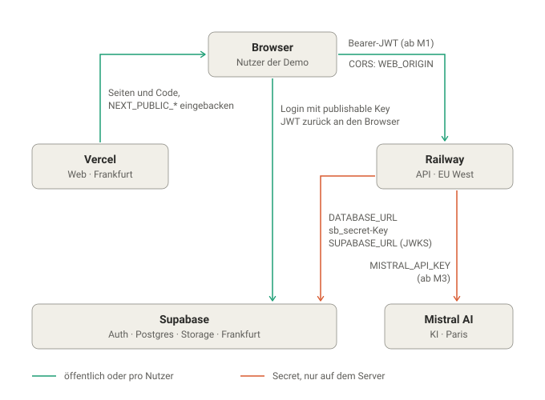
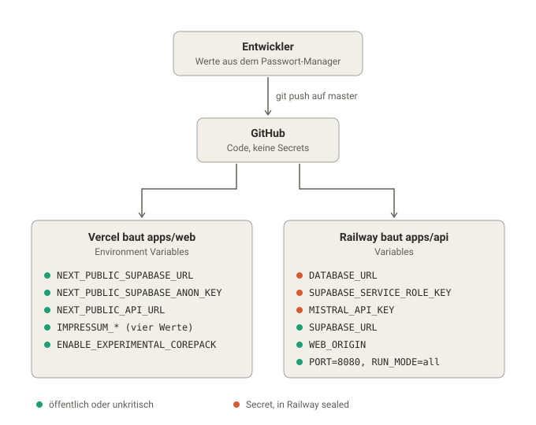

# Deployment

Dieses Dokument beschreibt Umgebungen, Einrichtung und Deployment des NotebookLM-Klons. Welcher Funktionsumfang nach jedem Meilenstein live sein muss, steht in der [`CLAUDE.md`](../CLAUDE.md), Abschnitt 10.

---

## Umgebungen

| Umgebung | Web | API | Supabase |
|---|---|---|---|
| Entwicklung | `localhost:3000` | `localhost:4000` | Cloud-Projekt `notebooklm-dev` |
| Produktion | Vercel | Railway (EU) | Cloud-Projekt `notebooklm-prod` (Frankfurt) |

- Für die Entwicklung gibt es ein **eigenes Supabase-Cloud-Projekt**. Es braucht kein Docker und verhält sich identisch zur Produktion.
- Die Projekte teilen nie Schlüssel oder Daten.
- **Bewusst ohne Staging-Umgebung** (ADR 4): Supabase Free erlaubt nur zwei aktive Projekte, ein drittes wäre kostenpflichtig. Eine Staging-API gegen `notebooklm-dev` scheidet aus, weil ihr Ingestion-Worker Jobs aus derselben pg-boss-Queue ziehen würde wie die lokale API. Stattdessen prüft der Integrationspunkt auf `dev` alle Pakete zusammen gegen die echte Datenbank, und nach jedem Deployment folgt ein Smoke-Test (Abschnitt „Ablauf pro Meilenstein“). Fehler fängt das Rollback ab. In einem Produktivbetrieb käme eine Staging-Umgebung mit eigener Datenbank hinzu.
- Lokal kann zusätzlich **Ollama** für Chat-Modelle genutzt werden. Embeddings laufen auch lokal über Mistral.

---

## Überblick: Dienste und Schlüssel

Zur Laufzeit: Wer spricht mit wem, und welcher Schlüssel liegt wo? Türkis sind öffentliche Werte oder das Login-Token eines Nutzers, orange sind Secrets, die den Server nie verlassen.

Beim Deployment: Der Code kommt über GitHub, die Variablen trägt der Entwickler von Hand in die Dashboards ein. GitHub kennt keine Secrets.

- Der `sb_publishable`-Key ist bewusst öffentlich. Er erlaubt nur den Login. Wegen RLS ohne Policies erreicht er keine Daten.
- Das JWT ist ein kurzlebiger Ausweis pro Nutzer. Die API prüft es mit den öffentlichen Schlüsseln des Supabase-Projekts (JWKS), ein Secret braucht sie dafür nicht.
- `NEXT_PUBLIC_*` wird beim Build eingebacken. Ändert sich die Railway-Domain, muss Vercel neu bauen.

---

## Kosten

Ziel ist der günstigste Betrieb, der für eine öffentliche Demo zuverlässig ist.

| Dienst | Plan | Kosten |
|---|---|---|
| Vercel | Hobby | kostenlos |
| Supabase | Free (zwei Projekte: dev und prod) | kostenlos |
| Railway | Hobby | geringe monatliche Grundgebühr mit enthaltenem Nutzungsguthaben |
| Mistral | Pay-as-you-go | nutzungsabhängig, durch monatliches Ausgabelimit gedeckelt |

Die aktuellen Preise und Limits werden vor der Einrichtung auf den Seiten der Anbieter geprüft.

---

## Einrichtung Supabase

Für **beide** Projekte:

1. Region **Frankfurt** (`eu-central-1`) wählen.
2. Extension `vector` aktivieren. Das übernimmt alternativ die erste SQL-Migration.
3. **Authentication:**
   - E-Mail/Passwort-Anmeldung aktiviert.
   - **Registrierung neuer Nutzer deaktiviert.** Accounts entstehen nur über `db:seed`.
   - Asymmetrische JWT-Signaturschlüssel aktiv. Bei neuen Projekten ist das Standard.
4. **Storage:** privaten Bucket `sources` anlegen, ohne Policies. Zugriff erfolgt nur über die API mit dem Service-Role-Key.
5. Verbindungsdaten für die API notieren: Projekt-URL, Service-Role-Key und Connection-String des **Session-Poolers**.

### Datenbankverbindung

Die API verbindet sich über den **Session-Pooler (Port 5432)**, nicht über den Transaction-Pooler (Port 6543). pg-boss und Drizzle sind auf eine dauerhafte Session angewiesen. Die API läuft auf Railway als langlebiger Prozess, das passt dazu.

---

## Lokale Entwicklung

1. `pnpm install`
2. `apps/api/.env.example` nach `apps/api/.env` kopieren und mit den Werten von `notebooklm-dev` füllen.
3. `apps/web/.env.example` nach `apps/web/.env.local` kopieren und füllen.
4. `pnpm --filter @notebooklm/api db:migrate`
5. `pnpm --filter @notebooklm/api db:seed`
6. `pnpm dev`

Optional für lokale Modelle: Ollama starten und `OLLAMA_BASE_URL` in `apps/api/.env` setzen. Damit Prompts mit mehreren Quellenabschnitten nicht abgeschnitten werden, wird die Kontextlänge von Ollama erhöht (`OLLAMA_CONTEXT_LENGTH`, z. B. 16384).

---

## API auf Railway

Die Einstellungen werden **im Dashboard** in den Settings des Service gesetzt. Diese Tabelle ist die verbindliche Referenz dafür. Weicht das Dashboard ab, gilt die Tabelle.

| Bereich | Einstellung | Wert |
|---|---|---|
| Source | Branch | `master` |
| Source | Root Directory | leer (Repository-Root) |
| Build | Custom Build Command | `pnpm install --frozen-lockfile && pnpm --filter @notebooklm/shared build && pnpm --filter @notebooklm/api build` |
| Build | Watch Paths | leer |
| Deploy | Region | EU West (Amsterdam) |
| Deploy | Custom Start Command | `pnpm --filter @notebooklm/api db:migrate && pnpm --filter @notebooklm/api start:prod` |
| Deploy | Healthcheck Path / Timeout | `/health` / `60` Sekunden |
| Deploy | Restart Policy | On Failure, höchstens 5 Versuche |
| Config-as-code | Railway Config File | leer |
| Networking | Public Domain | `quellenchat-api.up.railway.app`, Target Port `8080` |
| Variables | `PORT` | `8080` |
| Variables | `RUN_MODE` | `all` |
| Variables | `WEB_ORIGIN` | Produktionsdomain von Vercel |

- **Root Directory leer:** Der Build braucht `pnpm-lock.yaml` und `packages/shared` aus dem Repository-Root.
- **Watch Paths leer:** Sonst löst eine Änderung nur in `packages/shared` kein Deployment aus.
- **`PORT` ausdrücklich setzen:** Ohne die Variable übernahm Railway den Port 5432 aus der `DATABASE_URL`. Die App lauschte dann dort, während die öffentliche Domain keine Antwort bekam (`502 Application failed to respond`, Healthcheck trotzdem grün). `PORT` und der Target Port der Domain stehen deshalb fest auf `8080`.
- **Client-IP für das Rate-Limit:** `trust proxy` steht auf `1`. Live gemessen: Verschiedene Client-IPs bekommen getrennte Zähler, gefälschte `X-Forwarded-For`-Header ändern den Zähler nicht. Bekannte Einschränkung: Pro Client entstehen zwei Zähler, die abwechselnd hochzählen. Das Limit pro IP liegt damit effektiv bis zum Doppelten. Für den groben Flutschutz ist das unkritisch, die fachlichen Limits zählen pro Nutzer in der Datenbank.
- **Nur ein Service:** Railway erkennt den pnpm-Workspace und legt beim Verbinden für jede App einen Service an. Der Service für `@notebooklm/web` wird gelöscht, weil das Frontend auf Vercel läuft.

**Warum keine Konfigurationsdatei:** Ursprünglich lagen diese Werte versioniert in einer `railway.json`. Railway hat diese Config as Code abgekündigt. Neue Services können sie seit 2026-08-28 nicht mehr nutzen, bestehende Dateien werden nur bis 2026-12-01 gelesen. Der Nachfolger „Infrastructure as Code“ (`.railway/railway.ts`) bräuchte das npm-Paket `railway` und die Railway-CLI. Außerdem wird er nicht beim Deployment angewendet, sondern per `railway config apply`. Für einen einzigen Service steht das in keinem Verhältnis zum Nutzen. Die Werte stehen deshalb im Dashboard und sind hier dokumentiert.

Alle weiteren Variablen stehen in `apps/api/.env.example`.

Migrationen laufen vor jedem Start. Schlägt eine Migration fehl, startet die neue Version nicht und die alte bleibt aktiv.

---

## Web auf Vercel

| Einstellung | Wert |
|---|---|
| Root-Verzeichnis | `apps/web` |
| Framework | Next.js |
| Region der Funktionen | Frankfurt (`fra1`) |
| Build-Command | `pnpm --filter @notebooklm/shared build && pnpm --filter @notebooklm/web build` |

Im Dashboard gesetzt:

| Einstellung | Wert |
|---|---|
| Project Name | `quellenchat` (bestimmt die Domain `quellenchat.vercel.app`) |
| Production Branch | `master` |
| Node.js Version | `24.x` |
| Variable `ENABLE_EXPERIMENTAL_COREPACK` | `1`, damit Vercel die pnpm-Version aus `packageManager` nutzt (12.14.0) statt seiner eigenen |

Beim Import übernimmt Vercel den Repository-Namen als Projektnamen, und ist der Name schon vergeben, hängt es ein Zufallssuffix an. Den Namen deshalb vor dem ersten Deploy setzen. Die Domain lässt sich später unter `https://vercel.com/<team>/<projekt>/settings/domains` ändern, denn in der Seitenleiste der Settings fehlt dieser Punkt.

Framework, Region und Build-Command stehen versioniert in [`apps/web/vercel.json`](../apps/web/vercel.json). Das Paket `@notebooklm/shared` muss zuerst gebaut werden, weil es auf Vercel nicht vorab existiert. Damit Vercel auch Dateien außerhalb von `apps/web` bereitstellt, bleibt die Option „Include source files outside of the Root Directory“ aktiviert (Standard).

Variablen laut `apps/web/.env.example`, mit `NEXT_PUBLIC_API_URL` auf die Railway-Domain. Die vier `IMPRESSUM_*`-Variablen sind für die Produktion Pflicht. Fehlen sie, bricht der Build ab, damit die Seite nie ohne Impressum live geht. Sie werden nur in Vercel eingetragen, nie im Repository.

**Projektname und Domain:** Das Vercel-Projekt heißt `quellenchat`. Die Produktionsdomain `https://quellenchat.vercel.app` ist zugleich `WEB_ORIGIN` in Railway. Ist der Name vergeben, hängt Vercel ein Suffix an, dann wird `WEB_ORIGIN` angepasst. Die Domain enthält bewusst nicht die Marke „NotebookLM“ (`CLAUDE.md` §1).

CORS erlaubt nur die Produktionsdomain. Preview-Deployments von Vercel erreichen die API deshalb nicht. Das ist gewollt.

---

## Ablauf pro Meilenstein

Jeder Meilenstein endet mit einem Deployment:

1. Lokal: `pnpm lint`, `pnpm typecheck` und `pnpm test` grün.
2. Bei Schemaänderungen: Migration lokal gegen `notebooklm-dev` geprüft.
3. Der Entwickler mergt den Integrationsbranch `dev` nach `master` und pusht `master`. Railway und Vercel deployen automatisch, beide nur von `master`. Ein Push von `dev` löst kein Produktions-Deployment aus.
4. **Smoke-Test live:** den Live-Zustand des Meilensteins aus der `CLAUDE.md` (Abschnitt 10) von Hand durchspielen.
5. Ergebnis im `docs/devlog.md` festhalten.

**Rollback:** Vercel kann eine frühere Version sofort wieder aktivieren. Railway kann ein früheres Deployment erneut ausrollen. Migrationen werden deshalb nur additiv geschrieben (keine Spalten löschen, solange eine ältere Version sie noch braucht).

---

## Checkliste vor der Abgabe

- [ ] Monatliches Ausgabelimit in der Mistral-Konsole gesetzt.
- [ ] Registrierung in `notebooklm-prod` deaktiviert.
- [ ] `pnpm --filter @notebooklm/api db:seed:prod` ausgeführt, Demo-Login funktioniert. Das Skript liest `apps/api/.env.production`, die nur lokal liegt und durch `.gitignore` ausgeschlossen ist.
- [ ] Hauptfluss live durchgespielt: Login, Notebook, Upload, Verarbeitung, Frage, Zitat, Export.
- [ ] Keine Secrets im Repository (`.env`-Dateien ignoriert, Historie geprüft).
- [ ] Keine Demo-Zugangsdaten im Repository oder auf der Live-Seite.
- [ ] README-Links zu Live-Demo und Loom-Video gesetzt.
- [ ] Impressum zeigt die richtigen Anbieterangaben. Die Datenschutzerklärung stimmt mit der tatsächlichen Verarbeitung überein: Anbieter, Cookies, Speicherdauer. Beide Texte idealerweise von jemandem mit juristischem Hintergrund gegenlesen lassen.
- [ ] **Pausierung geprüft:** Supabase pausiert Free-Projekte nach längerer Inaktivität. Prüfen, ob das Polling von pg-boss das Projekt aktiv hält. Falls nicht, für die Bewerbungsphase einen Keep-alive einrichten.
